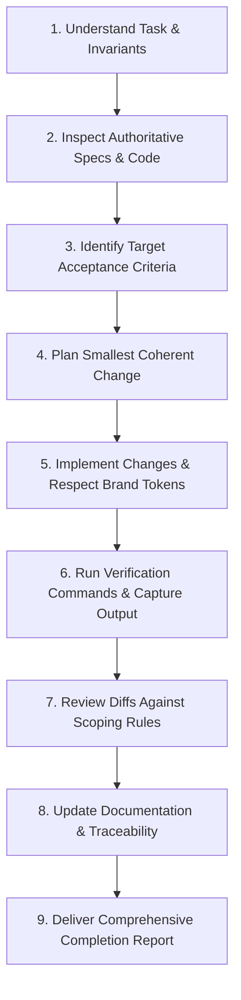

# AGENTS.md — Repository Operating Instructions for AI Agents
**Project:** 3A Technology Solutions Corporate Web Platform & 3A Techvolution Academy  
**Target Stack:** Next.js (App Router), TypeScript (Strict), Tailwind CSS  
**Operating Role:** AI Software Engineering Agent  

---

## 1. Project Context & Objectives

### 1.1 Project Overview
This repository contains the source code, design specifications, and technical documentation for the official web platform of **3A Technology Solutions** and its educational division, **3A TECHVOLUTION ACADEMY**.

The platform is a high-performance, accessible, and conversion-oriented corporate website designed to:
1. Establish market authority and commercial credibility for 3A Technology Solutions across Nigeria and international markets.
2. Generate qualified commercial client enquiries for web engineering, custom software, workflow automation, and artificial intelligence integration.
3. Demonstrate applied engineering capabilities through transparent, documented project case studies.
4. Provide a friction-free gateway for prospective students and professionals to discover courses offered by 3A Techvolution Academy.

### 1.2 Core Architectural Invariants (Non-Negotiable)
- **Phase 1 Release Scope:** A statically compiled, server-rendered corporate website.
- **No In-House LMS / User Accounts:** All student course registration is routed externally (e.g., approved WhatsApp enquiry or official enrollment form). Do not create student databases, login screens, or dashboard portals.
- **No Payment Gateways:** Direct payment processing (Paystack, Flutterwave, Stripe) is strictly out of scope. Invoicing is handled off-platform.
- **No Headless or Runtime CMS / Database:** Content for services, projects, and academy tracks is stored as statically typed TypeScript data files (`src/data/*.ts`). Do not spin up PostgreSQL, MySQL, MongoDB, Sanity, or Strapi.
- **No Floating Web Chatbots:** Autonomous conversational agents on the frontend are deferred to future phases.

### 1.3 Repository Authority Directory
- **Product Requirements & Acceptance Criteria:** [`PRD.md`](file:///c:/Users/DELL/Desktop/3A%20TECHNOLOGY/prd.md)
- **Visual Standards & Color Tokens:** [`3A_Technology_Solutions_Brand_Identity_Standards.pdf`](file:///c:/Users/DELL/Desktop/3A%20TECHNOLOGY/3A_Technology_Solutions_Brand_Identity_Standards.pdf)
- **Official Brand Mark Reference:** [`3a_technology_solutions_ending_slide.png`](file:///c:/Users/DELL/Desktop/3A%20TECHNOLOGY/3a_technology_solutions_ending_slide.png)
- **Agent Operating Rules:** This document ([`AGENTS.md`](file:///c:/Users/DELL/Desktop/3A%20TECHNOLOGY/AGENTS.md))

---

## 2. Document Authority & Governance Hierarchy

When requirements, visual guidelines, or technical approaches appear to conflict, agents must enforce the following strict precedence hierarchy:

```text
[Tier 1: Highest Authority] 
    3A_Technology_Solutions_Brand_Identity_Standards.pdf
    └── Governs brand colors, typography philosophy, logo integrity, imagery ethics, and communication tone.

[Tier 2: Product & Functional Authority] 
    PRD.md (v2.0+)
    └── Governs release boundaries, sitemap, functional requirements (FR-01 to FR-11), acceptance criteria, and technical stack.

[Tier 3: Engineering & Agent Workflow Authority] 
    AGENTS.md
    └── Governs agent behavior, code quality, verification protocols, security, and change control.

[Tier 4: Implementation Layer] 
    Codebase, Configuration Files & Tests
    └── Must conform to Tiers 1–3. Existing code must never silently override documented specifications.
```

### Escalation Protocol for Conflicts
- **Strict Rule:** Agents must **NEVER** silently adopt the easiest, most convenient, or lowest-effort interpretation when faced with ambiguous or conflicting requirements.
- **Action Required:** Stop, cite the conflicting sections/documents explicitly, present viable architectural options with tradeoffs, and await human direction.

---

## 3. Development Rules & Engineering Standards

### 3.1 Inspect Before Modifying
- Always read existing file implementations, type definitions, and tests before drafting changes.
- Verify existing dependencies in `package.json` before proposing or importing new packages.

### 3.2 Small, Coherent Changes
- Decompose complex features into isolated, testable modifications.
- Do not refactor unrelated files or modify global configurations while working on a localized task.

### 3.3 Strict TypeScript & Component Rules
- TypeScript `strict` mode must remain enabled with zero `any` usage.
- Prefer React Server Components (RSC) by default. Use `'use client'` strictly when client-side interactivity, state hooks, or browser event listeners are required.
- Place reusable UI components under `src/components/ui/` and route-specific layouts/views under `src/app/`.

### 3.4 Brand Design System Adherence
The visual styling is governed by the official 3A Brand Standards. All styles must use these locked tokens:
- **Primary Navy:** `#0B2B6B` (Major surfaces, headings, primary buttons)
- **Accent Yellow:** `#F7C800` (Key CTAs, highlights, focal accents, badges)
- **Dark Charcoal:** `#1F2937` (High-contrast text, dark cards, footer)
- **Light Gray:** `#F4F6F8` (Subtle backgrounds, card fills, input borders)
- **Pure White:** `#FFFFFF` (Canvas breathing room)
- **Aesthetic:** "Premium Minimalism"—clean grids, generous whitespace, thin lines, subtle borders (`1px solid #E5E7EB`).
- **Prohibitions:** Never apply neon cyberpunk aesthetics, random gradients, decorative 3D models, or unpurposeful stock photography.

### 3.5 Centralized Site Configuration
- Contact numbers, WhatsApp links, official email addresses, social URLs, and brand constants must reside in a single configuration file (e.g., `src/config/site.ts`).
- Never hardcode telephone numbers, emails, or external URLs across individual page components.

---

## 4. Traceability & Requirements Mapping

Every implementation task must map back to the requirements outlined in [`PRD.md`](file:///c:/Users/DELL/Desktop/3A%20TECHNOLOGY/prd.md):

| Requirement ID | Domain / Scope | Primary Acceptance Criteria Focus |
| :--- | :--- | :--- |
| **FR-01** | Global Navigation & Drawer | `AC-01.1` to `AC-01.4` (Desktop links, responsive mobile drawer, keyboard accessibility) |
| **FR-02** | Services Directory & Slugs | `AC-02.1` to `AC-02.3` (5 category pages, dynamic slug validation, pre-selected quote CTA) |
| **FR-03** | Portfolio & Case Studies | `AC-03.1` to `AC-03.4` (Filterable directory, development status badges, case study details) |
| **FR-04** | Academy Gateway | `AC-04.1` to `AC-04.4` (Mission overview, curriculum tracks, external registration links) |
| **FR-05** | General Contact Form | `AC-05.1` to `AC-05.4` (Zod schema, honeypot anti-spam, server action, feedback toasts) |
| **FR-06** | Commercial Quote Form | `AC-06.1` to `AC-06.4` (Scope intake, budget/timeline selection, service query param prefill) |
| **FR-07** | WhatsApp & Direct Links | `AC-07.1` to `AC-07.3` (Centralized config, pre-filled URL encoding, security rel tags) |
| **FR-08** | Typed Content Layer | `AC-08.1` to `AC-08.3` (Static TypeScript data files, strict type contracts) |
| **FR-09** | SEO & Structured Data | `AC-09.1` to `AC-09.4` (Metadata API, Open Graph, dynamic sitemap.xml, JSON-LD Schema) |
| **FR-10** | Error Handling & Recovery | `AC-10.1` to `AC-10.3` (Branded 404 `not-found.tsx`, error boundary `error.tsx`, empty states) |
| **FR-11** | Privacy & Analytics Readiness | `AC-11.1` to `AC-11.2` (Declarative data-analytics tags, NDPR compliance, no rogue cookies) |

- **Commit & Documentation Rule:** Cite the governing requirement ID (e.g., `[FR-05]`, `[AC-01.2]`) in code comments for non-trivial logic, commit messages, and completion reports.

---

## 5. Testing & Verification Protocol

### 5.1 Evidence-Based Verification Standard
- **Golden Rule:** Never declare a feature "complete," "working," or "verified" without executing concrete verification commands and inspecting the output.
- Hypotheses, assumptions, or silent omissions are unacceptable.
- Always distinguish:
  1. Checks executed with passing logs.
  2. Checks executed with failing logs.
  3. Checks not executed (with clear technical rationale).

### 5.2 Mandatory Verification Suite
Prior to concluding any coding task, execute relevant commands within the environment:

```powershell
# 1. Static Typecheck (Must complete with 0 errors)
npm run typecheck # or: npx tsc --noEmit

# 2. Code Linting & Formatting Check
npm run lint

# 3. Production Compilation & Bundle Validation
npm run build

# 4. Automated Unit & Integration Tests (when test suites exist)
npm test
```

---

## 6. Security, Privacy & Compliance Safeguards

1. **Zero Secret Leakage:**
   - Never commit `.env`, `.env.local`, API tokens, or SMTP credentials to Git.
   - Secrets must remain exclusively server-side. Never expose private credentials via `NEXT_PUBLIC_` environment variables.
2. **Input Sanitization & Injection Defense:**
   - Sanitize all text input from contact/quote forms to prevent Cross-Site Scripting (XSS).
   - Enforce header validation on email sending routines to prevent mail relay injection.
3. **Anti-Spam & Abuse Throttling:**
   - Include a hidden honeypot input field (`hp_field`) on all public forms; silently drop submissions if populated.
   - Enforce rate-limiting on Server Actions or API routes.
4. **No Security Relaxations to Pass Tests:**
   - Do not disable SSL verification, weaken CORS policies, or disable validation schemas simply to make automated tests pass.
5. **Data Protection (NDPR Compliance):**
   - Collect only data strictly necessary for project quotes or general contact.
   - Do not deploy third-party advertising tracking pixels (Meta Pixel, Google Ads tags) without explicit consent configurations.

---

## 7. Change Management & Governance Gates

The following modifications represent **Architectural Boundary Events** and require explicit human stakeholder approval before implementation:

1. **Scope Expansion:**
   - Adding student accounts, authentication, course video hosting, or internal LMS functions.
   - Introducing payment processing or online checkouts.
   - Adding CMS software (Sanity, Strapi, Contentful) or database servers.
2. **Visual & Brand Alterations:**
   - Modifying the hex values of the 5 approved brand colors.
   - Modifying, redrawing, recoloring, or altering the proportions of the official 3A logo.
3. **External Dependencies:**
   - Adding heavy third-party UI component libraries or animation engines that negatively impact bundle size (>50kB gzip).
4. **Data Privacy Changes:**
   - Altering form collection fields to request sensitive personal data.

---

## 8. Systematic Implementation Workflow

All agents must follow this sequential 9-step engineering lifecycle:



1. **Understand Task:** Confirm the user prompt's scope and verify it does not violate release boundaries.
2. **Inspect Specs & Code:** Read relevant sections of [`PRD.md`](file:///c:/Users/DELL/Desktop/3A%20TECHNOLOGY/prd.md) and existing code.
3. **Identify Acceptance Criteria:** Isolate the exact `AC-xx.x` criteria the change will satisfy.
4. **Plan Change:** Draft minimal diffs, avoiding wide refactors.
5. **Implement:** Write clean, type-safe code using approved design tokens and semantic HTML.
6. **Verify:** Run typecheck, linting, and build commands. Capture terminal outputs.
7. **Review Diffs:** Ensure no unintended changes or out-of-scope features were introduced.
8. **Update Documentation:** Keep `PRD.md` or component documentation synchronized.
9. **Deliver Report:** Submit an evidence-based completion report.

---

## 9. Standard Completion Report Structure

Upon completing any agent task, provide a structured report following this exact format:

1. **Executive Summary:** Concise summary of what was accomplished and architectural decisions made.
2. **Requirements & Acceptance Criteria Addressed:** Specific IDs (`FR-xx`, `AC-xx.x`) fulfilled.
3. **Files Created or Modified:** Clickable markdown file links with brief descriptions of changes.
4. **Verification Commands & Concrete Evidence:** Exact command lines executed, exit codes, and relevant terminal output snippets.
5. **Residual Limitations or Deferred Items:** Explicit statement of what was not done or any technical caveats.
6. **Unresolved Decisions Requiring Human Input:** Any business or credential dependencies identified.
7. **Confirmation of Project Scope Status:** Affirmation that out-of-scope boundaries remain respected.

---

## 10. Tool Compatibility & Environment Portability

- **Cross-Platform Instructions:** Instructions must remain functional across operating environments (Windows PowerShell and POSIX shells).
- **Paths:** Always use forward slashes (`/`) or proper quoting for paths in code, imports, and tool arguments to maintain cross-platform compatibility.
- **Operating Environment:** When running commands on Windows, account for PowerShell syntax differences (e.g., using `Remove-Item` instead of `rm`, avoiding unquoted `&&` chains where unsupported).
