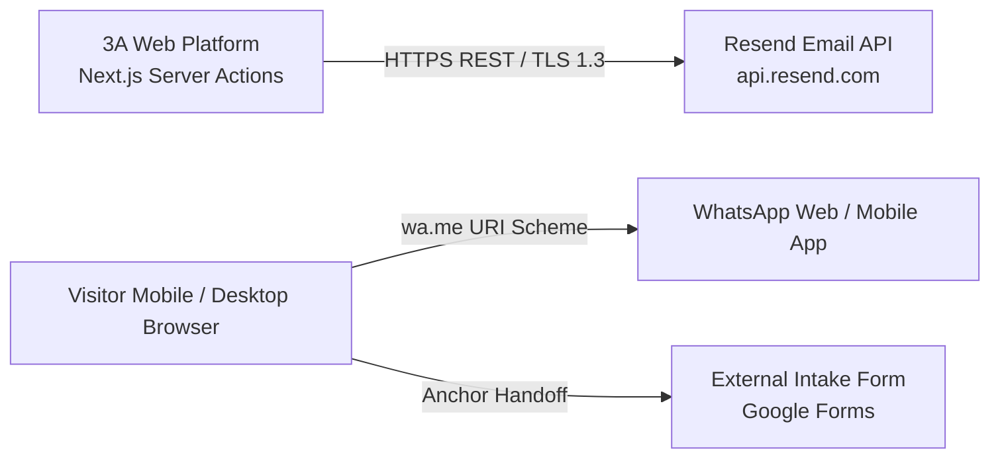

# API and Integration Specification
**Project:** 3A Technology Solutions Corporate Web Platform & 3A Techvolution Academy  
**Role:** API Architect and Integration Engineer  
**Status:** Authoritative Interface Specification  
**Version:** 1.0  
**Date:** October 2026  
**Governing Documents:** [`PRD.md`](file:///c:/Users/DELL/Desktop/3A%20TECHNOLOGY/prd.md) (v2.0), [`AGENTS.md`](file:///c:/Users/DELL/Desktop/3A%20TECHNOLOGY/AGENTS.md), [`docs/architecture.md`](file:///c:/Users/DELL/Desktop/3A%20TECHNOLOGY/docs/architecture.md), [`docs/data-architecture.md`](file:///c:/Users/DELL/Desktop/3A%20TECHNOLOGY/docs/data-architecture.md), [`docs/database-schema.md`](file:///c:/Users/DELL/Desktop/3A%20TECHNOLOGY/docs/database-schema.md), [`docs/decisions/`](file:///c:/Users/DELL/Desktop/3A%20TECHNOLOGY/docs/decisions)  

---

## 1. Architectural Strategy & Interface Paradigms

The 3A Technology Solutions platform utilizes a justified, multi-tiered interface strategy designed for performance, strict type safety, zero client bundle bloat, and defensive input validation:

1. **Next.js Server Actions (RPC Paradigm - Primary Inbound Mutations):**
   - *Applied to:* Inbound commercial quote requests and contact form submissions.
   - *Justification:* Native to Next.js 14+ App Router. Directly callable by Client Component forms (`QuoteForm.tsx`, `ContactForm.tsx`) with end-to-end TypeScript inference. Eliminates the need to maintain public REST route endpoints with CORS configurations, reduces client JavaScript bundle sizes, and prevents Cross-Site Request Forgery (CSRF) vulnerabilities by leveraging Next.js internal action tokens.
2. **RESTful HTTP Endpoints (Programmatic Integration & Health Checking):**
   - *Applied to:* `POST /api/contact`, `POST /api/quote`, and `GET /api/health`.
   - *Justification:* Provides standardized HTTP JSON endpoints for headless consumers, smoke tests, and synthetic monitoring probes.
3. **Internal Function Contracts (In-Process Data Access):**
   - *Applied to:* Content queries (`src/lib/content.ts`).
   - *Justification:* In-memory functional query layer for static data (`src/data/*.ts`), completely shielding UI presentation components from raw file structures.
4. **Dynamic Feed Endpoints:**
   - *Applied to:* `GET /sitemap.xml` and `GET /robots.txt` generated via Next.js metadata route handlers.

---

## 2. Standardized Error Handling & Response Envelope

All API endpoints and Server Actions conform to a uniform response envelope.

### 2.1 Standard Success Envelope
```json
{
  "success": true,
  "data": { ... },
  "message": "Operation completed successfully."
}
```

### 2.2 Standard Error Envelope (RFC 7807 Aligned)
```json
{
  "success": false,
  "error": {
    "code": "VALIDATION_ERROR",
    "message": "One or more submission fields failed validation.",
    "fields": {
      "email": ["Please provide a valid business email address."],
      "service": ["Selected service must be an approved category."]
    },
    "timestamp": "2026-10-27T08:15:30.123Z"
  }
}
```

### 2.3 Error Code Dictionary
| Error Code | HTTP Status | Description & Trigger Condition |
| :--- | :--- | :--- |
| `VALIDATION_ERROR` | `400 Bad Request` | Payload failed Zod schema parsing; field-specific validation messages returned. |
| `SPAM_DETECTED` | `200 OK (Masked)` | Bot trap triggered: honeypot `hp_field` was populated. Silently dropped with simulated success. |
| `RATE_LIMIT_EXCEEDED` | `429 Too Many Requests` | IP address exceeded the rolling limit of 5 submissions per 60 minutes. |
| `METHOD_NOT_ALLOWED` | `405 Method Not Allowed` | Non-POST request sent to mutation endpoints. |
| `SERVICE_UNAVAILABLE` | `503 Service Unavailable` | Downstream transactional email dispatch timed out or failed permanently. |
| `INTERNAL_ERROR` | `500 Internal Server Error` | Unexpected runtime exception caught by top-level error boundary. |

---

## 3. Operations Specification

### OP-001: Submit General Contact Enquiry
- **Stable Operation ID:** `submitContactEnquiry`
- **Interface Modes:**
  1. *Server Action:* `src/actions/enquiry.ts` $\rightarrow$ `submitGeneralEnquiry(prevState, formData)`
  2. *REST Endpoint:* `POST /api/contact`
- **Purpose:** Receives general inbound commercial inquiries, validates fields, screens for spam bots, and dispatches an email notification to 3A administration.
- **Related Requirement:** `FR-05` (`AC-05.1` to `AC-05.4`).
- **Authentication & Authorization:** Publicly accessible (Zero auth required).
- **Rate Limit & Throttling:** Maximum 5 submissions per IP address per rolling hour.
- **Request Headers:**
  - `Content-Type: application/json` (REST) or `multipart/form-data` (Server Action)
- **Request Schema (Zod Validation):**
  ```typescript
  export const ContactEnquiryRequestSchema = z.object({
    fullName: z.string().trim().min(2, "Name must be at least 2 characters").max(100),
    email: z.string().trim().email("Please provide a valid email address").max(100),
    phone: z.string().trim().max(20).optional(),
    subject: z.string().trim().max(100).optional(),
    message: z.string().trim().min(15, "Message must be at least 15 characters").max(2000),
    hp_field: z.string().max(0, "Spam detected"), // Honeypot trap must be empty
  });
  ```
- **Responses:**
  - `200 OK`:
    ```json
    {
      "success": true,
      "message": "Thank you for contacting 3A Technology Solutions. We will follow up within 24 business hours."
    }
    ```
  - `400 Bad Request`: Field validation error (missing name, malformed email, message too short).
  - `429 Too Many Requests`: Rate limit exceeded.
  - `503 Service Unavailable`: Downstream email gateway failure.
- **Sensitive Data & Logging Restrictions:**
  - `fullName`, `email`, `phone`, and `message` must **never** be logged to application console streams.
  - Only anonymous audit metadata (execution latency, status code, IP hash) is recorded.

---

### OP-002: Submit Commercial Project Quote Request
- **Stable Operation ID:** `submitQuoteRequest`
- **Interface Modes:**
  1. *Server Action:* `src/actions/enquiry.ts` $\rightarrow$ `submitQuoteRequest(prevState, formData)`
  2. *REST Endpoint:* `POST /api/quote`
- **Purpose:** Captures structured project scoping briefs, budget tiers, and timelines from prospective corporate clients.
- **Related Requirement:** `FR-06` (`AC-06.1` to `AC-06.4`).
- **Authentication & Authorization:** Publicly accessible (Zero auth required).
- **Rate Limit & Throttling:** Maximum 5 submissions per IP address per rolling hour.
- **Request Schema (Zod Validation):**
  ```typescript
  export const QuoteRequestSchema = z.object({
    fullName: z.string().trim().min(2, "Name must be at least 2 characters").max(100),
    company: z.string().trim().max(100).optional(),
    email: z.string().trim().email("Please provide a valid business email").max(100),
    phone: z.string().trim().min(7, "Please provide a valid phone/WhatsApp number").max(25),
    service: z.enum([
      'web-development',
      'custom-software',
      'ai-automation',
      'data-science-analytics',
      'brand-digital-media',
    ]),
    budgetRange: z.enum([
      'under-1m',      // Under ₦1,000,000
      '1m-3m',         // ₦1,000,000 – ₦3,000,000
      '3m-7.5m',       // ₦3,000,000 – ₦7,500,000
      '7.5m-plus',     // ₦7,500,000+
      'advisory',      // Undetermined / Advisory Required
    ]),
    timeline: z.enum([
      'urgent',        // Urgent (< 1 Month)
      '1-3-months',    // 1 – 3 Months
      '3-plus-months', // 3+ Months
      'flexible',      // Flexible / Exploratory
    ]),
    projectDescription: z.string().trim().min(20, "Project description must be at least 20 characters").max(3000),
    hp_field: z.string().max(0, "Spam detected"), // Honeypot trap must be empty
  });
  ```
- **Query Parameter Pre-Selection Behavior:**
  - Accessing `/request-quote?service=ai-automation` initializes the form with `service: "ai-automation"`.
- **Responses:**
  - `200 OK`:
    ```json
    {
      "success": true,
      "message": "Quote request received successfully. Our engineering team will review your scope and provide a formal proposal within 24–48 business hours."
    }
    ```
  - `400 Bad Request`: Field validation failure.
  - `429 Too Many Requests`: Rate limit exceeded.
- **Sensitive Data & Logging Restrictions:** Strictly prohibited from logging `projectDescription`, `phone`, or `email`.

---

### OP-003: Liveness & Health Check
- **Stable Operation ID:** `getSystemHealth`
- **Method & Route:** `GET /api/health`
- **Purpose:** Edge probe endpoint verifying application uptime, runtime environment, and build timestamp.
- **Authentication:** Publicly accessible.
- **Rate Limit:** 60 requests per minute per IP.
- **Response (`200 OK`):**
  ```json
  {
    "status": "UP",
    "timestamp": "2026-10-27T08:15:30.123Z",
    "runtime": "Node.js v20.x (Vercel Edge)",
    "version": "1.0.0"
  }
  ```

---

### OP-004: Dynamic XML Sitemap Feed
- **Stable Operation ID:** `getSitemapXml`
- **Method & Route:** `GET /sitemap.xml`
- **Purpose:** Dynamically generates search engine XML sitemap containing all static routes and published service/case-study slugs.
- **Related Requirement:** `FR-09` (`AC-09.2`).
- **Response Headers:** `Content-Type: application/xml; charset=utf-8`
- **Caching:** `Cache-Control: public, max-age=86400, s-maxage=86400, stale-while-revalidate`

---

### OP-005: Search Engine Crawler Directives
- **Stable Operation ID:** `getRobotsTxt`
- **Method & Route:** `GET /robots.txt`
- **Purpose:** Directs automated crawlers, permits indexing of all marketing routes, and advertises the canonical sitemap URL.
- **Related Requirement:** `FR-09` (`AC-09.3`).
- **Response Headers:** `Content-Type: text/plain; charset=utf-8`
- **Content Output:**
  ```text
  User-agent: *
  Allow: /
  Disallow: /api/

  Sitemap: https://3atechnology.com.ng/sitemap.xml
  ```

---

### OP-006: Internal Static Content Query Contract (`src/lib/content.ts`)
- **Stable Operation ID:** `queryContentInternal`
- **Interface Mode:** In-process TypeScript typed functions.
- **Purpose:** Authoritative query layer providing structured access to `services.ts`, `projects.ts`, and `programmes.ts`.
- **Related Requirement:** `FR-02`, `FR-03`, `FR-04`, `FR-08`, Rule `ARCH-07`.
- **Function Signatures:**
  ```typescript
  export function getAllServices(): Service[];
  export function getServiceBySlug(slug: ServiceCategory): Service | null;
  export function getAllProjects(): Project[];
  export function getProjectsByCategory(category: ServiceCategory): Project[];
  export function getProjectBySlug(slug: string): Project | null;
  export function getAllProgrammes(): AcademyProgramme[];
  export function getProgrammeBySlug(slug: string): AcademyProgramme | null;
  ```
- **Error Behavior:** Querying a non-existent slug returns `null`, enabling Next.js route handlers to immediately invoke `notFound()`.

---

## 4. External Integrations Specification

The platform connects to three external cloud communication services:



### 4.1 Integration: Resend Transactional Email API
- **Purpose:** Primary pipeline for delivering formatted lead notification emails to 3A leadership.
- **Host Endpoint:** `https://api.resend.com/emails`
- **HTTP Method:** `POST`
- **Authentication:** HTTP Bearer token authorization: `Authorization: Bearer ${process.env.RESEND_API_KEY}`.
- **Request Payload Structure:**
  ```json
  {
    "from": "3A Web Inquiries <notifications@3atechnology.com.ng>",
    "to": ["contact@3atechnology.com.ng"],
    "reply_to": "prospect@company.com",
    "subject": "New Commercial Quote Request: Acme Corp (AI Automation)",
    "html": "<div>...Formatted Responsive HTML Template...</div>"
  }
  ```
- **Timeouts & Retries:**
  - Request Timeout: **5,000 milliseconds**.
  - Retry Strategy: Maximum 1 immediate retry upon HTTP 500/502/503 response.
- **Rate Limits (Resend Free/Pro Tier):** Maximum 10 requests per second. (Peak 3A form submission volume is well below 1 request per minute).
- **Failure Behavior:**
  - If Resend returns an error or times out, the Server Action catches the exception, logs an operational error code without prospect PII, and returns `{ success: false, error: "Our automated dispatch service experienced a temporary delay. Please message our technical lead directly on WhatsApp." }`.
  - Client-side form state is **preserved** (`ARCH-10`).
- **Fallback Driver:** If `SMTP_HOST` is configured in environment variables, the system automatically redirects dispatch to standard Nodemailer SMTP (`ADR-005`).

---

### 4.2 Integration: WhatsApp Deep Link Gateway (Click-to-Chat)
- **Purpose:** Real-time conversational gateway for immediate business or academy inquiries.
- **URI Specification:** `https://wa.me/${siteConfig.contact.whatsapp}?text=${encodedMessage}`
- **Authentication:** None (client-side browser protocol handoff).
- **Encoding Requirements:**
  - Must use JavaScript `encodeURIComponent()` to escape spaces (`%20`), line breaks (`%0A`), and punctuation.
- **Contextual Message Templates:**
  1. *General / Header CTA:*
     `Hello%203A%20Technology%2C%20I%20would%20like%20to%20discuss%20a%20technology%20solution%20for%20my%20business.`
  2. *Service Page CTA (`/services/[slug]`):*
     `Hello%203A%20Technology%2C%20I%20am%20interested%20in%20your%20services%20for%20${service.title}.`
  3. *Academy Page CTA (`/academy`):*
     `Hello%203A%20Techvolution%20Academy%2C%20I%20would%20like%20to%20inquire%20about%20upcoming%20training%20cohorts.`
- **Failure Behavior:** If WhatsApp desktop/mobile app is not installed, standard browser redirection presents the official WhatsApp Web or download page.

---

### 4.3 Integration: External Academy Enrollment Gateway
- **Purpose:** Collects formal student course registrations without maintaining an in-house LMS database (`ARCH-02`).
- **Endpoint:** Approved external form URL (e.g., Google Forms / Microsoft Forms) stored in `siteConfig.academy.enrollmentFormUrl`.
- **Handoff Mechanism:** Standard HTML anchor link opening in a new tab:
  ```tsx
  <a 
    href={siteConfig.academy.enrollmentFormUrl} 
    target="_blank" 
    rel="noopener noreferrer"
  >
    Enroll in Cohort
  </a>
  ```
- **Security Attribute Rule:** Must strictly enforce `rel="noopener noreferrer"` to prevent window opener tab-nabbing vulnerabilities.

---

## 5. Machine-Readable OpenAPI 3.1 Companion Recommendation

To facilitate automated contract testing, postman collection generation, and automated documentation, the RESTful surface of the application is specified in an OpenAPI 3.1 companion file located at `docs/openapi.yaml`.

### OpenAPI Structure Overview (`docs/openapi.yaml`):
```yaml
openapi: 3.1.0
info:
  title: 3A Technology Solutions Platform API
  version: 1.0.0
  description: Public intake endpoints and health probes for 3A Technology Solutions corporate platform.
servers:
  - url: https://3atechnology.com.ng
    description: Production Edge Server
  - url: http://localhost:3000
    description: Local Development Environment
paths:
  /api/health:
    get:
      operationId: getSystemHealth
      summary: Liveness and edge health check
      responses:
        '200':
          description: System operational
  /api/contact:
    post:
      operationId: submitContactEnquiry
      summary: Submit general contact inquiry
      requestBody:
        required: true
        content:
          application/json:
            schema:
              $ref: '#/components/schemas/ContactEnquiryRequest'
      responses:
        '200':
          description: Inquiry received
        '400':
          description: Validation error
        '429':
          description: Rate limit exceeded
  /api/quote:
    post:
      operationId: submitQuoteRequest
      summary: Submit commercial project quote request
      requestBody:
        required: true
        content:
          application/json:
            schema:
              $ref: '#/components/schemas/QuoteRequest'
      responses:
        '200':
          description: Quote brief received
        '400':
          description: Validation error
        '429':
          description: Rate limit exceeded
```

---

## 6. Requirements Traceability Matrix

| Requirement ID | API Operation / Integration | Implementing Module | Verification Method |
| :--- | :--- | :--- | :--- |
| **FR-01** | Header/Footer Navigation links | `Header.tsx`, `MobileDrawer.tsx` | Playwright accessibility & link test. |
| **FR-02** | `queryContentInternal` (Services) | `src/lib/content.ts` | Vitest unit test for all 5 service slugs. |
| **FR-03** | `queryContentInternal` (Projects) | `src/lib/content.ts` | Vitest unit test for category filtering. |
| **FR-04** | External Academy Enrollment Link | `siteConfig.academy.enrollmentFormUrl` | Link validation test verifying `rel="noopener noreferrer"`. |
| **FR-05** | `submitContactEnquiry` | `src/actions/enquiry.ts`, `ContactForm.tsx` | Vitest schema check; Playwright submit smoke test. |
| **FR-06** | `submitQuoteRequest` | `src/actions/enquiry.ts`, `QuoteForm.tsx` | Vitest validation test for budget/timeline enums. |
| **FR-07** | WhatsApp Click-to-Chat Gateway | `src/lib/whatsapp.ts`, `siteConfig` | Unit test verifying correct URL encoding. |
| **FR-08** | Statically Typed Content Contract | `src/types/content.ts` | `npx tsc --noEmit` build verification. |
| **FR-09** | `getSitemapXml`, `getRobotsTxt` | `src/app/sitemap.ts`, `robots.ts` | HTTP GET test verifying XML/text content types. |
| **FR-10** | Error Envelope & Recovery | `src/app/not-found.tsx`, `error.tsx` | Playwright 404/500 recovery rendering test. |
| **FR-11** | Zero Tracking Pixels | Entire API & Layout layer | Network trace verifying zero outbound ad requests. |
