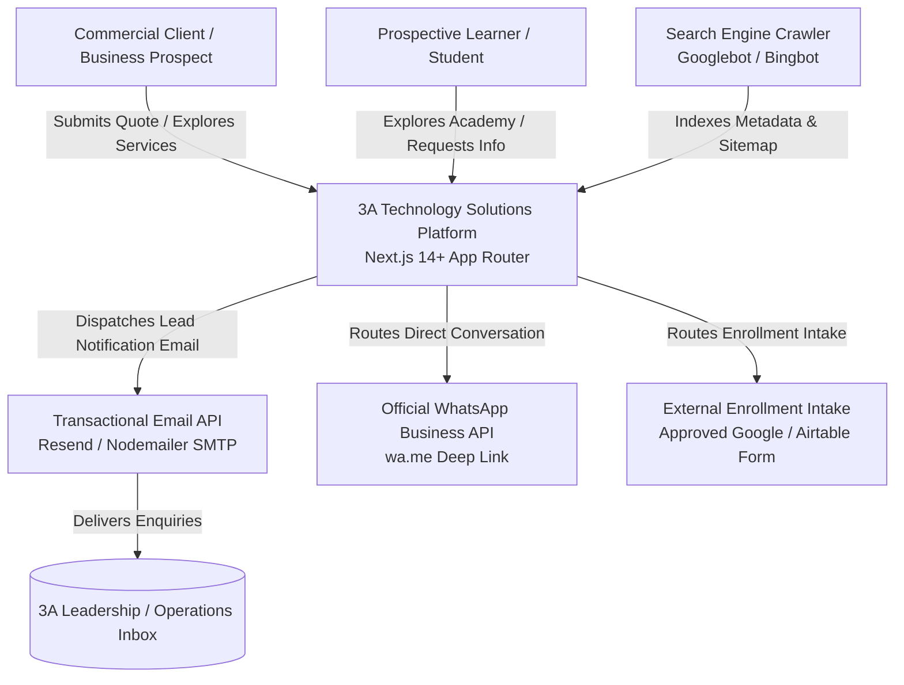
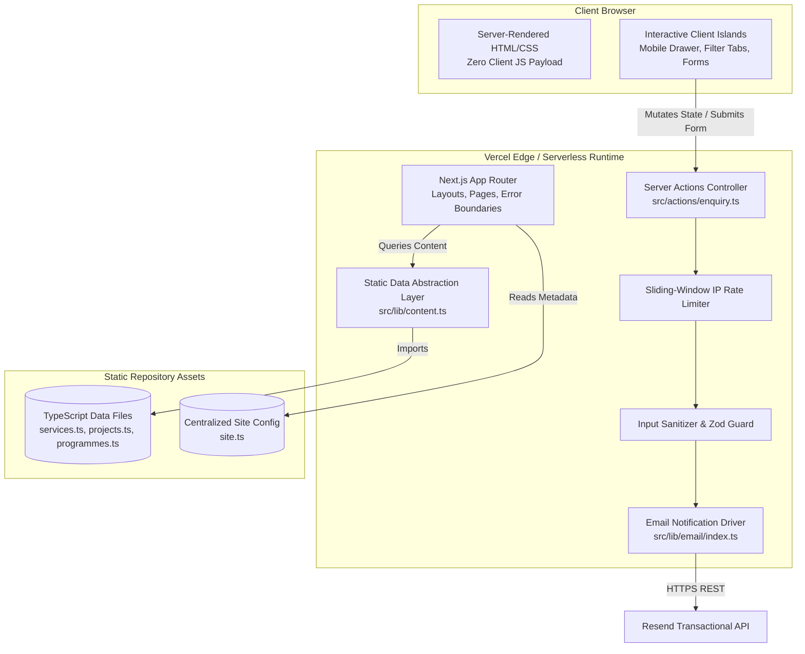
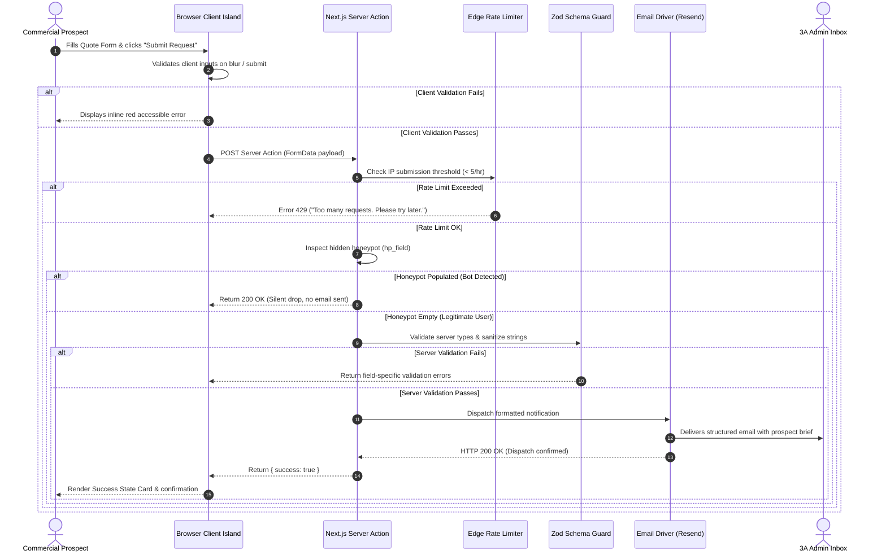

# System Architecture Document
**Project:** 3A Technology Solutions Corporate Web Platform & 3A Techvolution Academy  
**Status:** Authoritative Architectural Baseline (Draft for Stakeholder Sign-Off)  
**Version:** 1.0  
**Role:** Principal Software Architect  
**Date:** October 2026  
**Governing Documents:** [`PRD.md`](file:///c:/Users/DELL/Desktop/3A%20TECHNOLOGY/prd.md) (v2.0), [`AGENTS.md`](file:///c:/Users/DELL/Desktop/3A%20TECHNOLOGY/AGENTS.md), [`docs/specification-audit.md`](file:///c:/Users/DELL/Desktop/3A%20TECHNOLOGY/docs/specification-audit.md), [`docs/research-and-decisions.md`](file:///c:/Users/DELL/Desktop/3A%20TECHNOLOGY/docs/research-and-decisions.md), [`docs/decisions/`](file:///c:/Users/DELL/Desktop/3A%20TECHNOLOGY/docs/decisions)  

---

## 1. System Overview, Purpose & Boundaries

### 1.1 Purpose & Commercial Mission
The **3A Technology Solutions Web Platform** is an enterprise-grade digital flagship engineered to:
1. Establish commercial authority and market credibility for 3A Technology Solutions across Nigerian, pan-African, and international markets.
2. Capture and qualify commercial client enquiries for custom software engineering, website development, workflow automation, and practical AI integrations.
3. Demonstrate verified technical competencies through documented, transparent project case studies.
4. Provide a dedicated, friction-free gateway for prospective students to discover courses offered by **3A TECHVOLUTION ACADEMY**.

### 1.2 Non-Negotiable System Boundaries (Phase 1 Release Scope)
In accordance with `PRD.md` Section 4.2 and `AGENTS.md` Section 1.2, the platform enforces strict structural invariants:
- **No Runtime Database:** No PostgreSQL, MySQL, MongoDB, or Redis databases are required for baseline runtime. All content is stored in statically typed TypeScript data files (`src/data/*.ts`).
- **No In-House LMS or Student Accounts:** All student course registration is routed externally to an official enrollment intake (e.g., Google Form) or dedicated WhatsApp advisory chat. No user authentication tables, student profiles, or course video delivery mechanisms exist.
- **No Payment Gateways:** Direct online checkout processing (Paystack, Flutterwave, Stripe) is strictly out of scope. Commercial client billing is handled via standard enterprise invoicing off-platform.
- **No Conversational Chatbots:** No floating LLM chatbots or autonomous web agents are embedded on the frontend. Direct client communication is routed via verified WhatsApp links and structured enquiry forms.

### 1.3 System Actors
- **Commercial Client:** Decision-maker (SME founder, corporate executive, school administrator) seeking software or AI solutions; navigates services and submits project quotes.
- **Prospective Student / Learner:** Individual seeking practical technology skills; explores academy tracks and submits enrollment enquiries via external channels.
- **General Visitor:** Explores company background, technical case studies, and corporate policies.
- **3A Administrative Team:** Receives structured lead notifications via transactional email and responds to incoming enquiries.
- **Search Engine Crawler:** Automated user agents (Googlebot, Bingbot) indexing semantic HTML, dynamic sitemaps, and JSON-LD schema.

---

## 2. Architectural Drivers & Quality Attributes

| Quality Attribute | Architectural Driver | Engineering Strategy |
| :--- | :--- | :--- |
| **Performance** | Sub-second mobile page loads across standard 3G/4G connections in Nigeria. | React Server Components (RSC) by default; zero client JavaScript for static content pages; Next.js automatic image optimization to WebP/AVIF; Core Web Vitals target: LCP < 2.2s, CLS < 0.05. |
| **Reliability & Availability** | Zero downtime during traffic spikes; immune to database server outages. | Serverless edge deployment on Vercel with global CDN caching; zero stateful runtime database dependencies. |
| **Security & Privacy** | Protection against spam floods, cross-site scripting (XSS), and email injection; full NDPR compliance. | Defense-in-depth: client and server Zod schema validation; hidden honeypot spam traps; sliding-window IP rate limiting; zero third-party tracking cookies. |
| **Accessibility (a11y)** | Universal usability on all mobile and desktop form factors. | Conformance with **WCAG 2.1 Level AA**; Radix UI primitives for keyboard-trapped mobile drawer; strict contrast rules preventing `#F7C800` (Yellow) on `#FFFFFF` (White) text failures (`AUD-01`). |
| **Maintainability** | Clean separation of concerns with compile-time type guarantees. | Strict TypeScript (`strict: true`, zero `any`); centralized configuration (`src/config/site.ts`); static data abstraction (`src/lib/content.ts`) allowing future CMS migration without UI changes. |
| **Cost Efficiency** | Minimal operating expenditure for Phase 1. | $0 infrastructure runtime cost during initial operations utilizing free serverless and transactional email tiers (Vercel Hobby + Resend Free Tier). |

---

## 3. System Context & External Architecture

### 3.1 C4 Level 1: System Context Diagram
The following diagram illustrates how the 3A Web Platform interacts with human actors and external cloud services:



### 3.2 C4 Level 2: Container & Subsystem Architecture
Inside the 3A Platform container:



---

## 4. Components & Responsibilities

### 4.1 Route Handlers & Layouts (`src/app/`)
- **`src/app/layout.tsx` (Root Layout):** Server Component. Injects global typography (`Plus Jakarta Sans` and `Inter`), renders sticky global navigation and footer, injects JSON-LD `Organization` structured data, and establishes the accessible viewport shell.
- **`src/app/page.tsx` (Homepage):** Server Component. Features the dual-pathway value proposition hero, core service highlight cards, featured project teasers, operating methodology, academy intro, and conversion CTA.
- **`src/app/services/page.tsx` & `[slug]/page.tsx`:** Services directory and dynamic category detail pages. Pre-rendered at build time via `generateStaticParams()`.
- **`src/app/projects/page.tsx` & `[slug]/page.tsx`:** Portfolio directory with category filter bar and individual project case study views.
- **`src/app/academy/page.tsx` & `programmes/page.tsx`:** 3A Techvolution Academy overview and course catalog.
- **`src/app/contact/page.tsx` & `request-quote/page.tsx`:** General enquiry and commercial scoping intake pages housing interactive form islands.
- **`src/app/not-found.tsx` & `error.tsx`:** Custom branded 404 recovery and 500 error boundary components.
- **`src/app/sitemap.ts` & `robots.ts`:** Automated dynamic XML sitemap and search engine crawler directives.

### 4.2 Presentation & UI Primitives (`src/components/`)
- **`src/components/ui/` (Design System Primitives):** Reusable, accessible UI elements styled with Tailwind tokens:
  - `Button.tsx`: Variants for Primary Navy (`bg-brand-navy text-white`), Accent Yellow (`bg-brand-yellow text-brand-charcoal`), and Outline (`border-brand-navy`).
  - `Card.tsx`: Structural containers with subtle borders (`1px solid #E5E7EB`) and clean elevation.
  - `Badge.tsx`: Status badges for case studies (`Client Project`, `Live Production`, `Deployed Prototype`, `R&D`).
- **`src/components/layout/`:**
  - `Header.tsx`: Responsive navigation shell. Houses desktop navigation links and the mobile hamburger trigger.
  - `MobileDrawer.tsx`: Client Island built on Radix UI Dialog. Guarantees keyboard focus trapping, `Escape` key dismissal, and backdrop blurring.
  - `Footer.tsx`: Authoritative company links, brand mark, official contact details, and copyright/NDPR statements.
- **`src/components/forms/`:**
  - `ContactForm.tsx`: React Hook Form + Zod client component for general enquiries.
  - `QuoteForm.tsx`: Structured intake with budget and timeline dropdowns, query parameter pre-selection, and accessible feedback alerts.
  - `Honeypot.tsx`: Visually masked, inaccessible trap input (`hp_field`).

### 4.3 Data & Abstraction Layer (`src/data/` & `src/lib/`)
- **`src/data/services.ts`:** Strongly typed dataset of all 5 approved service categories.
- **`src/data/projects.ts`:** Strongly typed dataset of verified portfolio case studies.
- **`src/data/programmes.ts`:** Strongly typed dataset of confirmed academy training tracks.
- **`src/lib/content.ts`:** Query interface exporting `getAllServices()`, `getServiceBySlug()`, `getAllProjects()`, `getProjectsByCategory()`, and `getAllProgrammes()`. Shields presentation components from direct data file dependencies.
- **`src/config/site.ts`:** Single authoritative configuration store for WhatsApp links, telephone numbers, official emails, social links, and brand constants (`AGENTS.md` Section 3.5).

### 4.4 Server Actions & Mutation Controllers (`src/actions/`)
- **`src/actions/enquiry.ts`:** Asynchronous server action executing:
  1. Rate limit evaluation based on client IP.
  2. Honeypot check: If `hp_field` is populated, returns `{ success: true }` silently (dropping spam).
  3. Strict server-side Zod schema validation.
  4. Header sanitization (stripping `\r`, `\n` to prevent mail injection).
  5. Dispatch to email driver and returning structured feedback `{ success: true, message: "..." }` or field-specific errors.

---

## 5. Data Flows & Processing Lifecycles

### 5.1 Commercial Lead Intake Flow
The following sequence diagram details the end-to-end lifecycle of a commercial quote request:



---

## 6. Interaction Patterns & Caching Topology

### 6.1 Rendering & Edge Caching
- **Static Pre-Rendering (SSG):** All marketing and detail routes (`/`, `/services/*`, `/projects/*`, `/academy/*`, `/about`, `/contact`, `/privacy`, `/terms`) are generated as static HTML during `next build`.
- **Edge Cache Directives:** Static assets, JavaScript chunks, and optimized images are distributed globally with immutable caching headers:
  `Cache-Control: public, max-age=31536000, immutable`
- **Dynamic Action Routing:** Server Actions execute on-demand in serverless functions without caching, ensuring real-time rate limiting and instant lead delivery.

### 6.2 Idempotency & Abuse Mitigation
- **Form Submission Idempotency:** The client-side submit button disables itself upon click and displays an animated loading spinner to prevent accidental double-submissions.
- **Sliding-Window IP Throttling:** Submissions are tracked in an Edge memory cache. Any IP submitting more than 5 requests in a rolling 60-minute window receives an HTTP 429 response.

---

## 7. Security Architecture & Sensitive Data Handling

### 7.1 Trust Boundaries & Defense-in-Depth
```text
[UNTRUSTED ZONE] Client Browser
       │  (HTTPS TLS 1.3 / User Inputs / Potential Bots)
───────▼──────────────────────────────────────────────────────
[TRUST BOUNDARY 1] Edge Firewall & Vercel CDN
       │  (DDoS protection, Static Cache, Rate Limiting)
───────▼──────────────────────────────────────────────────────
[TRUST BOUNDARY 2] Next.js Serverless Execution Environment
       │  (Zod Parsing, Sanitization, Honeypot Check, Private Secrets)
───────▼──────────────────────────────────────────────────────
[TRUST BOUNDARY 3] External Transactional API (Resend / SMTP)
          (Encrypted outbound dispatch to 3A Corporate Mailbox)
```

### 7.2 Secret Management
- **Zero Secrets Committed:** Local `.env` and `.env.local` files are strictly excluded via `.gitignore`.
- **No `NEXT_PUBLIC_` Credential Leaks:** Private credentials (`RESEND_API_KEY`, `SMTP_PASSWORD`) are never prefixed with `NEXT_PUBLIC_`, ensuring they are excluded from browser JavaScript bundles.
- **Continuous Secret Scanning:** CI/CD builds incorporate secret detection to prevent accidental token exposure.

### 7.3 Data Privacy & NDPR Compliance
In compliance with the **Nigeria Data Protection Act (NDPA 2023) / NDPR**:
- **Data Minimization:** Contact and quote forms collect only information strictly necessary to scope projects (Name, Email, Phone, Project Context).
- **Transient Memory Processing:** Form submission data is processed purely in transient memory for email formatting. Because no database is deployed, no prospect personal data is stored in unencrypted application tables.
- **Zero Third-Party Tracking Cookies:** Phase 1 uses zero advertising tracking pixels (Meta Pixel, Google Ads) or non-essential cookies. Consequently, invasive cookie consent modals are omitted, and full transparency is provided via the `/privacy` policy.

*(Note: Comprehensive security controls are detailed in [`docs/security-specification.md`](file:///c:/Users/DELL/Desktop/3A%20TECHNOLOGY/docs/security-specification.md)).*

---

## 8. Deployment Units, Infrastructure & Runtime

### 8.1 Runtime Configuration
- **Operating Environment:** Node.js v20.x Active LTS.
- **Hosting Target:** Vercel Global Edge Network.
- **DNS & SSL/TLS:** Automated DNS management with Let's Encrypt automated TLS 1.3 certificate renewals.
- **Source Control Pipeline:** GitHub repository with branch protection rules:
  - `main` branch $\rightarrow$ Production deployment.
  - Pull Requests $\rightarrow$ Isolated preview deployments with unique URLs.

### 8.2 Production HTTP Security Headers
Configured in `next.config.mjs` on all outgoing responses:
```javascript
const securityHeaders = [
  { key: 'X-DNS-Prefetch-Control', value: 'on' },
  { key: 'Strict-Transport-Security', value: 'max-age=63072000; includeSubDomains; preload' },
  { key: 'X-Frame-Options', value: 'DENY' },
  { key: 'X-Content-Type-Options', value: 'nosniff' },
  { key: 'Referrer-Policy', value: 'strict-origin-when-cross-origin' },
  { key: 'Permissions-Policy', value: 'camera=(), microphone=(), geolocation=()' }
];
```

---

## 9. Failure Modes & Recovery Strategies

| Failure Scenario | Impact | System Detection & Recovery Behavior |
| :--- | :--- | :--- |
| **Email Gateway Timeout / Outage** | Enquiries cannot be dispatched to admin. | Server Action catches timeout; returns `{ success: false, error: "Our automated dispatch service experienced a temporary network issue. Please message us directly on WhatsApp." }`. Preserves user inputs on the client form. |
| **Spam Bot Flood Attack** | Potential mail relay abuse or quota consumption. | Honeypot field silently drops submissions with a simulated 200 OK. Edge rate limiter drops IPs exceeding 5 submissions/hour. |
| **Invalid Dynamic Route Request (`/services/unknown`)** | User enters non-existent URL. | `generateStaticParams()` and runtime validation call Next.js `notFound()`, rendering branded `not-found.tsx` with clear recovery links. |
| **Corrupted Static Content Data** | Malformed object in `src/data/*.ts`. | TypeScript build compiler (`npx tsc --noEmit`) fails immediately during build time, blocking broken deployments from reaching production. |
| **Uncaught React Exception** | Runtime crash in client island. | Component error boundary catches exception, rendering branded `error.tsx` with a "Try again" reset button. |

---

## 10. Approved Technology Stack & ADR Traceability

| Layer / Subsystem | Approved Technology / Package | Governing Architecture Record |
| :--- | :--- | :--- |
| **Application Framework** | **Next.js 14+ (App Router, React Server Components)** | [`ADR-001`](file:///c:/Users/DELL/Desktop/3A%20TECHNOLOGY/docs/decisions/ADR-001-frontend-framework-and-rendering-strategy.md) |
| **Styling & Tokens** | **Tailwind CSS 3.4+ with Semantic Tokens** | [`ADR-002`](file:///c:/Users/DELL/Desktop/3A%20TECHNOLOGY/docs/decisions/ADR-002-styling-and-design-token-architecture.md) |
| **Accessible Primitives** | **Radix UI (`@radix-ui/react-dialog`) & Lucide React** | [`ADR-002`](file:///c:/Users/DELL/Desktop/3A%20TECHNOLOGY/docs/decisions/ADR-002-styling-and-design-token-architecture.md) |
| **Data Layer** | **Typed TypeScript Data Files (`src/data/*.ts`)** | [`ADR-003`](file:///c:/Users/DELL/Desktop/3A%20TECHNOLOGY/docs/decisions/ADR-003-static-content-data-layer.md) |
| **Form Management** | **React Hook Form + Zod Resolvers** | [`ADR-004`](file:///c:/Users/DELL/Desktop/3A%20TECHNOLOGY/docs/decisions/ADR-004-form-intake-server-actions-and-anti-spam.md) |
| **Server Mutations** | **Next.js Server Actions with Honeypot Anti-Spam** | [`ADR-004`](file:///c:/Users/DELL/Desktop/3A%20TECHNOLOGY/docs/decisions/ADR-004-form-intake-server-actions-and-anti-spam.md) |
| **Email Notification** | **Resend HTTP API with Nodemailer SMTP Fallback** | [`ADR-005`](file:///c:/Users/DELL/Desktop/3A%20TECHNOLOGY/docs/decisions/ADR-005-transactional-email-dispatch-service.md) |
| **Cloud Hosting** | **Vercel Global Edge Network** | [`ADR-006`](file:///c:/Users/DELL/Desktop/3A%20TECHNOLOGY/docs/decisions/ADR-006-hosting-and-deployment-infrastructure.md) |
| **Automated Verification** | **Vitest + React Testing Library + Playwright** | [`ADR-007`](file:///c:/Users/DELL/Desktop/3A%20TECHNOLOGY/docs/decisions/ADR-007-testing-and-quality-assurance-stack.md) |

---

## 11. Architectural Trade-offs & Limitations

1. **Static Data Layer vs. Real-Time CMS:**
   - *Trade-off:* Content updates (adding a new service or case study) require committing code to Git and running a build.
   - *Justification:* Completely eliminates database licensing, maintenance, connection pooling overhead, and security attack vectors in Phase 1.
2. **External Course Enrollment vs. Built-In LMS:**
   - *Trade-off:* Prospective students complete enrollment on an external intake form (Google Form) or WhatsApp rather than an integrated student portal.
   - *Justification:* Enforces release speed, eliminates student identity management risks, and aligns with Nigerian professional learning practices.
3. **Dual-Driver Email Architecture:**
   - *Trade-off:* Maintaining abstraction logic for both Resend API and Nodemailer SMTP.
   - *Justification:* Protects 3A against vendor lock-in, enabling instant switching to corporate mail servers if enterprise compliance requires it.

---

## 12. Requirements Traceability Matrix

| Requirement ID | Domain / Feature | Implementing Architectural Components | Verification Mechanism |
| :--- | :--- | :--- | :--- |
| **FR-01** | Navigation & Drawer | `src/components/layout/Header.tsx`, `MobileDrawer.tsx` | Playwright E2E tests for mobile viewport & keyboard focus trap (`Escape`, `Tab`). |
| **FR-02** | Services Directory & Slugs | `src/app/services/page.tsx`, `[slug]/page.tsx`, `src/data/services.ts` | Vitest schema check; static build pre-rendering check (`next build`). |
| **FR-03** | Portfolio & Case Studies | `src/app/projects/page.tsx`, `[slug]/page.tsx`, `src/data/projects.ts` | Component tests for filter categories; dynamic slug resolution check. |
| **FR-04** | Academy Gateway | `src/app/academy/page.tsx`, `programmes/page.tsx`, `src/data/programmes.ts` | Link verification test (`rel="noopener noreferrer"`) to external intake form. |
| **FR-05** | General Contact Form | `src/app/contact/page.tsx`, `ContactForm.tsx`, `src/actions/enquiry.ts` | Unit tests for Zod validation; Playwright test for submission feedback. |
| **FR-06** | Commercial Quote Form | `src/app/request-quote/page.tsx`, `QuoteForm.tsx`, `src/actions/enquiry.ts` | Playwright test verifying query param prefill (`?service=ai-automation`). |
| **FR-07** | WhatsApp Integration | `src/config/site.ts`, `src/lib/whatsapp.ts` | Automated URL encoding test for contextual click-to-chat links. |
| **FR-08** | Typed Content Model | `src/types/content.ts`, `src/data/*.ts` | Static compiler check (`npx tsc --noEmit`). |
| **FR-09** | SEO & Structured Data | `src/app/sitemap.ts`, `robots.ts`, Root Layout JSON-LD | Lighthouse SEO audit (target ≥ 95); schema validator check. |
| **FR-10** | Error Handling & Recovery | `src/app/not-found.tsx`, `src/app/error.tsx` | Playwright test verifying 404 rendering and back-to-home navigation. |
| **FR-11** | Privacy & Analytics | Root Layout, declarative `data-analytics` attributes | Code inspection confirming zero third-party tracking scripts loaded. |

---

## 13. Decisions Requiring Human Approval & Next Architectural Steps

The following business choices (documented in Section 7 of [`research-and-decisions.md`](file:///c:/Users/DELL/Desktop/3A%20TECHNOLOGY/docs/research-and-decisions.md)) remain pending human stakeholder sign-off:
1. **Approval of Resend API** as the primary transactional email service.
2. **Approval of Vercel Cloud Platform** as the production hosting target.
3. **Delivery of Official Corporate Contact Info** (email, WhatsApp business line, physical office location in Nigeria).
4. **Delivery of Official Transparent Vector Logo Assets** (`.svg` emblem and wordmark).

### Next Architectural Phase:
Upon stakeholder approval, the engineering team will proceed to **Phase 2: Design Tokens & Layout Scaffolding**, beginning with package initialization, Tailwind theme tokens configuration, and the accessible mobile navigation shell.
