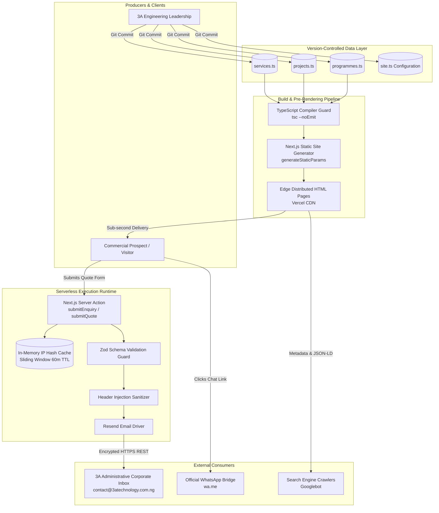

# Data Architecture and Information Management Specification
**Project:** 3A Technology Solutions Corporate Web Platform & 3A Techvolution Academy  
**Role:** Data Architect and Software Systems Engineer  
**Status:** Authoritative Data Baseline (Draft for Review)  
**Version:** 1.0  
**Date:** October 2026  
**Governing Documents:** [`PRD.md`](file:///c:/Users/DELL/Desktop/3A%20TECHNOLOGY/prd.md) (v2.0), [`AGENTS.md`](file:///c:/Users/DELL/Desktop/3A%20TECHNOLOGY/AGENTS.md), [`docs/architecture.md`](file:///c:/Users/DELL/Desktop/3A%20TECHNOLOGY/docs/architecture.md), [`docs/architecture-essential.md`](file:///c:/Users/DELL/Desktop/3A%20TECHNOLOGY/docs/architecture-essential.md), [`docs/decisions/`](file:///c:/Users/DELL/Desktop/3A%20TECHNOLOGY/docs/decisions)  

---

## 1. Executive Summary & Data Philosophy

This document defines the data architecture, entity relationships, information lifecycles, and privacy controls for the **3A Technology Solutions** web platform.

In strict alignment with the **Phase 1 Architectural Invariants** (`AGENTS.md` Section 1.2 and `docs/architecture-essential.md` Rule `ARCH-01`), the data architecture adheres to the principle of **"Zero-State Persistence & Transient Stream Processing"**:
1. **Zero Database Footprint:** The platform operates with **zero runtime relational or NoSQL database servers** (no PostgreSQL, MySQL, MongoDB, or SQLite). 
2. **Statically Typed Content Layer:** All published services, portfolio case studies, and academy course offerings are modeled as immutable, strongly typed TypeScript data structures (`src/data/*.ts`) validated at compile time.
3. **Transient Lead Processing:** Incoming prospective client enquiries from `/contact` and `/request-quote` are processed in ephemeral serverless execution memory, validated via Zod schemas, sanitized against injection, and dispatched directly over TLS to the administrative email inbox. No personal data is written to application databases.
4. **NDPR / NDPA 2023 Compliance by Design:** By collecting only strictly necessary scoping data, storing zero persistent user records, and deploying zero advertising tracking pixels, the platform guarantees privacy compliance.

---

## 2. Comprehensive Data Inventory

The platform processes five distinct categories of data:

| Data Category | Purpose & Description | Primary Source | Consumers | Sensitivity Tier | Storage Medium & Location | Retention Period | Related Requirements |
| :--- | :--- | :--- | :--- | :--- | :--- | :--- | :--- |
| **Published Commercial Services** | Public catalog of 3A's 5 engineering service categories, problem contexts, technical approaches, and deliverables. | 3A Technical Leadership / Product Management | Public visitors, prospective clients, search bots | **Public (Tier 1)** | Version-controlled TypeScript data: `src/data/services.ts` | Permanent until modified via Git commit | `FR-02`, `FR-08` |
| **Portfolio Case Studies** | Documented technical projects, prototypes, screenshots, architecture summaries, and verified outcomes. | 3A Engineering & AI Teams | Public visitors, enterprise prospects, search bots | **Public (Tier 1)** | Version-controlled TypeScript data: `src/data/projects.ts` | Permanent until modified via Git commit | `FR-03`, `FR-08` |
| **Academy Course Catalog** | Confirmed curriculum tracks, module outlines, prerequisites, duration, and target audience profiles. | 3A Techvolution Academy Director | Students, graduates, corporate upskillers | **Public (Tier 1)** | Version-controlled TypeScript data: `src/data/programmes.ts` | Permanent until updated per academic cohort | `FR-04`, `FR-08` |
| **Inbound Commercial Leads (PII)** | Prospect enquiries and quote scoping requests: Full Name, Email, Phone, Company, Service, Budget, Timeline, Scope. | Website Visitors via `/contact` & `/request-quote` | 3A Sales & Executive Leadership | **Confidential / PII (Tier 3)** | Transient serverless memory $\rightarrow$ Encrypted email dispatch to 3A Corporate Mailbox | 0 days in web runtime (ephemeral); retained per corporate email retention policies | `FR-05`, `FR-06`, `FR-07` |
| **Security & Rate-Limiting Telemetry** | IP address hashes and submission timestamps used to throttle spam flood attacks. | Inbound HTTP Request Headers | Next.js Server Actions Rate Limiter | **Internal / Ephemeral (Tier 2)** | In-memory sliding-window cache at Vercel Edge | Maximum 60 minutes (rolling window TTL) | `FR-05`, `FR-10`, `ARCH-09` |

---

## 3. Data Lifecycles & Information Flow

### 3.1 Static Content Lifecycle (Services, Projects, Programmes)
```text
[Authoring / Sign-Off]
  └── Stakeholder approves service scope or verified case study
[Data Modeling]
  └── Content structured in src/data/*.ts adhering to src/types/content.ts
[Compile-Time Verification]
  └── `npx tsc --noEmit` validates required fields, types, and enum values
[Build Pre-Rendering]
  └── Next.js `generateStaticParams()` pre-renders immutable static HTML
[Edge Distribution]
  └── Static pages distributed across global CDN nodes with Cache-Control headers
```

### 3.2 Inbound Commercial Lead Lifecycle
```text
[1. Collection]
  └── User enters project brief on `/request-quote`
[2. Client Validation]
  └── React Hook Form + Zod validates input lengths and email syntax on blur
[3. Secure Transport]
  └── Payload posted over HTTPS (TLS 1.3) to Next.js Server Action
[4. Security Filtering]
  ├── Rate limiter checks IP hash threshold (< 5 per hour)
  ├── Honeypot check: If `hp_field` is populated, drop silently
  └── String sanitization: Strip `\r` and `\n` to prevent email header injection
[5. Server Verification]
  └── Zod runtime schema re-evaluates all fields; rejects malformed payloads
[6. Outbound Dispatch]
  └── Dispatched via HTTPS REST call to Resend Transactional Email API
[7. Administrative Delivery]
  └── Delivered to 3A corporate inbox (`contact@3atechnology.com.ng`)
[8. Transient Zero-Persistence Cleanup]
  └── Memory garbage-collected upon function termination; zero database storage
```

---

## 4. End-to-End Data Flow Architecture

The following diagram maps the flow of data between producers, processing nodes, storage abstractions, and external recipients:



---

## 5. Authoritative Data Ownership & Source of Truth

To eliminate data ambiguity, authoritative ownership for every piece of data is formalized:

| Data Domain | Source of Truth | Authoritative Owner | Update & Approval Workflow |
| :--- | :--- | :--- | :--- |
| **Commercial Services** | `src/data/services.ts` | Head of Technology Solutions | Engineering review + Git PR approval |
| **Portfolio Case Studies** | `src/data/projects.ts` | Lead Project Engineers | Verification of client permission + Git PR |
| **Academy Tracks & Fees** | `src/data/programmes.ts` | Academy Program Director | Curriculum sign-off + Git PR approval |
| **Corporate Contact Info** | `src/config/site.ts` | Operations / Managing Director | Executive sign-off + Git PR approval |
| **Legal & Privacy Policies**| `src/app/privacy/page.tsx` | Legal / Compliance Officer | NDPR review + Git PR approval |
| **SEO Meta & Structured Data**| `src/app/sitemap.ts` | Technical Lead | Automated generation based on static slugs |

---

## 6. Data Quality, Integrity & Schema Contracts

### 6.1 TypeScript Interface Contracts (`src/types/content.ts`)
All published content must conform strictly to exported TypeScript interface contracts:

```typescript
// 1. Service Taxonomy Contract (6 Commercial Services; Branding & Digital Media Excluded)
export type ServiceSlug =
  | 'web-development'
  | 'custom-software'
  | 'ai-automation'
  | 'data-science-analytics'
  | 'technology-consulting'
  | 'academic-research-support';

export interface Service {
  slug: ServiceSlug;
  title: string;
  shortSummary: string;
  iconName: string;
  problemContext: string;
  targetAudience: string[];
  technicalApproach: string;
  deliverables: string[];
  ethicalNote?: string;
  featuredCaseStudySlug?: string;
  relatedProjectSlugs: string[];
}

// 2. Portfolio Case Study Contract (3 Collections & Explicit Confidentiality)
export type PortfolioCollection =
  | 'business-client-solutions'
  | 'websites-digital-experiences'
  | 'student-research-projects';

export type ProjectClassification =
  | 'AI-Powered Business Operations Tool'
  | 'Business Solution'
  | 'Client Project'
  | 'Institutional Platform'
  | 'Website & Landing Page'
  | 'Custom Digital Experience'
  | 'Student Project'
  | 'Research Project';

export type ProjectVisibility = 'public' | 'confidential';

export interface Project {
  slug: string;
  title: string;
  primaryCollection: PortfolioCollection;
  collections: PortfolioCollection[];
  category: ServiceSlug;
  relatedServices: ServiceSlug[];
  classification: ProjectClassification;
  clientOrOrganization?: string;
  status: string;
  visibility: ProjectVisibility;
  confidentialityNotice?: string;
  shortSummary: string;
  theChallenge: string;
  theSolution: string;
  verifiedFeatures: string[];
  technologiesUsed: string[];
  imagePlaceholder: string;
  liveUrl?: string; // Strictly omitted when visibility === 'confidential'
  githubUrl?: string; // Strictly omitted when visibility === 'confidential'
  featured: boolean;
  seoTitle: string;
  seoDescription: string;
}

// 3. Academy Programme, Learning Pathway & Support Service Contracts
export type LearningPathwaySlug =
  | 'ai-for-beginners'
  | 'ai-for-students-researchers'
  | 'ai-for-graduates-nysc'
  | 'ai-for-professionals-businesses'
  | 'ai-development-vibe-coding';

export interface CourseCohortInfo {
  cohortLabel: string;
  intakeWindow?: string;
  scheduleNotes?: string;
  registrationUrl?: string;
}

export interface AcademyProgramme {
  slug: string;
  title: string;
  shortDescription: string;
  overview: string;
  learningPathways: LearningPathwaySlug[];
  learningOutcomes: string[];
  curriculumModules: string[];
  level: 'Beginner' | 'Intermediate' | 'Advanced' | 'All Levels';
  format: 'Weekend Cohort' | 'In-Person' | 'Hybrid' | 'Online Live' | 'Customized Schedule';
  duration?: string; // Optional; displayed only when verified and meaningful
  targetAudience: string[];
  prerequisites: string[];
  feeDisplay: string;
  cohortInfo?: CourseCohortInfo;
  enrollmentUrl?: string;
  enquiryRoute: string;
  isCustomizedTraining?: boolean;
  status: 'Upcoming' | 'Open for Enrolment' | 'Ongoing' | 'Completed' | 'Registration Closed';
  startDate?: string;
  published: boolean;
  featured: boolean;
}

export type ResourceAvailability = 'Available' | 'Coming Soon' | 'In Development';
```

### 6.2 Normalization & Content Integrity Rules
1. **URL Slug Invariant:** All slugs must be strictly lowercase alphanumeric strings separated by single hyphens (e.g., `ai-automation`). No spaces, underscores, or uppercase characters are permitted.
2. **Category Foreign Key Constraint:** Every project in `projects.ts` must reference a valid `category` matching the `ServiceCategory` union. Build-time compilation fails if a project uses an unmapped category.
3. **Array Completeness:** Lists of deliverables, target audiences, and technologies must contain at least 2 non-empty items. Empty arrays trigger code review rejection.

---

## 7. Privacy, Security & Compliance Controls

### 7.1 Compliance with the Nigeria Data Protection Act (NDPA 2023 / NDPR)
- **Principle of Data Minimization:** Public forms do not collect sensitive personal data (e.g., National Identification Numbers [NIN], bank details, birth dates, or residential addresses). Only the minimum contact details required to scope an enterprise project are requested.
- **Lawful Basis for Processing:** Processing of contact and quote enquiries is based on **legitimate business interest** and **pre-contractual necessity** (evaluating and responding to inbound commercial solicitations).
- **Transient Memory Isolation:** Because form data is not saved to a relational database, there is no persistent database table susceptible to SQL injection, bulk credential dumping, or data leaks.
- **Zero Third-Party Advertising Pixels:** No Meta Pixels, Google Tag Manager scripts, or ad retargeting cookies are loaded on the website (`ARCH-11`).

### 7.2 Sanitization & Injection Defense
- **Email Header Injection Defense:** Text input fields (`fullName`, `email`, `subject`) are scrubbed of newline (`\n`) and carriage return (`\r`) characters before injection into email template headers, preventing attackers from injecting malicious `Bcc:` or `Cc:` recipients.
- **Cross-Site Scripting (XSS) Prevention:** Next.js and React natively escape all data rendered in JSX. No user-supplied text is ever passed to `dangerouslySetInnerHTML`.

---

## 8. Storage Role Mapping & Technology Justification

In compliance with the project instructions, **only storage technologies justified by Phase 1 release scope** are adopted:

| Storage Role | Technology Selected | Justification & Architectural Boundary |
| :--- | :--- | :--- |
| **Primary Content Store** | **Version-Controlled TypeScript Files (`src/data/*.ts`)** | Statically compiled with the application bundle; zero infrastructure cost; 100% build-time type verification. |
| **In-Flight Data Processing** | **Serverless Execution Memory (Node.js)** | Holds validated lead data in memory for < 500ms during Server Action dispatch; immediately reclaimed by garbage collection. |
| **Security & Throttling Cache** | **Edge In-Memory Key-Value Cache** | Tracks IP hash counters with a 60-minute sliding window to block automated spam floods without provisioning Redis. |
| **Media & Static Asset Store** | **Public Static Storage (`/public/`) via Vercel Edge CDN** | WebP photography, SVG vector marks, and favicon assets cached globally across edge points of presence. |
| **Relational Database** | **DEFERRED (Phase 2/3)** | Prohibited by `ARCH-01`. Will be evaluated only if an authenticated client portal or internal CMS is approved. |
| **NoSQL / Document Store** | **DEFERRED (Phase 2/3)** | Not required for static corporate website operations. |
| **Vector Storage (RAG)** | **EXCLUDED** | Prohibited by `ARCH-13`. No live LLM chat retrieval is deployed on the frontend. |

---

## 9. Integration, External Transfers & Failure Handling

### 9.1 External Integrations

```text
[3A Platform] ──(HTTPS REST)──> [Resend Transactional Email API]
      │
      ├──(Deep Link)──────────> [WhatsApp Business Gateway (wa.me)]
      │
      └──(External Form URL)──> [Approved Google Form / External Intake]
```

1. **Transactional Email Gateway (Resend / SMTP):**
   - Transmits lead notifications over an encrypted TLS connection.
   - Requires API token isolation in server-side environment variables (`RESEND_API_KEY`).
2. **WhatsApp Business Gateway:**
   - Client initiates connection via standard browser URL redirection:
     `https://wa.me/<NUMBER>?text=<ENCODED_MESSAGE>`
   - Generated using `encodeURIComponent()` to ensure special characters and line breaks render cleanly in WhatsApp Mobile and WhatsApp Web.
3. **External Academy Enrollment Intake:**
   - Directs learners to an external Google Form via standard external anchor tags with `target="_blank"` and `rel="noopener noreferrer"`.

### 9.2 Integration Failure & Resilience Handling
- **Email API Network Timeout:** If Resend fails to respond within 5,000ms, the Server Action catches the exception, logs a sanitized error code, and returns a helpful fallback to the user:
  ```json
  {
    "success": false,
    "error": "Our automated notification dispatch experienced a temporary delay. Please message our technical lead directly on WhatsApp."
  }
  ```
  Crucially, client-entered form inputs are **preserved in state** (`ARCH-10`), allowing the user to retry without re-typing.

---

## 10. Schema Evolution, Migrations & CMS Transition Roadmap

### 10.1 Schema Evolution in Phase 1
- **Backward-Compatible Field Additions:** Any new property added to a data model (e.g., adding `caseStudyVideoUrl?: string` to `Project`) must be declared as **optional** in `src/types/content.ts`. This ensures existing static data records compile without errors.
- **Rollback Mechanism:** Content rollbacks are executed instantaneously using standard Git version control (`git revert <commit-hash>`), triggering a zero-downtime redeployment via Vercel.

### 10.2 Future Headless CMS Migration Path (Phase 2/3)
Because presentation components are strictly decoupled from raw data files through the query interface in `src/lib/content.ts` (`ARCH-07`), migrating to a headless CMS (e.g., Sanity, Strapi) in future releases requires **zero changes to UI components**:
```text
[Phase 1 Implementation]
  Page Component ──> src/lib/content.ts ──> Reads local src/data/services.ts

[Phase 2 Migration]
  Page Component ──> src/lib/content.ts ──> Fetches from Sanity API (GROQ/GraphQL)
```

---

## 11. Observability, Logging & Error Telemetry

### 11.1 Logging Rules & PII Masking
In strict adherence to `AGENTS.md` Section 6 and NDPR principles:
- **No Plaintext PII in Logs:** User names, phone numbers, email addresses, and project scoping descriptions must **never** be logged to application console streams (`console.log`, `console.error`) or monitoring dashboards.
- **Permitted Operational Logging:**
  - Submission outcome status (`status: "SUCCESS" | "FAILED"`).
  - Error category code (`error: "RATE_LIMIT_EXCEEDED" | "EMAIL_DISPATCH_TIMEOUT"`).
  - Anonymized / Hashed IP identifier (`ipHash: "e3b0c442..."`).
  - Execution duration in milliseconds (`latencyMs: 342`).

---

## 12. Requirements & ADR Traceability Matrix

| Requirement ID | Data Architecture Implementation | Governing Rule / ADR |
| :--- | :--- | :--- |
| **FR-02** | 5 category dataset in `src/data/services.ts`; typed via `Service` interface. | `ARCH-01`, `ARCH-07`, [`ADR-003`](file:///c:/Users/DELL/Desktop/3A%20TECHNOLOGY/docs/decisions/ADR-003-static-content-data-layer.md) |
| **FR-03** | Case study records in `src/data/projects.ts`; verified status badges. | `ARCH-01`, `ARCH-07`, [`ADR-003`](file:///c:/Users/DELL/Desktop/3A%20TECHNOLOGY/docs/decisions/ADR-003-static-content-data-layer.md) |
| **FR-04** | Course catalog in `src/data/programmes.ts`; external enrollment URL. | `ARCH-02`, [`ADR-003`](file:///c:/Users/DELL/Desktop/3A%20TECHNOLOGY/docs/decisions/ADR-003-static-content-data-layer.md) |
| **FR-05** | General enquiry schema validation in `src/lib/validations/enquiry.ts`. | `ARCH-09`, [`ADR-004`](file:///c:/Users/DELL/Desktop/3A%20TECHNOLOGY/docs/decisions/ADR-004-form-intake-server-actions-and-anti-spam.md) |
| **FR-06** | Commercial quote intake schema with budget and timeline enums. | `ARCH-09`, [`ADR-004`](file:///c:/Users/DELL/Desktop/3A%20TECHNOLOGY/docs/decisions/ADR-004-form-intake-server-actions-and-anti-spam.md) |
| **FR-07** | Centralized WhatsApp URL generation utility using `siteConfig`. | `ARCH-06`, `PRD.md` Section 7 |
| **FR-08** | Statically typed content model in `src/types/content.ts`. | `ARCH-01`, `ARCH-14`, [`ADR-003`](file:///c:/Users/DELL/Desktop/3A%20TECHNOLOGY/docs/decisions/ADR-003-static-content-data-layer.md) |
| **FR-11** | Zero advertising tracking scripts; transient lead data processing. | `ARCH-11`, `AGENTS.md` Section 6 |
