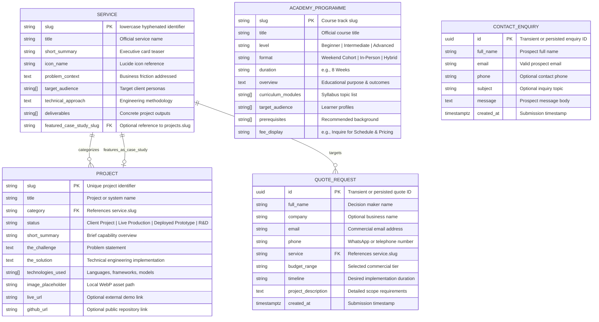

# Database Schema Specification & Data Modeling Baseline
**Project:** 3A Technology Solutions Corporate Web Platform & 3A Techvolution Academy  
**Role:** Senior Database Architect  
**Status:** Authoritative Schema Specification (Phase 1 File-Based Schema Active; Relational DDL Proposed for Phase 2/3)  
**Version:** 1.0  
**Date:** October 2026  
**Governing Documents:** [`PRD.md`](file:///c:/Users/DELL/Desktop/3A%20TECHNOLOGY/prd.md) (v2.0), [`AGENTS.md`](file:///c:/Users/DELL/Desktop/3A%20TECHNOLOGY/AGENTS.md), [`docs/architecture.md`](file:///c:/Users/DELL/Desktop/3A%20TECHNOLOGY/docs/architecture.md), [`docs/data-architecture.md`](file:///c:/Users/DELL/Desktop/3A%20TECHNOLOGY/docs/data-architecture.md), [`docs/architecture-essential.md`](file:///c:/Users/DELL/Desktop/3A%20TECHNOLOGY/docs/architecture-essential.md)  

---

## 1. Architectural Context & Invariant Governance Notice

In accordance with the foundational architectural invariants defined in `AGENTS.md` Section 1.2 and `docs/architecture-essential.md` Rule `ARCH-01`, this document establishes a dual-tier specification:

1. **Phase 1 Active Schema (Production Runtime):** Operates with **zero runtime relational or NoSQL database servers**. All published content is modeled as statically typed TypeScript interface schemas (`src/types/content.ts`) and Zod validation schemas (`src/lib/validations/enquiry.ts`), backed by version-controlled data files (`src/data/*.ts`).
2. **Proposed Relational Schema Blueprint (Phase 2/3 Architecture):** Formally specifies the normalized relational schema (PostgreSQL DDL / Prisma schema) designed to receive the static dataset should business stakeholders approve an internal CMS, relational persistence, or client portal in future phases.

> [!IMPORTANT]
> **Zero Live Database Modifications:** In strict compliance with release governance, no live database instances are provisioned, connected, or altered. This document serves as the formal data contract and forward migration blueprint.

---

## 2. Entity-Relationship (ER) Model

The following diagram defines the structural entities, attributes, primary keys, and foreign-key relationships governing 3A's commercial and educational domains:



---

## 3. Phase 1 Active Schema (TypeScript Data Contracts)

The active production schema is implemented via strict TypeScript interface definitions in `src/types/content.ts` and runtime Zod schemas in `src/lib/validations/enquiry.ts`.

### 3.1 `Service` Entity Contract
- **Purpose:** Authoritative schema for commercial technology services published at `/services` and `/services/[slug]`.
- **Primary Identifier:** `slug` (Unique, lowercase hyphenated string).
- **TypeScript Interface:**
  ```typescript
  export type ServiceCategory = 
    | 'web-development' 
    | 'custom-software' 
    | 'ai-automation' 
    | 'data-science-analytics' 
    | 'brand-digital-media';

  export interface Service {
    slug: ServiceCategory;                      // PK: Unique category slug
    title: string;                             // Required: Full service title
    shortSummary: string;                      // Required: Card summary (100–160 chars)
    iconName: string;                          // Required: Lucide icon identifier
    problemContext: string;                    // Required: Detailed business problem
    targetAudience: string[];                  // Required: Array of client types (min 2)
    technicalApproach: string;                 // Required: Architecture description
    deliverables: string[];                    // Required: Array of concrete outputs (min 2)
    featuredCaseStudySlug?: string;            // Optional FK: references Project.slug
  }
  ```
- **Related Requirements:** `FR-02`, `FR-08`, `AC-02.1` to `AC-02.3`.

### 3.2 `Project` Entity Contract
- **Purpose:** Authoritative schema for technical projects, prototypes, and client case studies published at `/projects` and `/projects/[slug]`.
- **Primary Identifier:** `slug` (Unique, lowercase hyphenated string).
- **TypeScript Interface:**
  ```typescript
  export type ProjectStatus = 
    | 'Client Project' 
    | 'Live Production' 
    | 'Deployed Prototype' 
    | 'Research & Development';

  export interface Project {
    slug: string;                              // PK: Unique case study slug
    title: string;                             // Required: Project name
    category: ServiceCategory;                 // FK: References Service.slug
    status: ProjectStatus;                     // Required: Development / deployment status
    shortSummary: string;                      // Required: Card summary
    theChallenge: string;                      // Required: Problem statement
    theSolution: string;                       // Required: Technical solution
    technologiesUsed: string[];                // Required: Badges (min 2)
    imagePlaceholder: string;                  // Required: Local path to WebP asset
    liveUrl?: string;                          // Optional: External verified demo URL
    githubUrl?: string;                        // Optional: External approved public repo
  }
  ```
- **Related Requirements:** `FR-03`, `FR-08`, `AC-03.1` to `AC-03.4`.

### 3.3 `AcademyProgramme` Entity Contract
- **Purpose:** Authoritative schema for education and training tracks published at `/academy` and `/academy/programmes`.
- **Primary Identifier:** `slug` (Unique, lowercase hyphenated string).
- **TypeScript Interface:**
  ```typescript
  export interface AcademyProgramme {
    slug: string;                              // PK: Unique course track slug
    title: string;                             // Required: Course name
    level: 'Beginner' | 'Intermediate' | 'Advanced'; // Required: Target skill tier
    format: 'Weekend Cohort' | 'In-Person' | 'Hybrid'; // Required: Delivery format
    duration: string;                          // Required: e.g., "8 Weeks"
    overview: string;                          // Required: Course description
    curriculumModules: string[];               // Required: Syllabus modules (min 3)
    targetAudience: string[];                  // Required: Target profiles (min 2)
    prerequisites?: string[];                  // Optional: Recommended background
    feeDisplay?: string;                       // Optional: e.g., "Inquire for Schedule & Pricing"
  }
  ```
- **Related Requirements:** `FR-04`, `FR-08`, `AC-04.1` to `AC-04.4`.

### 3.4 Transient Inbound Lead Schemas (Zod Validation)
Inbound form submissions are validated in memory using runtime Zod schemas:

```typescript
// src/lib/validations/enquiry.ts
import { z } from 'zod';

export const ContactEnquirySchema = z.object({
  fullName: z.string().trim().min(2, 'Name must be at least 2 characters').max(100),
  email: z.string().trim().email('Valid email address required').max(100),
  phone: z.string().trim().max(20).optional(),
  subject: z.string().trim().max(100).optional(),
  message: z.string().trim().min(15, 'Message must be at least 15 characters').max(2000),
  hp_field: z.string().max(0, 'Spam rejected'), // Honeypot trap must be empty
});

export const QuoteRequestSchema = z.object({
  fullName: z.string().trim().min(2, 'Name must be at least 2 characters').max(100),
  company: z.string().trim().max(100).optional(),
  email: z.string().trim().email('Valid email address required').max(100),
  phone: z.string().trim().min(7, 'Contact phone number required').max(25),
  service: z.enum([
    'web-development',
    'custom-software',
    'ai-automation',
    'data-science-analytics',
    'brand-digital-media',
  ]),
  budgetRange: z.string().min(1, 'Budget range selection required'),
  timeline: z.string().min(1, 'Desired timeline selection required'),
  projectDescription: z.string().trim().min(20, 'Scope description must be at least 20 characters').max(3000),
  hp_field: z.string().max(0, 'Spam rejected'), // Honeypot trap must be empty
});
```

---

## 4. Proposed Relational Schema Specification (Phase 2/3 PostgreSQL DDL)

If stakeholder governance approves persistent database storage in a future phase (e.g., to support an authenticated administrative dashboard or CRM integration), the following normalized PostgreSQL DDL represents the authoritative schema blueprint:

### 4.1 Table: `services`
Stores core commercial engineering service offerings.

```sql
CREATE TABLE services (
    slug VARCHAR(64) PRIMARY KEY,
    title VARCHAR(128) NOT NULL,
    short_summary VARCHAR(256) NOT NULL,
    icon_name VARCHAR(64) NOT NULL,
    problem_context TEXT NOT NULL,
    target_audience JSONB NOT NULL DEFAULT '[]'::jsonb,
    technical_approach TEXT NOT NULL,
    deliverables JSONB NOT NULL DEFAULT '[]'::jsonb,
    featured_case_study_slug VARCHAR(64),
    created_at TIMESTAMPTZ NOT NULL DEFAULT CURRENT_TIMESTAMP,
    updated_at TIMESTAMPTZ NOT NULL DEFAULT CURRENT_TIMESTAMP,
    CONSTRAINT check_service_slug_format CHECK (slug ~ '^[a-z0-9]+(-[a-z0-9]+)*$')
);

CREATE INDEX idx_services_slug ON services(slug);
```

### 4.2 Table: `projects`
Stores case studies, deployed prototypes, and client software builds.

```sql
CREATE TYPE project_status_enum AS ENUM (
    'Client Project',
    'Live Production',
    'Deployed Prototype',
    'Research & Development'
);

CREATE TABLE projects (
    slug VARCHAR(64) PRIMARY KEY,
    title VARCHAR(128) NOT NULL,
    category VARCHAR(64) NOT NULL,
    status project_status_enum NOT NULL DEFAULT 'Deployed Prototype',
    short_summary VARCHAR(256) NOT NULL,
    the_challenge TEXT NOT NULL,
    the_solution TEXT NOT NULL,
    technologies_used JSONB NOT NULL DEFAULT '[]'::jsonb,
    image_placeholder VARCHAR(256) NOT NULL,
    live_url VARCHAR(512),
    github_url VARCHAR(512),
    created_at TIMESTAMPTZ NOT NULL DEFAULT CURRENT_TIMESTAMP,
    updated_at TIMESTAMPTZ NOT NULL DEFAULT CURRENT_TIMESTAMP,
    CONSTRAINT fk_project_category FOREIGN KEY (category) REFERENCES services(slug) ON DELETE RESTRICT,
    CONSTRAINT check_project_slug_format CHECK (slug ~ '^[a-z0-9]+(-[a-z0-9]+)*$')
);

-- Foreign key back-reference on services for circular case study highlight
ALTER TABLE services 
ADD CONSTRAINT fk_service_featured_case_study 
FOREIGN KEY (featured_case_study_slug) REFERENCES projects(slug) ON DELETE SET NULL;

CREATE INDEX idx_projects_category ON projects(category);
CREATE INDEX idx_projects_status ON projects(status);
```

### 4.3 Table: `academy_programmes`
Stores education tracks for 3A Techvolution Academy.

```sql
CREATE TYPE programme_level_enum AS ENUM ('Beginner', 'Intermediate', 'Advanced');
CREATE TYPE programme_format_enum AS ENUM ('Weekend Cohort', 'In-Person', 'Hybrid');

CREATE TABLE academy_programmes (
    slug VARCHAR(64) PRIMARY KEY,
    title VARCHAR(128) NOT NULL,
    level programme_level_enum NOT NULL,
    format programme_format_enum NOT NULL DEFAULT 'Weekend Cohort',
    duration VARCHAR(32) NOT NULL,
    overview TEXT NOT NULL,
    curriculum_modules JSONB NOT NULL DEFAULT '[]'::jsonb,
    target_audience JSONB NOT NULL DEFAULT '[]'::jsonb,
    prerequisites JSONB DEFAULT '[]'::jsonb,
    fee_display VARCHAR(64) DEFAULT 'Inquire for Schedule & Pricing',
    is_active BOOLEAN NOT NULL DEFAULT TRUE,
    created_at TIMESTAMPTZ NOT NULL DEFAULT CURRENT_TIMESTAMP,
    updated_at TIMESTAMPTZ NOT NULL DEFAULT CURRENT_TIMESTAMP,
    CONSTRAINT check_programme_slug_format CHECK (slug ~ '^[a-z0-9]+(-[a-z0-9]+)*$')
);

CREATE INDEX idx_academy_programmes_active ON academy_programmes(is_active);
```

### 4.4 Table: `enquiries` (Future Lead Persistence Audit Log)
Stores inbound general contact submissions.

```sql
CREATE TABLE enquiries (
    id UUID PRIMARY KEY DEFAULT gen_random_mark_uuid(),
    full_name VARCHAR(128) NOT NULL,
    email VARCHAR(128) NOT NULL,
    phone VARCHAR(32),
    subject VARCHAR(128),
    message TEXT NOT NULL,
    ip_hash VARCHAR(64) NOT NULL,
    is_processed BOOLEAN NOT NULL DEFAULT FALSE,
    created_at TIMESTAMPTZ NOT NULL DEFAULT CURRENT_TIMESTAMP,
    CONSTRAINT check_enquiry_email_valid CHECK (email ~* '^[A-Z0-9._%+-]+@[A-Z0-9.-]+\.[A-Z]{2,}$')
);

CREATE INDEX idx_enquiries_email ON enquiries(email);
CREATE INDEX idx_enquiries_created_at ON enquiries(created_at DESC);
CREATE INDEX idx_enquiries_unprocessed ON enquiries(is_processed) WHERE is_processed IS FALSE;
```

### 4.5 Table: `quote_requests` (Future Commercial Scoping Audit Log)
Stores commercial project quote inquiries.

```sql
CREATE TABLE quote_requests (
    id UUID PRIMARY KEY DEFAULT gen_random_uuid(),
    full_name VARCHAR(128) NOT NULL,
    company VARCHAR(128),
    email VARCHAR(128) NOT NULL,
    phone VARCHAR(32) NOT NULL,
    service_slug VARCHAR(64) NOT NULL,
    budget_range VARCHAR(64) NOT NULL,
    timeline VARCHAR(64) NOT NULL,
    project_description TEXT NOT NULL,
    ip_hash VARCHAR(64) NOT NULL,
    status VARCHAR(32) NOT NULL DEFAULT 'NEW_ENQUIRY',
    created_at TIMESTAMPTZ NOT NULL DEFAULT CURRENT_TIMESTAMP,
    CONSTRAINT fk_quote_service FOREIGN KEY (service_slug) REFERENCES services(slug) ON DELETE RESTRICT,
    CONSTRAINT check_quote_email_valid CHECK (email ~* '^[A-Z0-9._%+-]+@[A-Z0-9.-]+\.[A-Z]{2,}$')
);

CREATE INDEX idx_quote_requests_service ON quote_requests(service_slug);
CREATE INDEX idx_quote_requests_created_at ON quote_requests(created_at DESC);
CREATE INDEX idx_quote_requests_status ON quote_requests(status);
```

---

## 5. Referential Integrity, Constraints & Business Rules

| Business Rule / Invariant | Relational Implementation | TypeScript Implementation (Phase 1) |
| :--- | :--- | :--- |
| **Unique Route Slugs** | `PRIMARY KEY (slug)` on `services`, `projects`, `academy_programmes`. | TypeScript record map / unique key constraint checked at build time. |
| **Service Category Integrity** | `FOREIGN KEY (category) REFERENCES services(slug) ON DELETE RESTRICT`. | TypeScript union type: `category: ServiceCategory`. Compiler rejects unmapped categories. |
| **Slug Formatting Standard** | `CHECK (slug ~ '^[a-z0-9]+(-[a-z0-9]+)*$')` enforces lowercase alphanumeric hyphens. | Unit test verifying slug regex across all datasets. |
| **Email Validity Standard** | Regex constraint enforcing RFC 5322 email syntax. | Zod `z.string().email()` validation guard. |
| **Array Minimum Bounds** | Application-level validation ensuring `deliverables` and `technologies_used` have $\ge 2$ entries. | TypeScript type verification and test runner assertion. |
| **Spam Honeypot Guard** | Not stored in DB. Evaluated at ingress layer; if populated, silently discarded. | Zod `hp_field: z.string().max(0)`. |

---

## 6. Indexing Strategy & Performance Rationale

In the proposed relational blueprint, all indexes are derived directly from documented user journeys:

1. **`idx_projects_category` on `projects(category)`:**
   - *Rationale:* Accelerates portfolio filtering on `/projects` when visitors filter case studies by service category (`AC-03.1`).
2. **`idx_projects_status` on `projects(status)`:**
   - *Rationale:* Supports filtering verified production client work from internal research prototypes.
3. **`idx_quote_requests_service` on `quote_requests(service_slug)`:**
   - *Rationale:* Enables commercial reporting on which service offerings generate the highest lead volume.
4. **`idx_enquiries_created_at` on `enquiries(created_at DESC)`:**
   - *Rationale:* Supports chronological sorting on future administrative dashboards.

---

## 7. Sensitive Fields, Privacy & Access Controls (NDPR Compliance)

### 7.1 PII Field Identification
The following fields are classified as **Confidential Personal Data (Tier 3)**:
- `enquiries.full_name`, `enquiries.email`, `enquiries.phone`, `enquiries.message`
- `quote_requests.full_name`, `quote_requests.email`, `quote_requests.phone`, `quote_requests.project_description`

### 7.2 Access & Protection Controls
1. **Zero Public Exposure:** Inbound lead fields must never be exposed via public API endpoints, client-side state, or public bundle code.
2. **Phase 1 Transient Processing:** In Phase 1, these fields are processed purely in ephemeral serverless execution memory and dispatched over encrypted TLS to the administrative email inbox. No database table containing PII exists (`ARCH-01`).
3. **Phase 2/3 Encryption at Rest:** If persisted in a future database, PII fields must utilize AES-256 database-level encryption at rest, and access must be restricted through strict Role-Based Access Control (RBAC).
4. **Anonymized IP Telemetry:** Client IP addresses are never stored in raw form; they are transformed via a one-way cryptographic hash (`SHA-256(ip + salt)`) for rolling rate-limiting counters.

---

## 8. Schema Migration, Evolution & CMS Transition Strategy

### 8.1 Phase 1 Static Evolution Workflow
1. **Schema Modifications:** Any field additions or type updates are made to `src/types/content.ts`.
2. **Data File Updates:** Corresponding objects in `src/data/services.ts`, `src/data/projects.ts`, or `src/data/programmes.ts` are populated.
3. **Compiler Verification:** `npx tsc --noEmit` verifies 100% type compliance.
4. **Automated Rollback:** If a content error occurs in production, `git revert <commit>` instantly triggers a fresh build and atomic rollout via Vercel Edge.

### 8.2 Phase 2/3 Database / CMS Migration Workflow
When stakeholder governance approves database persistence or a headless CMS:
1. **Migration Execution:** Run initial Prisma/SQL migration scripts establishing the normalized tables defined in Section 4.
2. **Automated Seeding Script:** Execute an automated seed script (`scripts/seed-from-ts.ts`) that imports the verified Phase 1 TypeScript data objects (`services.ts`, `projects.ts`, `programmes.ts`) and inserts them into the database with zero manual data entry.
3. **Adapter Switch:** Update the internal functions in `src/lib/content.ts` to query the database/CMS instead of importing static files. As mandated by Rule `ARCH-07`, **zero changes to presentation components are required**.

---

## 9. Requirements Traceability Matrix

| Requirement ID | Schema Entity / Contract | Implementation File | Verification Test |
| :--- | :--- | :--- | :--- |
| **FR-02** | `Service` Entity Contract | `src/types/content.ts`, `src/data/services.ts` | Vitest schema integrity test; static compilation check. |
| **FR-03** | `Project` Entity Contract | `src/types/content.ts`, `src/data/projects.ts` | Referential check ensuring `category` maps to a valid `ServiceCategory`. |
| **FR-04** | `AcademyProgramme` Contract | `src/types/content.ts`, `src/data/programmes.ts` | Vitest verification of modules and fee display strings. |
| **FR-05** | `ContactEnquirySchema` | `src/lib/validations/enquiry.ts` | Unit test verifying Zod validation, string limits, and honeypot rejection. |
| **FR-06** | `QuoteRequestSchema` | `src/lib/validations/enquiry.ts` | Unit test verifying enum validation for services, budgets, and timelines. |
| **FR-08** | Statically Typed Layer | Entire `src/types/` & `src/data/` structure | `npx tsc --noEmit` build gate check. |

---

## 10. Architectural Approval & Sign-Off Status

- **Phase 1 Active Schema:** Fully specified and approved for implementation scaffolding using static TypeScript contracts.
- **Phase 2/3 Relational DDL:** Formally drafted as an architectural blueprint; marked as **`Proposed`** pending future business scope expansion.
- **Live Database Modifications:** **None executed.** Zero database servers or live migrations were run.
