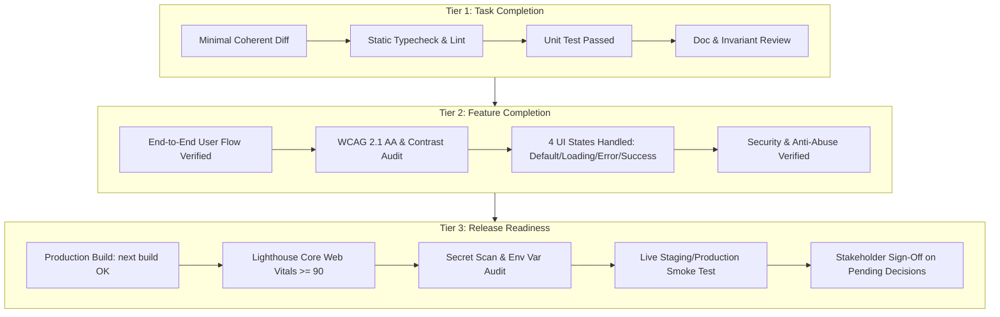

# Definition of Done and Release Quality Governance
**Project:** 3A Technology Solutions Corporate Web Platform & 3A Techvolution Academy  
**Role:** Engineering Quality and Release Governance Lead  
**Status:** Authoritative Governance Baseline  
**Version:** 1.0  
**Date:** November 2026  
**Governing Documents:** [`PRD.md`](file:///c:/Users/DELL/Desktop/3A%20TECHNOLOGY/prd.md) (v2.0), [`AGENTS.md`](file:///c:/Users/DELL/Desktop/3A%20TECHNOLOGY/AGENTS.md), [`docs/architecture-essential.md`](file:///c:/Users/DELL/Desktop/3A%20TECHNOLOGY/docs/architecture-essential.md), [`docs/security-specification.md`](file:///c:/Users/DELL/Desktop/3A%20TECHNOLOGY/docs/security-specification.md), [`docs/testing-strategy.md`](file:///c:/Users/DELL/Desktop/3A%20TECHNOLOGY/docs/testing-strategy.md), [`docs/api-specification.md`](file:///c:/Users/DELL/Desktop/3A%20TECHNOLOGY/docs/api-specification.md)  

---

## 1. Executive Summary & Quality Governance Philosophy

This document defines the auditable, multi-tiered **Definition of Done (DoD)** governing all software engineering activities across the **3A Technology Solutions** repository. 

### 1.1 The Golden Rules of Quality Governance
1. **Evidence Before Assertions (`AGENTS.md` Section 5.1):** No developer or AI agent shall declare work "complete," "passing," or "ready" without executing concrete verification commands and providing raw, inspectable terminal logs. Hypotheses and unverified claims are strictly rejected.
2. **Transparent Accounting of Test States:** All engineering reports must explicitly distinguish:
   - **Passed Checks:** Executed with clean exit code `0`.
   - **Failed Checks:** Executed with non-zero exit codes; defect tickets logged.
   - **Unrun Checks:** Omitted intentionally with clear technical justification.
   - **Blocked Checks:** Prevented by missing external dependencies or credentials.
   - *Concealing, ignoring, or silencing test failures is a critical governance violation.*
3. **Strict Invariant Adherence (`ARCH-01` to `ARCH-15`):** Phase 1 release scope invariants (zero database, zero in-house LMS/user accounts, zero payment gateways, zero chatbots) must be maintained across all tasks. Scope creep requires explicit stakeholder approval.

---

## 2. Three-Tier Definition of Done Framework

To prevent bureaucratic overhead while guaranteeing high technical rigor, the Definition of Done is segmented into three distinct evaluation tiers:



---

## 3. Tier 1: Task-Level Definition of Done (Task DoD)

Applied to granular engineering tasks, pull requests, bug fixes, and single component implementations.

| Criterion ID | Quality Criterion | Required Condition | Verification Method | Required Evidence | Status |
| :--- | :--- | :--- | :--- | :--- | :--- |
| **DOD-T1.1** | **Acceptance Criteria Fulfillment** | Every discrete acceptance criterion (`AC-xx.x`) assigned to the task is demonstrably satisfied. | Manual code review against `PRD.md`. | Traceability statement linking code diff to `AC` IDs. | **MANDATORY** |
| **DOD-T1.2** | **Zero Static Typing Errors** | TypeScript compiler completes with zero type errors, zero `@ts-ignore`, and zero `any` types. | `npm run typecheck` (`tsc --noEmit`). | Command output showing `exit code 0` with zero diagnostic errors. | **MANDATORY** |
| **DOD-T1.3** | **Zero Linting Violations** | Code adheres to project ESLint rules, import boundaries, and formatting rules. | `npm run lint`. | Command output showing `exit code 0` with zero warnings or errors. | **MANDATORY** |
| **DOD-T1.4** | **Relevant Unit Tests Executed** | New or modified logic (schemas, sanitizers, helpers) has passing unit tests. | `npm run test:unit`. | Test runner summary showing passing assertions. | **MANDATORY** |
| **DOD-T1.5** | **No Unauthorized Scope Creep** | The change does not introduce database connections, auth packages, payment SDKs, or unapproved styles. | Diff inspection against `docs/architecture-essential.md`. | Verified git diff showing compliance with invariants `ARCH-01` to `ARCH-15`. | **MANDATORY** |
| **DOD-T1.6** | **Minimal Coherent Diff** | No unrelated files, formatting churn, or accidental whitespace modifications in PR. | `git status` / `git diff`. | Clean diff restricted solely to files relevant to the task. | **MANDATORY** |
| **DOD-T1.7** | **Documentation Synchronized** | Any architectural change, schema addition, or new environment variable is reflected in docs. | File inspection of `docs/`. | Updated markdown files linked in the task completion report. | **CONDITIONAL** (Required if interfaces change) |

---

## 4. Tier 2: Feature-Level Definition of Done (Feature DoD)

Applied when an entire functional requirement (`FR-01` to `FR-11`) or major subsystem (e.g., Services Catalog, Commercial Quote Flow, Mobile Navigation Shell) is declared ready for integration.

| Criterion ID | Quality Criterion | Required Condition | Verification Method | Required Evidence | Status |
| :--- | :--- | :--- | :--- | :--- | :--- |
| **DOD-F2.1** | **End-to-End User Journey Operable** | The complete user flow functions as specified from trigger to terminal state across viewports. | Playwright E2E test execution (`npm run test:e2e`). | Passing Playwright test suite output; zero assertion timeouts. | **MANDATORY** |
| **DOD-F2.2** | **All 4 UI States Handled** | Component gracefully handles **Default**, **Loading**, **Error**, and **Success** states. Non-destructive input preservation on failure (`ARCH-10`). | Component test + Playwright network mock. | Screenshots or DOM assertions proving state transitions and input preservation. | **MANDATORY** |
| **DOD-F2.3** | **WCAG 2.1 Level AA Compliance** | Zero critical/serious axe-core violations; keyboard navigation operable; focus rings visible. | Automated `@axe-core/playwright` audit scan. | Zero axe violations report; keyboard tab order verified. | **MANDATORY** |
| **DOD-F2.4** | **Brand Palette & Contrast Safety** | Accent Yellow (`#F7C800`) strictly paired with Dark Charcoal text; no yellow text on white/gray (`AUD-01`). | Automated contrast assertion + visual code review. | Contrast calculation $\ge 4.5:1$ (normal text) and $\ge 8:1$ (buttons). | **MANDATORY** |
| **DOD-F2.5** | **Security & Anti-Abuse Verified** | Honeypot trap (`hp_field`), sliding-window IP rate limiting, and CRLF header sanitizers verified. | Vitest security integration tests (`SEC-02` to `SEC-05`). | Passing test logs verifying bot drops and HTTP 429 rate limit triggers. | **MANDATORY** |
| **DOD-F2.6** | **Zero PII Exposure in Logs** | No customer names, emails, phone numbers, or scoping text logged to console streams (`SEC-11`). | Code inspection of all `console.*` calls in feature files. | Code review confirming only anonymized metadata and error codes are logged. | **MANDATORY** |
| **DOD-F2.7** | **External Link Safety** | All external links (`target="_blank"`) declare `rel="noopener noreferrer"` (`SEC-14`). | ESLint `react/jsx-no-target-blank` scan. | ESLint passing with zero tab-nabbing vulnerabilities. | **MANDATORY** |
| **DOD-F2.8** | **Regression Suite Passing** | The introduction of the feature causes zero regressions in previously passing tests. | Full test suite run (`npm test`). | 100% of existing test suites maintain passing status. | **MANDATORY** |

---

## 5. Tier 3: Release-Level Definition of Done (Release Readiness)

Applied prior to production deployment, staging freeze, or public DNS switchover.

| Criterion ID | Quality Criterion | Required Condition | Verification Method | Required Evidence | Status |
| :--- | :--- | :--- | :--- | :--- | :--- |
| **DOD-R3.1** | **Successful Production Build** | Next.js compilation completes with zero errors; all static routes pre-rendered successfully. | `npm run build` (`next build`). | Build log showing successful static generation of all pages without warnings. | **MANDATORY** |
| **DOD-R3.2** | **Lighthouse Core Web Vitals Met** | Mobile performance, accessibility, best practices, and SEO scores meet or exceed targets. | `@lhci/cli` audit against production build. | Lighthouse report: Performance $\ge 90$, Accessibility $\ge 95$, SEO $\ge 95$, LCP $< 2.2$s, CLS $< 0.05$. | **MANDATORY** |
| **DOD-R3.3** | **Zero Vulnerable Dependencies** | No High or Critical Common Vulnerabilities and Exposures (CVEs) in production dependency tree. | `npm audit --audit-level=high`. | Command output showing `found 0 vulnerabilities`. | **MANDATORY** |
| **DOD-R3.4** | **Zero Secret Leakage** | No private API tokens (`RESEND_API_KEY`), passwords, or `.env` files present in Git history. | `gitleaks detect --source=.`. | Gitleaks scan report showing `exit code 0` and zero leaks detected. | **MANDATORY** |
| **DOD-R3.5** | **Production HTTP Security Headers** | Security headers (`CSP`, `HSTS`, `X-Frame-Options: DENY`, `X-Content-Type-Options: nosniff`) active. | HTTP curl probe against staging/production URL. | Inspectable response header dump confirming all mandatory security directives. | **MANDATORY** |
| **DOD-R3.6** | **Live End-to-End Smoke Test** | Real quote and contact submissions successfully deliver to the administrative email inbox. | Manual test dispatch in production environment. | Verified delivery confirmation in 3A corporate administrative mailbox. | **MANDATORY** |
| **DOD-R3.7** | **Domain & SSL/TLS Active** | Custom domain resolves correctly over HTTPS with active Let's Encrypt TLS certificate. | Browser / SSL Labs test. | Valid SSL certificate badge; automatic HTTP $\rightarrow$ HTTPS 301 redirection. | **MANDATORY** |
| **DOD-R3.8** | **Stakeholder Decisions Approved** | All 4 unresolved business decisions (`DEC-01` to `DEC-04`) formally signed off by 3A leadership. | Document inspection of `docs/research-and-decisions.md`. | Written stakeholder approval on file. | **MANDATORY** |
| **DOD-R3.9** | **Recovery & Rollback Documented** | Atomic rollback procedure via Vercel / Git revert is documented and verified. | Review of deployment procedures in `docs/architecture.md`. | Verified rollback documentation; single-click redeployment confirmed. | **MANDATORY** |

---

## 6. Test Failure Investigation and Reporting Protocol

When a verification command fails, developers and AI agents must strictly follow this investigation protocol:

```text
[TEST FAILURE DETECTED]
       │
       ├── 1. Capture & Log: Record exact command line, exit code, and full error trace.
       │
       ├── 2. Categorize Defect:
       │      ├── Flaky / Timing Race Condition -> Follow testing-strategy.md Section 7.
       │      ├── Schema / Type Divergence -> Fix TypeScript interface or test fixture.
       │      ├── Environmental Blockage -> Document missing dependency or API key.
       │      └── True Product Regression -> Log bug ticket, isolate failure, and remediate.
       │
       ├── 3. Mandatory Reporting Rule: NEVER comment out, suppress, or modify an assertion
       │      merely to make a test pass without an approved architectural change.
       │
       └── 4. Re-verify: Re-execute full test suite to guarantee zero regression.
```

---

## 7. Standard Auditable Completion Report Template

In strict adherence to `AGENTS.md` Section 9, all task completion reports delivered by AI agents or engineers must use this standardized markdown template:

```markdown
### 1. Executive Summary of Changes
- **Task Description:** [Brief description of the work accomplished]
- **Architectural Rationale:** [Key design decisions and invariant compliance]

### 2. Requirements & Acceptance Criteria Traceability
- **PRD Requirement IDs:** [e.g., FR-05, FR-06]
- **Acceptance Criteria Satisfied:** [e.g., AC-05.1, AC-05.2, AC-06.3]
- **Architectural Rules Satisfied:** [e.g., ARCH-01, ARCH-04, ARCH-09]

### 3. Files Modified or Created
- [File 1](file:///path/to/file1) — [Description of change]
- [File 2](file:///path/to/file2) — [Description of change]

### 4. Concrete Verification Evidence (Command Outputs)
- **Static Typecheck:** `npm run typecheck`
  ```text
  Exit Code: 0
  Output: All files passed type checking with 0 errors.
  ```
- **Linting & Code Style:** `npm run lint`
  ```text
  Exit Code: 0
  Output: Zero linting errors found.
  ```
- **Unit & Component Tests:** `npm run test:unit`
  ```text
  Exit Code: 0
  Output: 18 tests passed across 4 test suites.
  ```
- **Production Build:** `npm run build`
  ```text
  Exit Code: 0
  Output: Compiled successfully. 12 static pages pre-rendered.
  ```

### 5. Accounting of Test States
- **Passed Checks:** [List of checks that passed]
- **Failed Checks:** [List of failed checks with defect descriptions, or "None"]
- **Unrun Checks:** [List of unrun checks with technical justification]
- **Blocked Checks:** [List of checks blocked by environment/external credentials]

### 6. Scope Invariant Affirmation
- [x] Zero runtime database connections introduced.
- [x] Zero in-house LMS / student authentication code introduced.
- [x] Zero payment gateway SDKs imported.
- [x] Zero autonomous conversational chatbots mounted on frontend.
- [x] Brand color tokens and contrast safety rules fully respected.

### 7. Residual Risks & Unresolved Business Decisions
- [List any open questions, external credentials needed, or follow-up items]
```

---

## 8. Requirements Traceability Matrix

| Requirement Domain | Governing DoD Tier | Key Gate Check |
| :--- | :--- | :--- |
| **All Tasks & PRs** | **Tier 1 (Task DoD)** | `DOD-T1.2` (Typecheck), `DOD-T1.3` (Lint), `DOD-T1.4` (Unit Tests), `DOD-T1.5` (Scope Invariants). |
| **Feature Delivery (`FR-01` to `FR-11`)** | **Tier 2 (Feature DoD)** | `DOD-F2.1` (E2E Journey), `DOD-F2.3` (WCAG a11y), `DOD-F2.5` (Security & Anti-Abuse). |
| **Production Launch** | **Tier 3 (Release DoD)** | `DOD-R3.1` (Build), `DOD-R3.2` (Lighthouse), `DOD-R3.4` (Gitleaks), `DOD-R3.6` (Smoke Test). |
