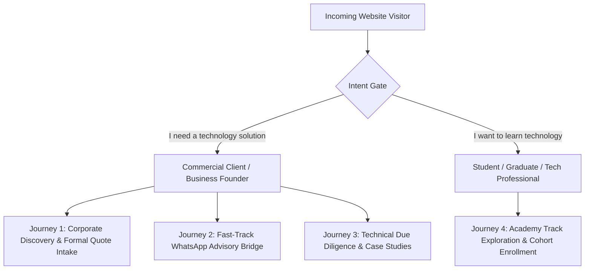

# Frontend Design System and User Interface Specification
**Project:** 3A Technology Solutions Corporate Web Platform & 3A Techvolution Academy  
**Role:** Senior Product Designer and Frontend Architect  
**Status:** Authoritative Design Specification  
**Version:** 1.0  
**Date:** October 2026  
**Governing Documents:** [`PRD.md`](file:///c:/Users/DELL/Desktop/3A%20TECHNOLOGY/prd.md) (v2.0), [`AGENTS.md`](file:///c:/Users/DELL/Desktop/3A%20TECHNOLOGY/AGENTS.md), [`docs/architecture.md`](file:///c:/Users/DELL/Desktop/3A%20TECHNOLOGY/docs/architecture.md), [`docs/architecture-essential.md`](file:///c:/Users/DELL/Desktop/3A%20TECHNOLOGY/docs/architecture-essential.md), [`docs/specification-audit.md`](file:///c:/Users/DELL/Desktop/3A%20TECHNOLOGY/docs/specification-audit.md), [`3A_Technology_Solutions_Brand_Identity_Standards.pdf`](file:///c:/Users/DELL/Desktop/3A%20TECHNOLOGY/3A_Technology_Solutions_Brand_Identity_Standards.pdf)  

---

## 1. Executive Summary & Design Philosophy

This document defines the comprehensive product design, information architecture, visual design system tokens, responsive screen layouts, and component states for the **3A Technology Solutions** web platform and its educational arm, **3A TECHVOLUTION ACADEMY**.

### 1.1 Core Aesthetic: "Premium Minimalism"
The visual identity strictly adheres to the official *3A Brand Identity Standards v1.0*:
- **Smart, Simple, Professional, Human, Future-Ready:** The design must position 3A as a credible, modern technology solutions provider making technology useful, understandable, and commercially valuable.
- **Restrained & Corporate:** No neon cyberpunk aesthetics, no excessive gradients, no unpurposeful 3D decoration, and no distracting animations.
- **Spacious & High-Contrast:** Generous whitespace, disciplined typography hierarchy, clean 1px borders, subtle data/grid motifs, and authentic Nigerian/African business and engineering context.

---

## 2. User Groups, Personas & User Journeys

The platform serves two distinct primary audiences without allowing either to dilute the other:



### 2.1 Persona Specifications
1. **Commercial Client (Ibrahim - SME Managing Director):**
   - *Goal:* Needs a reliable software partner to digitize company operations, automate records, and build a modern web portal.
   - *Behavior:* Scans for credibility, verified Nigerian/African case studies, clear technical capabilities, and direct quote scoping.
   - *Primary Route:* `/` $\rightarrow$ `/services/custom-software` $\rightarrow$ `/request-quote` (or instant WhatsApp chat).
2. **Prospective Learner (Amina - Recent Engineering Graduate / NYSC Corps Member):**
   - *Goal:* Wants practical, industry-aligned training in Artificial Intelligence and Data Science.
   - *Behavior:* Looks for curriculum outlines, duration, skill levels, delivery format (weekend/in-person), and external enrollment steps.
   - *Primary Route:* `/` $\rightarrow$ `/academy` $\rightarrow$ `/academy/programmes` $\rightarrow$ External Application Form.
3. **Enterprise CTO / Technical Evaluator (Kelechi - Corporate Tech Lead):**
   - *Goal:* Validates 3A's engineering competence and architecture rigor before issuing an RFP.
   - *Behavior:* Inspects project case studies, tech stack badges, architectural diagrams, and open-source contributions.
   - *Primary Route:* `/` $\rightarrow$ `/projects` $\rightarrow$ `/projects/marketmind-ai`.

---

## 3. Information Architecture & Sitemap Tree

The information architecture enforces a maximum depth of 2 levels from the root, guaranteeing that any service, project, or academy track is accessible within 2 clicks:

```text
/ (Homepage - Dual Pathway Hero)
├── services/
│   ├── index (Services Catalog - 5 Core Categories)
│   └── [slug]/ (Category Detail: web-development, custom-software, ai-automation, data-science-analytics, brand-digital-media)
├── projects/
│   ├── index (Portfolio Directory with Interactive Filter Bar)
│   └── [slug]/ (Project Case Study: marketmind-ai, deforestation-analysis, etc.)
├── academy/
│   ├── index (3A Techvolution Academy Landing & Educational Ethos)
│   └── programmes/ (Confirmed Course Catalog & Curriculum Outlines)
├── about/ (Company Mission, Principles, Team & Dual-Brand Model)
├── contact/ (Direct Contact Channels & General Enquiry Form)
├── request-quote/ (Structured Commercial Project Scoping Intake)
├── privacy/ (NDPA 2023 / NDPR Compliant Privacy Policy)
├── terms/ (Terms of Service)
├── not-found (Branded 404 Recovery Screen)
└── error (Branded 500 Runtime Recovery Screen)
```

### 3.1 Content Relationship & Internal Linking Architecture
```text
[Service Detail Page: /services/ai-automation]
       │
       ├── Links to Related Case Study ──> [/projects/marketmind-ai]
       │
       └── Pre-populates Scoping Form  ──> [/request-quote?service=ai-automation]
```

---

## 4. Design System & Token Specifications

### 4.1 Authoritative Color Palette
The color tokens are locked to the official brand standards with mandatory WCAG 2.1 AA accessibility rules resolving Finding `AUD-01`:

| Token Name | Hex Code | RGB | Intended Application | Mandatory Contrast Rules (WCAG 2.1 AA) |
| :--- | :--- | :--- | :--- | :--- |
| **`brand-navy`** | `#0B2B6B` | `rgb(11, 43, 107)` | Anchor Color: Headings, primary buttons, hero text, dark surface backgrounds. | Minimum 8.5:1 contrast against White canvas. |
| **`brand-yellow`** | `#F7C800` | `rgb(247, 200, 0)` | Accent Only: High-visibility CTAs, key number highlights, dividers, focal badges. | **Rule 1:** Buttons must strictly use `text-brand-charcoal` (8.1:1 contrast). **White text on yellow is forbidden.**<br>**Rule 2:** Yellow text/icons must **never** sit on White (`#FFFFFF`) or Light Gray (`#F4F6F8`). |
| **`brand-charcoal`**| `#1F2937` | `rgb(31, 41, 55)` | Primary Body Text, dark cards, footer background. | 11.2:1 contrast against White canvas. |
| **`brand-light`** | `#F4F6F8` | `rgb(244, 246, 248)` | Section backdrops, card fills, input field fills. | Provides subtle visual grouping without harsh borders. |
| **`brand-white`** | `#FFFFFF` | `rgb(255, 255, 255)` | Pure canvas, card surfaces, high-contrast breathing room. | Canvas base. |
| **`brand-border`**| `#E5E7EB` | `rgb(229, 231, 235)` | Structural 1px card outlines and divider rules. | Subtle separation. |

### 4.2 Typography Hierarchy
The typography stack combines modern geometric confidence for headlines with neutral legibility for body copy:
- **Display & Headings:** `Plus Jakarta Sans`, sans-serif (Weights: 600 SemiBold, 700 Bold, 800 ExtraBold).
- **Body & UI Components:** `Inter`, sans-serif (Weights: 400 Regular, 500 Medium, 600 SemiBold).

| Role | Font Family | Size (Desktop / Mobile) | Weight | Line Height | Tracking |
| :--- | :--- | :--- | :--- | :--- | :--- |
| **Display Hero (H1)** | `Plus Jakarta Sans` | `56px / 36px` | 800 | `1.1` | `-0.02em` |
| **Section Title (H2)**| `Plus Jakarta Sans` | `36px / 28px` | 700 | `1.2` | `-0.015em`|
| **Card Header (H3)**  | `Plus Jakarta Sans` | `24px / 20px` | 600 | `1.3` | `-0.01em` |
| **Subhead / Lead**    | `Inter` | `20px / 18px` | 400 | `1.6` | `normal`  |
| **Body Standard**     | `Inter` | `16px / 15px` | 400 | `1.65`| `normal`  |
| **UI Small / Meta**   | `Inter` | `14px / 13px` | 500 | `1.5` | `+0.01em` |
| **Badge / Micro**     | `Inter` | `12px / 11px` | 600 | `1.4` | `+0.03em` |

### 4.3 Spacing Scale & Layout Grid
- **Container Max-Width:** `1280px` (`max-w-7xl mx-auto px-4 sm:px-6 lg:px-8`).
- **Vertical Section Padding:** Desktop: `py-20` (80px); Mobile: `py-12` (48px).
- **Card Padding:** Standard: `p-6` (24px); Compact: `p-4` (16px); Hero Card: `p-8` (32px).
- **Responsive Breakpoints:**
  - `sm`: `640px` (Tablets / large phones)
  - `md`: `768px` (iPad / vertical tablets)
  - `lg`: `1024px` (Laptops / primary desktop navigation cutoff)
  - `xl`: `1280px` (Standard desktop monitors)

### 4.4 Component Primitives & States

```text
[PRIMARY BUTTON] 
  bg-brand-navy text-white hover:bg-[#071C49] active:scale-[0.98]
  Focus: ring-2 ring-brand-navy ring-offset-2
  Disabled: opacity-50 cursor-not-allowed

[ACCENT YELLOW BUTTON] 
  bg-brand-yellow text-brand-charcoal hover:bg-[#E0B500] font-semibold active:scale-[0.98]
  Focus: ring-2 ring-brand-charcoal ring-offset-2
  Disabled: opacity-50 cursor-not-allowed

[CARD CONTAINER]
  bg-white border border-brand-border rounded-xl p-6 shadow-sm hover:shadow-md transition-shadow
  Header: font-display text-brand-navy font-bold

[STATUS BADGE]
  Live Production: bg-emerald-50 text-emerald-700 border border-emerald-200
  Client Project:  bg-blue-50 text-brand-navy border border-blue-200
  Prototype / R&D: bg-amber-50 text-amber-800 border border-amber-200
```

---

## 5. Screen Specifications & Text Wireframes

### Screen 1: Global Navigation & Mobile Drawer
- **Purpose:** Consistent, accessible site navigation across all viewports (`FR-01`).
- **Desktop Wireframe (Viewport $\ge$ 1024px):**
  ```text
  +----------------------------------------------------------------------------------------------------+
  | [3A Logo Emblem + Wordmark]    Services v    Projects    Academy    About    Contact   [Request a Quote] |
  +----------------------------------------------------------------------------------------------------+
  ```
- **Mobile Wireframe (Viewport < 1024px):**
  ```text
  +----------------------------------------------------------------------------------------------------+
  | [3A Logo Emblem + Wordmark]                                                      [Hamburger Menu =] |
  +----------------------------------------------------------------------------------------------------+
  | MOBILE DRAWER (EXPANDED - Radix UI Focus Trap):                                                    |
  |  [X Close]                                                                                         |
  |  - Home                                                                                            |
  |  - Services (Accordion: Web, Software, AI, Data Science, Branding)                                 |
  |  - Projects & Case Studies                                                                         |
  |  - 3A Techvolution Academy                                                                         |
  |  - About 3A                                                                                        |
  |  - Contact Us                                                                                      |
  |  -----------------------------------------------------------------                                 |
  |  [CTA Button: Request a Quote]                                                                     |
  |  [WhatsApp Direct Advisory Link]                                                                   |
  +----------------------------------------------------------------------------------------------------+
  ```

---

### Screen 2: Homepage (`/`)
- **Purpose:** Primary digital flagship; immediately resolves visitor intent into Commercial vs. Academy pathways (`FR-01`, `FR-02`, `FR-04`).
- **Wireframe Structure:**
  ```text
  [HERO SECTION]
    Tagline: IDEAS • TECHNOLOGY • IMPACT
    H1: Technology That Works for People and Business.
    Lead: We engineer custom websites, enterprise software, AI integrations, and practical digital 
          solutions for growing businesses, while training the next generation of tech leaders.
    
    +----------------------------------------+   +----------------------------------------+
    | [PATHWAY A: COMMERCIAL CLIENTS]        |   | [PATHWAY B: TECHVOLUTION ACADEMY]      |
    | "I need a technology solution"         |   | "I want to learn technology"           |
    | [Explore Services] [Request a Quote]   |   | [Explore Academy Courses ->]           |
    +----------------------------------------+   +----------------------------------------+

  [TRUST & CAPABILITY BANNER]
    "Practical Engineering. Verified Outcomes. Nigerian Context."
    Stats: 5 Core Specializations | Enterprise Software | AI & Automation | Mentorship

  [CORE COMMERCIAL SERVICES (5 Cards Grid)]
    - Web & Digital Products | Custom Software | AI & Automation | Data Science | Branding
    [View All Services ->]

  [FEATURED CASE STUDIES (3 Columns)]
    - Card 1: MarketMind AI (AI & Automation) [Live Production]
    - Card 2: Deforestation Analysis (Data Science) [Research Prototype]
    - Card 3: Medicinal Plant Recognition (Computer Vision) [Deployed Prototype]
    [Explore All Case Studies ->]

  [OPERATING METHODOLOGY: "How 3A Works"]
    Step 1: Problem Definition -> Step 2: Pragmatic Engineering -> Step 3: Verified Impact

  [3A TECHVOLUTION ACADEMY HIGHLIGHT]
    Deep Navy Banner: "Practical, Hands-on Technology Education."
    [View Academy Programmes ->]

  [CONVERSION FOOTER BANNER]
    H2: Ready to build something that moves your business forward?
    [Request a Quote Today] [Chat with us on WhatsApp]
  ```

---

### Screen 3: Commercial Project Quote Scoping Screen (`/request-quote`)
- **Purpose:** Structured project intake form capturing commercial requirements without requiring user accounts (`FR-06`).
- **Wireframe & State Machine:**
  ```text
  +----------------------------------------------------------------------------------------------------+
  | H1: Request a Project Quote                                                                        |
  | Subhead: Tell us about your project goals, timeline, and budget. We will provide a formal proposal.|
  +----------------------------------------------------------------------------------------------------+
  | FORM CONTAINER (Max-w-2xl mx-auto):                                                                |
  |                                                                                                    |
  |  Full Name *                       Company / Organization (Optional)                               |
  |  [ Ibrahim Adeyemi               ] [ Adeyemi Logistics Ltd         ]                               |
  |                                                                                                    |
  |  Business Email *                  Phone / WhatsApp Number *                                       |
  |  [ ibrahim@adeyemi.ng            ] [ +234 801 234 5678             ]                               |
  |                                                                                                    |
  |  Primary Service Needed *                                                                          |
  |  [ Artificial Intelligence & Automation                       v ] (Supports ?service=... prefill)  |
  |                                                                                                    |
  |  Estimated Budget Range *          Desired Timeline *                                              |
  |  [ ₦3,000,000 – ₦7,500,000    v ]  [ 1 – 3 months                v ]                               |
  |                                                                                                    |
  |  Project Scope & Objectives * (Min 20 characters)                                                  |
  |  [ We require an automated computer vision document pipeline to extract data from bills of lading. ]|
  |                                                                                                    |
  |  [HIDDEN HONEYPOT: hp_field] (Zero display, tabindex -1)                                           |
  |                                                                                                    |
  |  [Submit Quote Request Button] (Disabled during submit with spinner)                               |
  +----------------------------------------------------------------------------------------------------+
  ```
- **State Specifications:**
  - **Default:** Clean input borders (`border-brand-border`), placeholders visible, submit button active.
  - **Validation Error:** Border changes to `border-red-500`; inline text `text-red-600 text-sm` appears below field with `aria-live="polite"`.
  - **Submitting (Loading):** Button displays SVG spinner, text changes to `"Submitting Quote..."`, all inputs disabled.
  - **Success State Card:** Form fields replaced by a centered card:
    ```text
    +--------------------------------------------------------------------+
    | [Green Checkmark Circle Icon]                                      |
    | H3: Quote Request Received!                                        |
    | Text: Thank you, Ibrahim. Our engineering lead will review your     |
    |       scoping brief and reply within 24 business hours.            |
    | [Button: Submit Another Request] [Button: Return to Home]          |
    +--------------------------------------------------------------------+
    ```
  - **Network / API Timeout Error:** Red alert banner at top of form: `"Our automated email dispatch experienced a temporary delay. Your information has been saved below—please click below to send your brief directly via WhatsApp."` **Form fields remain populated (`ARCH-10`).**

---

### Screen 4: Portfolio Directory & Case Study Views (`/projects` & `[slug]`)
- **Purpose:** Showcase technical rigor and transparency regarding project status (`FR-03`).
- **Interactive Elements:**
  - **Filter Bar:** Filter pills matching service taxonomy: `All Projects`, `Web Development`, `Custom Software`, `AI & Automation`, `Data Science & Analytics`, `Branding & Media`.
  - **Card Content:** Project Thumbnail (WebP), Status Badge, Project Title, One-line summary, Tech badges (`Next.js`, `PyTorch`, `FastAPI`), and CTA `"Read Case Study ->"`.
  - **Empty State Component (`AUD-10` Resolution):**
    ```text
    +--------------------------------------------------------------------+
    | [Folder / Search Icon]                                             |
    | H4: No matching projects found in this category.                   |
    | Text: We are continually adding verified case studies.             |
    | [Button: Reset Filter to All Projects]                             |
    +--------------------------------------------------------------------+
    ```

---

### Screen 5: 3A Techvolution Academy Landing & Catalog (`/academy`)
- **Purpose:** Educational brand flagship; details training tracks and cohort schedules (`FR-04`).
- **Wireframe Structure:**
  ```text
  [ACADEMY HERO]
    Tagline: 3A TECHVOLUTION ACADEMY
    H1: Practical Technology Skills Built for the Real World.
    Lead: Intensive, project-driven training in Programming, AI Engineering, and Data Science.
    CTAs: [Explore Cohort Programmes] [Chat with Academy Advisor on WhatsApp]

  [CURRICULUM TRACKS (Grid of Course Cards)]
    +------------------------------------------------------------------+
    | Track Name: Applied Artificial Intelligence & Machine Learning   |
    | Badge: Intermediate | Format: Weekend Cohort | Duration: 10 Weeks|
    | Overview: Learn to fine-tune LLMs, build RAG pipelines, and API.  |
    | Key Modules: Python for AI, Embeddings, PyTorch, Model Deployment|
    | Fee: Inquire for Schedule & Pricing                              |
    | [Primary CTA: Apply for Cohort ->] (Opens Google Form in new tab)|
    | [Secondary CTA: Inquire on WhatsApp]                             |
    +------------------------------------------------------------------+
  ```

---

## 6. Accessibility & Usability Standards (WCAG 2.1 AA)

1. **Strict Keyboard Operability:**
   - All interactive controls (buttons, links, form inputs, accordion triggers) are reachable and operable via keyboard (`Tab`, `Shift+Tab`, `Enter`, `Space`).
   - The mobile navigation drawer traps focus when opened, preventing tab navigation behind the modal overlay. Pressing `Escape` closes the drawer immediately.
2. **Visible Focus Rings:**
   - All interactive elements declare high-contrast focus rings: `focus-visible:ring-2 focus-visible:ring-brand-navy focus-visible:ring-offset-2`.
3. **Contrast Verification:**
   - Primary Navy (`#0B2B6B`) on White canvas: **8.5:1** (Passes AAA).
   - Dark Charcoal (`#1F2937`) on White canvas: **11.2:1** (Passes AAA).
   - Accent Yellow (`#F7C800`) button with Dark Charcoal text: **8.1:1** (Passes AAA).
4. **Assistive Technology & Screen Readers:**
   - Skip link implemented: `<a href="#main-content" className="sr-only focus:not-sr-only">Skip to content</a>`.
   - Decorative icons carry `aria-hidden="true"`.
   - Dynamic form validation errors are linked to inputs via `aria-describedby="field-error-id"` and flagged with `aria-invalid="true"`.

---

## 7. Visual Artifacts Requiring Dedicated Production Design

The following assets must be finalized prior to production build verification:

| Artifact ID | Asset Name & Format | Required Dimensions / Specs | Current Status & Action Required |
| :--- | :--- | :--- | :--- |
| **ART-01** | **Official 3A Vector Logo Suite** (`.svg`) | Scalable vector graphic; transparent background; emblem & wordmark versions. | **Action Required (`AUD-02`):** Stakeholder must supply `.svg` vectors or approve vectorization from `ending_slide.png`. |
| **ART-02** | **Default Open Graph Social Share Image** (`.jpg`/`.webp`) | `1200 x 630 px` (Aspect Ratio 1.91:1, `< 250 KB`). Deep Navy canvas with emblem, wordmark, and tagline. | Needs production design. |
| **ART-03** | **Favicon & Web App Icon Package** | `favicon.ico`, `icon-192.png`, `icon-512.png`, `apple-touch-icon.png`. | Needs export from vector logo. |
| **ART-04** | **Verified Case Study Screenshots** (`.webp`) | `800 x 450 px` (16:9 aspect ratio) optimized WebP mockups for MarketMind AI, Deforestation, etc. | Stakeholder approval needed for public case study visual assets (`AUD-09`). |

---

## 8. Requirements Traceability Matrix

| Requirement ID | UI Component / Design Element | Section in Design Spec |
| :--- | :--- | :--- |
| **FR-01** | Global Navigation & Radix Mobile Drawer | Section 5 (Screen 1) |
| **FR-02** | Services Overview & Dynamic Category Slugs | Section 5 (Screen 2 & Screen 3) |
| **FR-03** | Portfolio Grid, Status Badges, & Empty Filter State | Section 5 (Screen 4) |
| **FR-04** | Academy Landing, Track Cards, & External Intake CTA | Section 5 (Screen 5) |
| **FR-05** | General Contact Form with Accessible Inline Alerts | Section 5 (Screen 3) |
| **FR-06** | Commercial Quote Scoping Intake & Query Param Prefill | Section 5 (Screen 3) |
| **FR-07** | WhatsApp Click-to-Chat Deep Links & Config | Section 5 (Screen 1 & 2) |
| **FR-08** | Statically Typed Content Presentation Primitives | Section 4 (Component Primitives) |
| **FR-09** | Technical SEO, Open Graph Card Template & Alt Tags | Section 7 (Visual Artifacts ART-02) |
| **FR-10** | Branded 404 Recovery (`not-found.tsx`) & 500 Boundary | Section 3 (Information Architecture) |
| **FR-11** | Zero Advertising Tracking Modals; Privacy Layout | Section 3 & Section 6 |
