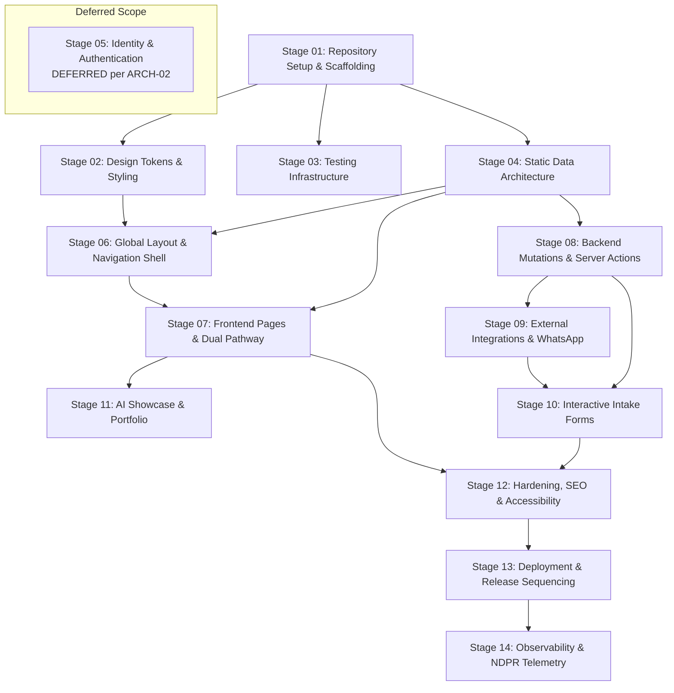

# Master Implementation Plan & Engineering Delivery Roadmap
**Project:** 3A Technology Solutions Corporate Web Platform & 3A Techvolution Academy  
**Role:** Technical Project Manager and Senior Software Architect  
**Status:** Authoritative Implementation Roadmap Baseline  
**Version:** 1.0  
**Date:** November 2026  
**Governing Documents:** [`PRD.md`](file:///c:/Users/DELL/Desktop/3A%20TECHNOLOGY/prd.md) (v2.0), [`AGENTS.md`](file:///c:/Users/DELL/Desktop/3A%20TECHNOLOGY/docs/AGENTS.md), [`docs/architecture.md`](file:///c:/Users/DELL/Desktop/3A%20TECHNOLOGY/docs/architecture.md), [`docs/architecture-essential.md`](file:///c:/Users/DELL/Desktop/3A%20TECHNOLOGY/docs/architecture-essential.md), [`docs/tasks.md`](file:///c:/Users/DELL/Desktop/3A%20TECHNOLOGY/docs/tasks.md), [`docs/definition-of-done.md`](file:///c:/Users/DELL/Desktop/3A%20TECHNOLOGY/docs/definition-of-done.md), [`docs/testing-strategy.md`](file:///c:/Users/DELL/Desktop/3A%20TECHNOLOGY/docs/testing-strategy.md), [`docs/design.md`](file:///c:/Users/DELL/Desktop/3A%20TECHNOLOGY/docs/design.md), [`docs/api-specification.md`](file:///c:/Users/DELL/Desktop/3A%20TECHNOLOGY/docs/api-specification.md), [`docs/security-specification.md`](file:///c:/Users/DELL/Desktop/3A%20TECHNOLOGY/docs/security-specification.md), [`docs/specification-audit.md`](file:///c:/Users/DELL/Desktop/3A%20TECHNOLOGY/docs/specification-audit.md), [`docs/research-and-decisions.md`](file:///c:/Users/DELL/Desktop/3A%20TECHNOLOGY/docs/research-and-decisions.md)

---

## 1. Executive Summary & Delivery Strategy

This document establishes the end-to-end technical implementation plan for engineering, verifying, hardening, and deploying the official corporate web platform for **3A Technology Solutions** and its educational division, **3A TECHVOLUTION ACADEMY**.

### 1.1 Core Engineering Principles
1. **Incremental Testable Deliverables:** Rather than assembling an unverified monolithic system, development is partitioned into discrete, independently verifiable stages. Each increment must compile with zero errors, pass linting, and satisfy its assigned test suite before subsequent work begins.
2. **Early De-Risking via Technical Spikes:** High-risk assumptions (e.g., WCAG 2.1 AA color contrast compliance with Accent Yellow, serverless cold-start email delivery, and keyboard focus trapping in mobile navigation drawers) are validated via targeted technical spikes prior to dependent feature implementation.
3. **Strict Invariant Guardrails (`ARCH-01` to `ARCH-15`):** Phase 1 release scope strictly prohibits runtime databases (`ARCH-01`), in-house LMS or student authentication accounts (`ARCH-02`), payment gateways (`ARCH-03`), and autonomous frontend conversational chatbots (`ARCH-13`).
4. **Evidence Before Assertions (`AGENTS.md` §5.1):** Work is never declared complete based on assumption. Progression through milestones requires inspectable terminal execution logs confirming clean exit codes (`0`).

---

## 2. Technical Spikes & High-Risk De-Risking Strategy

To prevent downstream architectural rework and blockers, the following 5 technical spikes are scheduled prior to or in tandem with early foundational stages:

| Spike ID | Subject & Assumption Tested | High-Risk Factor | Spike Implementation & Verification Method | Governing ADR / Finding |
| :--- | :--- | :--- | :--- | :--- |
| **SPK-01** | **Next.js In-Place Initialization** | Initializing Next.js in a root folder that already contains `/docs`, `prd.md`, and PDF assets without overwriting existing files. | Execute dry-run directory isolation; verify that non-colliding `package.json`, `tsconfig.json`, and `src/` are generated while preserving all root assets. | `ADR-001` |
| **SPK-02** | **Accent Yellow WCAG 2.1 AA Contrast Compliance** | Brand Accent Yellow (`#F7C800`) fails WCAG AA against white backgrounds (1.35:1). | Implement custom Tailwind utility classes locking `#F7C800` buttons to `#1F2937` (Dark Charcoal) text; write automated Vitest test asserting contrast $\ge 8:1$ and rejecting white text on yellow. | `AUD-01`, `ARCH-05` |
| **SPK-03** | **Serverless Transactional Email Latency & Cold Starts** | Serverless execution environments can timeout during direct SMTP handshakes. | Prototype dual-driver dispatcher (`src/lib/email/`); benchmark Resend HTTP API dispatch (< 400ms) versus Nodemailer SMTP fallback; verify graceful error handling when offline. | `ADR-005`, `DEC-01` |
| **SPK-04** | **Radix Dialog Mobile Focus Trapping on Mobile Viewports** | Mobile drawers frequently leak focus or cause background scroll bleed on iOS Safari / WebKit. | Construct minimal prototype of `MobileDrawer.tsx` utilizing `@radix-ui/react-dialog`; execute Playwright keyboard Tab-cycle audit asserting focus remains strictly trapped. | `ADR-002`, `FR-01` |
| **SPK-05** | **Client SearchParams Pre-selection without SSR Deopt** | Accessing `useSearchParams()` in Next.js 14+ without `<Suspense>` causes full-page client de-optimization. | Wrap `QuoteForm.tsx` in a `<Suspense>` boundary; verify with `npm run build` that `/request-quote` is statically generated with dynamic search param hydration. | `FR-06`, `AC-06.2` |

---

## 3. Implementation Stages Breakdown

The implementation roadmap is structured across 14 systematic stages. In accordance with delivery governance, non-applicable or explicitly deferred capabilities (such as runtime authentication and databases) are explicitly evaluated and bounded.



---

### Stage 01: Repository Setup & Tooling Infrastructure
- **Stage ID:** `STAGE-01`
- **Objective:** Establish the compilable Next.js 14+ App Router project foundation with strict TypeScript enforcement, directory aliases, and pristine compiler configurations.
- **Scope:**
  - Execute Spike `SPK-01`: Initialize Next.js in repository root without disturbing `/docs` or brand files.
  - Configure `tsconfig.json` with strict mode (`noImplicitAny`, `strictNullChecks`, `noUnusedLocals`).
  - Configure path alias `@/*` mapping to `./src/*`.
  - Establish base directory tree: `src/app/`, `src/components/`, `src/lib/`, `src/data/`, `src/config/`, `src/types/`.
- **Prerequisites:** Node.js v20+ LTS runtime, npm.
- **Outputs / Deliverables:**
  - `package.json`
  - `tsconfig.json`
  - `next.config.mjs`
  - `.eslintrc.json`
  - `src/app/layout.tsx` (minimal shell)
  - `src/app/page.tsx` (minimal shell)
- **Dependencies:** None (Initiating Stage).
- **Requirement IDs:** `PRD.md` §4.1, §9.1; `AGENTS.md` §3.3; `ARCH-14`; `TASK-001`.
- **Validation & Verification Commands:**
  ```powershell
  npx tsc --noEmit
  npm run lint
  npm run build
  ```
- **Risks & Mitigation:** Overwriting existing documentation files during scaffolding. *Mitigation:* Explicitly verify target paths before initial scaffolding; review git status.
- **Exit Criteria:** `tsc --noEmit`, `npm run lint`, and `npm run build` all exit with code `0`.

---

### Stage 02: Design Tokens, Typography & Brand Styling Infrastructure
- **Stage ID:** `STAGE-02`
- **Objective:** Translate authoritative brand standards into build-time design tokens, self-hosted typography, and contrast-safe Tailwind CSS utilities.
- **Scope:**
  - Execute Spike `SPK-02`: Codify locked 5-color palette: Primary Navy (`#0B2B6B`), Accent Yellow (`#F7C800`), Dark Charcoal (`#1F2937`), Light Gray (`#F4F6F8`), and Pure White (`#FFFFFF`).
  - Enforce WCAG 2.1 AA contrast safety: Yellow elements strictly paired with Charcoal/Navy text; white text on yellow is forbidden (`AUD-01`, `ARCH-05`).
  - Configure typography tokens using `next/font/google` for Plus Jakarta Sans and Inter.
  - Implement reusable UI primitives: `Button.tsx`, `Card.tsx`, `Badge.tsx`.
  - Ingest transparent brand mark assets (`TASK-004`, `AUD-02`, `DEC-04`).
- **Prerequisites:** `STAGE-01`.
- **Outputs / Deliverables:**
  - `tailwind.config.ts`
  - `src/app/globals.css`
  - `src/lib/utils.ts` (`cn` helper)
  - `src/components/ui/Button.tsx`
  - `src/components/ui/Card.tsx`
  - `src/components/ui/Badge.tsx`
  - Brand image assets in `public/images/brand/`
- **Dependencies:** `STAGE-01`.
- **Requirement IDs:** `PRD.md` §8.1, §8.2, §8.3; `ARCH-05`; `AUD-01`; `TASK-002`, `TASK-004`.
- **Validation & Verification Commands:**
  ```powershell
  npm run build
  npm run test:unit tests/unit/tokens.test.ts
  ```
- **Risks & Mitigation:** Stakeholder delay in providing standalone SVG vectors (`DEC-04`). *Mitigation:* Deploy high-fidelity provisional vector emblem generated from authoritative slide reference while awaiting client vector asset.
- **Exit Criteria:** Design tokens compile into Tailwind styles; button contrast satisfies WCAG AA ($\ge 4.5:1$); zero layout shift from web fonts.

---

### Stage 03: Automated Quality & Testing Framework Infrastructure
- **Stage ID:** `STAGE-03`
- **Objective:** Install and configure the multi-tiered automated test suite architecture (Vitest, React Testing Library, and Playwright).
- **Scope:**
  - Configure Vitest with JSDOM and `@testing-library/react` for isolated unit and component tests.
  - Configure Playwright with Chromium and WebKit viewport profiles for multi-browser E2E testing.
  - Configure `@axe-core/playwright` for automated WCAG accessibility audits.
  - Add npm scripts: `test:unit`, `test:e2e`, `test:a11y`, `typecheck`.
- **Prerequisites:** `STAGE-01`.
- **Outputs / Deliverables:**
  - `vitest.config.ts`
  - `playwright.config.ts`
  - `tests/setup.ts`
  - Baseline smoke tests (`tests/unit/smoke.test.ts`, `tests/e2e/smoke.spec.ts`)
- **Dependencies:** `STAGE-01`.
- **Requirement IDs:** `AGENTS.md` §5; `PRD.md` §12; `docs/definition-of-done.md` §3, §4; `TASK-003`; `ADR-007`.
- **Validation & Verification Commands:**
  ```powershell
  npm run test:unit
  npx playwright test tests/e2e/smoke.spec.ts
  ```
- **Risks & Mitigation:** Playwright browser binary download failures in Windows environments. *Mitigation:* Execute `npx playwright install --with-deps chromium`.
- **Exit Criteria:** Test runners execute cleanly, reporting 100% passing baseline assertions.

---

### Stage 04: Static Data Architecture & Domain Model
- **Stage ID:** `STAGE-04`
- **Objective:** Implement strongly typed TypeScript data models and validation schemas for services, case studies, academy tracks, and intake forms.
- **Scope:**
  - Centralized site configuration: `src/config/site.ts` (`ARCH-06`).
  - Domain TypeScript interfaces: `Service`, `Project`, `AcademyProgramme` (`src/types/content.ts`).
  - Static datastores: `src/data/services.ts` (5 confirmed categories), `src/data/projects.ts` (5 initial case studies with status badges), `src/data/programmes.ts` (`ARCH-01`, `AUD-04`).
  - In-memory query abstraction: `src/lib/content.ts` (`ARCH-07`).
  - Zod validation schemas: `ContactEnquirySchema`, `QuoteRequestSchema` with honeypot fields (`AUD-03`).
- **Prerequisites:** `STAGE-01`.
- **Outputs / Deliverables:**
  - `src/config/site.ts`
  - `src/types/content.ts`
  - `src/types/forms.ts`
  - `src/data/services.ts`, `projects.ts`, `programmes.ts`
  - `src/lib/content.ts`
  - `src/lib/validations/enquiry.ts`, `quote.ts`
  - Unit tests in `tests/unit/`
- **Dependencies:** `STAGE-01`.
- **Requirement IDs:** `PRD.md` §5, §7 (FR-07, FR-08); `ARCH-01`, `ARCH-06`, `ARCH-07`; `AUD-03`, `AUD-04`; `TASK-005`, `TASK-006`, `TASK-007`, `TASK-008`.
- **Validation & Verification Commands:**
  ```powershell
  npx tsc --noEmit
  npm run test:unit tests/unit/content-data.test.ts tests/unit/validations.test.ts
  ```
- **Risks & Mitigation:** Taxonomy drift between service slugs and project filter tags (`AUD-04`). *Mitigation:* Strict TypeScript union types enforcing identical category keys.
- **Exit Criteria:** All domain objects type-check cleanly; static query functions return expected data; Zod schemas validate correctly.

---

### Stage 05: Identity, Authentication & User Accounts (Explicit Invariant Assessment)
- **Stage ID:** `STAGE-05`
- **Objective:** Verify and maintain the non-negotiable architectural invariant excluding user accounts, LMS databases, and auth libraries.
- **Scope:**
  - **Explicit Scope Boundary:** This stage strictly enforces **EXCLUSION**. No user accounts, student portals, login sessions, JWT tokens, or authentication databases (`next-auth`, `@supabase/auth-helpers`, `clerk`) are permitted in Phase 1 (`ARCH-02`).
  - Automated dependency audit scanning `package.json` to ensure zero authentication packages exist.
  - Review all external CTA buttons on academy and commercial pages to ensure routing targets external endpoints.
- **Prerequisites:** `STAGE-01`.
- **Outputs / Deliverables:**
  - CI architectural boundary check script (`tests/unit/invariants.test.ts`).
- **Dependencies:** `STAGE-01`.
- **Requirement IDs:** `PRD.md` §4.2; `AGENTS.md` §1.2; `ARCH-02`.
- **Validation & Verification Commands:**
  ```powershell
  npm run test:unit tests/unit/invariants.test.ts
  ```
- **Risks & Mitigation:** Accidental inclusion of auth boilerplate from Next.js starters. *Mitigation:* Automated test asserts rejection of auth packages.
- **Exit Criteria:** Zero auth dependencies present; 100% invariant compliance verified.

---

### Stage 06: Global Layout & Accessible Navigation Shell
- **Stage ID:** `STAGE-06`
- **Objective:** Assemble the global layout shell, desktop header with dropdowns, accessible mobile drawer with focus trapping, and 4-column footer.
- **Scope:**
  - Execute Spike `SPK-04`: Mobile navigation drawer with `@radix-ui/react-dialog` focus trapping and `Escape` key dismissal.
  - Desktop navigation bar with active route indicators, services dropdown, and dual CTAs (`/academy`, `/request-quote`).
  - 4-column corporate footer with NDPR notice, brand emblem, and centralized contact channels (`TASK-011`).
  - Root layout (`src/app/layout.tsx`) injecting self-hosted fonts, skip-to-content accessibility link, and JSON-LD `Organization` schema.
- **Prerequisites:** `STAGE-02`, `STAGE-04`.
- **Outputs / Deliverables:**
  - `src/components/navigation/Header.tsx`, `Navbar.tsx`, `NavDropdown.tsx`
  - `src/components/navigation/MobileDrawer.tsx`
  - `src/components/navigation/Footer.tsx`
  - `src/components/seo/OrganizationSchema.tsx`
  - `src/components/ui/SkipToContent.tsx`
  - `src/app/layout.tsx`
- **Dependencies:** `STAGE-02`, `STAGE-04`.
- **Requirement IDs:** `PRD.md` §6.2, §7 (FR-01, AC-01.1 to AC-01.4); `ARCH-05`; `TASK-009`, `TASK-010`, `TASK-011`, `TASK-012`.
- **Validation & Verification Commands:**
  ```powershell
  npm run build
  npm run test:unit tests/unit/header.test.tsx tests/unit/mobile-drawer.test.tsx
  ```
- **Risks & Mitigation:** Focus trapping bugs or layout jumping on mobile keyboards. *Mitigation:* Radix UI Dialog primitives handle ARIA attributes and focus restoration automatically.
- **Exit Criteria:** Mobile drawer traps Tab cycling; `Escape` key closes drawer; desktop header shows active states; zero console errors.

---

### Stage 07: Frontend Content Pages & Dual-Pathway Experience
- **Stage ID:** `STAGE-07`
- **Objective:** Implement all core marketing pages, services directory, dynamic category slugs, portfolio directory, case studies, academy tracks, company story, and legal pages.
- **Scope:**
  - Homepage (`src/app/page.tsx`) with value proposition hero, dual-pathway intent gate, services grid, featured projects, methodology, academy banner, and conversion footer (`TASK-013`).
  - Services pages: `/services` index and dynamic pre-rendered detail routes `/services/[slug]` with pre-filled quote CTA (`TASK-014`, `TASK-015`).
  - Portfolio pages: `/projects` directory with category filter bar and individual case studies `/projects/[slug]` with status badges (`TASK-016`, `TASK-017`).
  - Academy pages: `/academy` landing and `/academy/programmes` course catalog with external registration routing (`TASK-018`, `TASK-019`, `AUD-05`).
  - Company pages: `/about` articulating 3A principles and `/privacy`, `/terms` with NDPR compliance (`TASK-020`, `TASK-021`, `AUD-11`).
- **Prerequisites:** `STAGE-04`, `STAGE-06`.
- **Outputs / Deliverables:**
  - `src/app/page.tsx`
  - `src/app/services/page.tsx` & `[slug]/page.tsx`
  - `src/app/projects/page.tsx` & `[slug]/page.tsx`
  - `src/app/academy/page.tsx` & `programmes/page.tsx`
  - `src/app/about/page.tsx`
  - `src/app/privacy/page.tsx` & `terms/page.tsx`
  - Associated UI section components under `src/components/`
- **Dependencies:** `STAGE-04`, `STAGE-06`.
- **Requirement IDs:** `PRD.md` §1, §3.2, §5, §7 (FR-01, FR-02, FR-03, FR-04); `ARCH-08`; `TASK-013` through `TASK-021`.
- **Validation & Verification Commands:**
  ```powershell
  npm run build
  npx playwright test tests/e2e/home.spec.ts tests/e2e/services.spec.ts tests/e2e/projects.spec.ts
  ```
- **Risks & Mitigation:** Dynamic slugs failing during static export. *Mitigation:* `generateStaticParams()` implemented on all dynamic routes returning complete slug sets.
- **Exit Criteria:** `npm run build` statically pre-renders all pages; dual-pathway routes resolve correctly; invalid slugs trigger 404.

---

### Stage 08: Backend Mutations, Server Actions & Anti-Abuse Defenses
- **Stage ID:** `STAGE-08`
- **Objective:** Implement secure Next.js Server Actions and REST API endpoints for form mutations with defense-in-depth anti-spam protections.
- **Scope:**
  - Honeypot spam trap: `src/lib/security/honeypot.ts` inspecting `hp_field` (`ARCH-09`).
  - Input sanitizer: `src/lib/security/sanitizer.ts` stripping carriage returns (`\r`, `\n`) from email headers.
  - Rate limiter: `src/lib/security/rate-limiter.ts` using sliding-window in-memory map (max 5 submissions/hour/IP).
  - Server Actions: `submitContactEnquiry` and `submitQuoteRequest` in `src/actions/`.
  - Standard REST routes: `POST /api/contact`, `POST /api/quote`, `GET /api/health` conforming to RFC 7807 error envelopes.
- **Prerequisites:** `STAGE-04`.
- **Outputs / Deliverables:**
  - `src/lib/security/honeypot.ts`, `sanitizer.ts`, `rate-limiter.ts`
  - `src/actions/enquiry.ts`, `quote.ts`
  - `src/app/api/contact/route.ts`, `quote/route.ts`, `health/route.ts`
  - Integration tests in `tests/integration/`
- **Dependencies:** `STAGE-04`.
- **Requirement IDs:** `PRD.md` §7 (AC-05.3, AC-06.3), §9.4; `ARCH-09`, `ARCH-10`; `TASK-024`, `TASK-026`.
- **Validation & Verification Commands:**
  ```powershell
  npm run test:unit tests/unit/security-defenses.test.ts tests/integration/actions.test.ts
  ```
- **Risks & Mitigation:** In-memory rate limiting state loss across serverless cold starts. *Mitigation:* Acceptable for Phase 1 baseline; acts as high-speed filter in combination with silent honeypot drop.
- **Exit Criteria:** Server actions validate inputs against Zod schemas; honeypots silently drop bots; 6th request from same IP is rate-limited (HTTP 429).

---

### Stage 09: External Integrations & Communication Pipelines
- **Stage ID:** `STAGE-09`
- **Objective:** Implement the transactional email dispatch pipeline (Resend API + Nodemailer fallback) and the contextual WhatsApp direct communication bridge.
- **Scope:**
  - Execute Spike `SPK-03`: Implement dual-driver email dispatcher (`src/lib/email/dispatcher.ts`) selecting driver based on `EMAIL_DRIVER` (`resend` vs `smtp`).
  - Create responsive React Email template for lead notifications (`LeadNotificationEmail.tsx`).
  - Ensure zero private credential leakage: `RESEND_API_KEY` and SMTP passwords restricted to server runtime (`ARCH-04`).
  - Implement contextual WhatsApp link generator (`src/lib/whatsapp.ts`) using centralized phone constant (`TASK-027`).
- **Prerequisites:** `STAGE-04`, `STAGE-08`.
- **Outputs / Deliverables:**
  - `src/lib/email/dispatcher.ts`, `resend.ts`, `smtp.ts`
  - `src/components/email/LeadNotificationEmail.tsx`
  - `src/lib/whatsapp.ts`
  - `src/components/ui/WhatsAppButton.tsx`
  - Mock integration tests in `tests/unit/`
- **Dependencies:** `STAGE-04`, `STAGE-08`.
- **Requirement IDs:** `PRD.md` §7 (AC-05.3, AC-06.4, AC-07.1 to AC-07.3); `ARCH-04`, `ARCH-06`; `ADR-005`; `DEC-01`, `DEC-03`; `TASK-025`, `TASK-027`.
- **Validation & Verification Commands:**
  ```powershell
  npm run test:unit tests/unit/email-dispatcher.test.ts tests/unit/whatsapp.test.ts
  ```
- **Risks & Mitigation:** Unverified client email credentials (`DEC-01`). *Mitigation:* Dual-driver pattern allows immediate testing with Resend mock/sandbox or standard SMTP.
- **Exit Criteria:** Email dispatcher formats lead data cleanly; mock dispatch returns success; WhatsApp generator outputs valid encoded deep links.

---

### Stage 10: Interactive Frontend Intake Forms & Core Workflows
- **Stage ID:** `STAGE-10`
- **Objective:** Implement accessible client form components for contact enquiries and commercial project quote requests.
- **Scope:**
  - Implement `ContactForm.tsx` on `/contact` with React Hook Form, inline accessible errors, honeypot, and loading state (`TASK-022`).
  - Execute Spike `SPK-05`: Implement `QuoteForm.tsx` on `/request-quote` with budget/timeline dropdowns and search parameter pre-selection (`?service=[slug]`) wrapped in `<Suspense>` (`TASK-023`).
  - Connect client forms to Server Actions (`submitContactEnquiry`, `submitQuoteRequest`).
  - Enforce non-destructive input preservation on server failure (`ARCH-10`).
- **Prerequisites:** `STAGE-06`, `STAGE-08`, `STAGE-09`.
- **Outputs / Deliverables:**
  - `src/app/contact/page.tsx` & `src/components/forms/ContactForm.tsx`
  - `src/app/request-quote/page.tsx` & `src/components/forms/QuoteForm.tsx`
  - `src/components/forms/FormField.tsx`, `SelectField.tsx`
  - E2E tests in `tests/e2e/forms.spec.ts`
- **Dependencies:** `STAGE-06`, `STAGE-08`, `STAGE-09`.
- **Requirement IDs:** `PRD.md` §7 (FR-05, FR-06); `ARCH-10`; `AUD-03`; `TASK-022`, `TASK-023`.
- **Validation & Verification Commands:**
  ```powershell
  npm run build
  npx playwright test tests/e2e/forms.spec.ts
  ```
- **Risks & Mitigation:** Form state wipeout upon validation failure. *Mitigation:* React Hook Form retains field inputs in local component state during action roundtrips.
- **Exit Criteria:** Forms submit via Server Actions; pre-selected service query params hydrate cleanly; loading and success alerts render properly.

---

### Stage 11: Artificial Intelligence Showcase & Technical Portfolio
- **Stage ID:** `STAGE-11`
- **Objective:** Showcase verified AI and data science capabilities across project case studies while enforcing the strict invariant prohibiting frontend conversational AI bots.
- **Scope:**
  - Invariant enforcement: Confirm zero conversational chat widgets or floating web agents on frontend (`ARCH-13`).
  - Showcase real applied AI projects: *MarketMind AI* (Generative AI & market intelligence), *Deforestation Analysis* (Satellite computer vision & predictive ML), *Medicinal Plant Recognition System* (Mobile computer vision).
  - Render architectural diagrams, problem contexts, verified methodologies, and tech stack tags (`PyTorch`, `FastAPI`, `Next.js`, `OpenCV`).
- **Prerequisites:** `STAGE-04`, `STAGE-07`.
- **Outputs / Deliverables:**
  - Case study presentations in `src/data/projects.ts` and `/projects/[slug]`
  - Architecture visual assets in `public/images/projects/`
  - E2E test asserting zero embedded AI chatbot scripts (`tests/e2e/ai-boundaries.spec.ts`)
- **Dependencies:** `STAGE-04`, `STAGE-07`.
- **Requirement IDs:** `PRD.md` §7 (FR-03); `ARCH-13`; `TASK-016`, `TASK-017`.
- **Validation & Verification Commands:**
  ```powershell
  npm run test:unit tests/unit/invariants.test.ts
  npx playwright test tests/e2e/ai-boundaries.spec.ts
  ```
- **Risks & Mitigation:** Misrepresenting prototype projects as completed enterprise contracts. *Mitigation:* Prominent display of verified status badges (`Live Production`, `Deployed Prototype`, `Research & Development`) per `AC-03.2`.
- **Exit Criteria:** AI case studies present transparent technical depth; zero conversational web chatbots exist in DOM.

---

### Stage 12: Resilient Error Handling, SEO & Accessibility Hardening
- **Stage ID:** `STAGE-12`
- **Objective:** Harden application against runtime exceptions, configure automated technical SEO, and execute rigorous WCAG 2.1 AA accessibility and Core Web Vitals audits.
- **Scope:**
  - Branded recovery pages: `not-found.tsx` (404), `error.tsx` (500), and `EmptyState.tsx` (`TASK-028`).
  - Dynamic SEO generation: `src/app/sitemap.ts`, `src/app/robots.ts`, dynamic Open Graph preview images (`TASK-029`, `AUD-07`).
  - Automated accessibility audit: `@axe-core/playwright` across all pages asserting 0 violations (`TASK-031`).
  - Core Web Vitals audit: Lighthouse CLI asserting Performance $\ge 90$, Accessibility $\ge 95$, SEO $\ge 95$, LCP $< 2.2$s, CLS $< 0.05$.
- **Prerequisites:** `STAGE-07`, `STAGE-10`.
- **Outputs / Deliverables:**
  - `src/app/not-found.tsx`, `src/app/error.tsx`
  - `src/components/ui/EmptyState.tsx`
  - `src/app/sitemap.ts`, `src/app/robots.ts`
  - `public/images/brand/og-default.png`
  - `.lighthouserc.json`
  - Full audit reports
- **Dependencies:** `STAGE-07`, `STAGE-10`.
- **Requirement IDs:** `PRD.md` §2.2, §7 (FR-09, FR-10), §9.2, §9.3; `ARCH-05`, `ARCH-10`; `DOD-R3.2`; `TASK-028`, `TASK-029`, `TASK-031`.
- **Validation & Verification Commands:**
  ```powershell
  npm run build
  npx playwright test tests/e2e/accessibility.spec.ts
  npx lhci autorun
  ```
- **Risks & Mitigation:** Dynamic sitemap generation failure on static export. *Mitigation:* Ensure `sitemap.ts` synchronously consumes `src/lib/content.ts` without external network dependencies.
- **Exit Criteria:** 0 axe accessibility violations; Core Web Vitals scores meet or exceed 90; sitemap.xml and robots.txt serve valid syntax.

---

### Stage 13: Production Hardening, Deployment & Release Sequencing
- **Stage ID:** `STAGE-13`
- **Objective:** Apply HTTP security headers, configure cloud deployment on Vercel, link custom production domain with SSL, and execute end-to-end smoke tests.
- **Scope:**
  - Security headers in `next.config.mjs`: `CSP`, `X-Frame-Options: DENY`, `X-Content-Type-Options: nosniff`, `HSTS`, `Referrer-Policy` (`TASK-032`).
  - Secret scanning: Execute `gitleaks` to confirm zero credential leakage (`ARCH-04`, `DOD-R3.4`).
  - Connect Vercel deployment pipeline; configure environment variables (`RESEND_API_KEY`, `NOTIFICATION_INBOX`) (`TASK-033`, `ADR-006`).
  - Verify custom domain TLS resolution and execute live end-to-end submission smoke test (`DOD-R3.6`, `DOD-R3.7`).
- **Prerequisites:** `STAGE-12`, Stakeholder sign-off on `DEC-01`, `DEC-02`, `DEC-03`.
- **Outputs / Deliverables:**
  - `next.config.mjs` (hardened headers)
  - Vercel production deployment
  - Live smoke test completion report
- **Dependencies:** `STAGE-12`.
- **Requirement IDs:** `PRD.md` §9.4, §11, §12; `ARCH-04`; `DOD-R3.1` to `DOD-R3.9`; `TASK-032`, `TASK-033`.
- **Validation & Verification Commands:**
  ```powershell
  npm run build
  npx gitleaks detect --source=.
  curl -I https://staging.3atechnology.com.ng
  ```
- **Risks & Mitigation:** Content Security Policy blocking required font or image domains. *Mitigation:* Test CSP rules on staging deployment before enforcing strict directives.
- **Exit Criteria:** Zero security vulnerabilities; HTTPS active; live quote enquiry delivered to corporate notification inbox.

---

### Stage 14: Observability, Telemetry & Privacy-First Analytics Readiness
- **Stage ID:** `STAGE-14`
- **Objective:** Prepare the platform for operational observability and privacy-compliant conversion tracking without deploying non-compliant tracking scripts.
- **Scope:**
  - Declarative analytics instrumentation: Attach `data-analytics-event` attributes to key conversion elements (`click_request_quote`, `click_whatsapp_general`, `click_whatsapp_academy`, `submit_contact`, `submit_quote`).
  - Health check endpoint: Verify `GET /api/health` returns JSON uptime and timestamp for automated monitoring.
  - Zero cookie guarantee: Verify no unauthorized third-party tracking cookies (Google Analytics, Meta Pixel) are deployed (`ARCH-11`, `AUD-11`).
- **Prerequisites:** `STAGE-13`.
- **Outputs / Deliverables:**
  - Declarative conversion telemetry tags across components
  - `src/app/api/health/route.ts`
  - Automated network cookie audit test (`tests/e2e/privacy.spec.ts`)
- **Dependencies:** `STAGE-13`.
- **Requirement IDs:** `PRD.md` §7 (FR-11, AC-11.1, AC-11.2); `ARCH-11`; `AUD-11`.
- **Validation & Verification Commands:**
  ```powershell
  npx playwright test tests/e2e/privacy.spec.ts
  ```
- **Risks & Mitigation:** Unapproved analytics tags introduced via third-party libraries. *Mitigation:* Automated test asserts zero cookies deposited on landing.
- **Exit Criteria:** Conversion buttons declare tracking attributes; `/api/health` responds HTTP 200; zero tracking cookies deposited.

---

## 4. Strict Dependencies vs. Parallelizable Work Matrix

To optimize engineering throughput, the delivery plan distinguishes between strictly sequential stages and streams that can execute in parallel:

| Stage ID | Stage Title | Execution Nature | Blocker / Strict Predecessors | Parallelizable With |
| :--- | :--- | :--- | :--- | :--- |
| **STAGE-01** | Repository Setup & Scaffolding | **Strict Sequential** | None (Initial start) | None |
| **STAGE-02** | Design Tokens & Styling | **Stream A (Frontend)** | `STAGE-01` | `STAGE-03`, `STAGE-04` |
| **STAGE-03** | Testing Infrastructure | **Stream B (Quality)** | `STAGE-01` | `STAGE-02`, `STAGE-04` |
| **STAGE-04** | Static Data Architecture | **Stream C (Data)** | `STAGE-01` | `STAGE-02`, `STAGE-03` |
| **STAGE-05** | Identity & Auth (Exclusion) | **Governance Check** | `STAGE-01` | Any |
| **STAGE-06** | Global Layout & Navigation | **Stream A (Frontend)** | `STAGE-02`, `STAGE-04` | `STAGE-08` |
| **STAGE-07** | Frontend Content Pages | **Stream A (Frontend)** | `STAGE-04`, `STAGE-06` | `STAGE-08`, `STAGE-09` |
| **STAGE-08** | Backend Server Actions | **Stream D (Backend)** | `STAGE-04` | `STAGE-06`, `STAGE-07` |
| **STAGE-09** | External Integrations & Email | **Stream D (Backend)** | `STAGE-04`, `STAGE-08` | `STAGE-07` |
| **STAGE-10** | Interactive Intake Forms | **Integration Gate** | `STAGE-06`, `STAGE-08`, `STAGE-09`| `STAGE-11` |
| **STAGE-11** | AI Showcase & Portfolio | **Content Enrichment** | `STAGE-04`, `STAGE-07` | `STAGE-10` |
| **STAGE-12** | Hardening, SEO & a11y | **Strict Sequential** | `STAGE-07`, `STAGE-10` | None |
| **STAGE-13** | Deployment & Release | **Strict Sequential** | `STAGE-12` | None |
| **STAGE-14** | Observability & Telemetry | **Post-Release Gate** | `STAGE-13` | None |

---

## 5. Deployment Sequencing, Rollback & Operational Verification

### 5.1 Deployment Sequencing Protocol
Deployments follow a strictly automated, atomic pipeline hosted on the Vercel edge network:
1. **Pre-Commit Verification:** Run `tsc --noEmit`, ESLint, and unit tests locally.
2. **Pull Request Preview:** Automated Vercel preview deployment generated for pull requests; Playwright E2E and axe-core accessibility checks execute against the preview URL.
3. **Staging Verification:** Merging into `staging` triggers staging environment deployment; smoke tests execute verifying form submissions and security headers.
4. **Production Release:** Fast-forward merge from `staging` into `main`; zero-downtime atomic cutover on production edge CDN.

### 5.2 Rollback Limitations & Recovery Procedures
- **Zero Database Migration Burden:** Because Phase 1 relies exclusively on version-controlled static TypeScript data files (`src/data/*.ts`), there are **zero database schema migrations, zero table locks, and zero data rollback hazards**.
- **Instantaneous Atomic Rollback:** In the event of an unforeseen production defect, rollback is executed via Vercel Dashboard ("Instant Rollback") or Git revert (`git revert HEAD && git push`). Reverting points traffic back to the previously verified immutable build artifact within seconds.
- **Operational Verification (Post-Deployment Smoke Test):**
  1. Verify HTTP 200 on all canonical routes (`/`, `/services`, `/projects`, `/academy`, `/contact`, `/request-quote`).
  2. Verify `/sitemap.xml` and `/robots.txt` serve valid XML and text.
  3. Submit a synthetic commercial quote request; verify delivery in corporate notification mailbox.
  4. Test WhatsApp click target on mobile viewport to verify deep link resolution.

---

## 6. Milestones, Outcomes & Uncertainty Declarations

### 6.1 Milestone Schedule & Acceptance Gates

```text
[M1: Repository & Design Token Baseline] ──────────► Verified Compilation & Contrast Pass
     │
     ▼
[M2: Content Layer & Core Shell Ready] ────────────► Data Abstraction & Responsive Layout Shell
     │
     ▼
[M3: Static Marketing Experience Complete] ────────► Pre-Rendered Pages & Dual Pathway Verified
     │
     ▼
[M4: Functional Intake & Security Complete] ───────► Server Actions, Email Dispatch & Anti-Spam Operable
     │
     ▼
[M5: Release Readiness & Staging Freeze] ──────────► WCAG AA, Lighthouse CWV >= 90 & Secret Scan Clean
     │
     ▼
[M6: Production Launch & Live Operational Sign-Off] ─► Domain HTTPS Active & End-to-End Smoke Test Passed
```

| Milestone ID | Milestone Name | Key Verifiable Outcome | Governing Stages | Exit Gate Verification |
| :--- | :--- | :--- | :--- | :--- |
| **M1** | **Repository & Design Baseline** | Next.js initialized with strict TypeScript; locked brand tokens; baseline testing suite operable. | `STAGE-01`, `STAGE-02`, `STAGE-03` | `tsc`, lint, and unit smoke tests pass with exit code `0`. |
| **M2** | **Content Layer & Shell** | Static datasets populated; header, mobile drawer, and footer fully operable with keyboard navigation. | `STAGE-04`, `STAGE-05`, `STAGE-06` | Mobile drawer focus trap verified via Playwright; data query unit tests pass. |
| **M3** | **Static Marketing Experience** | All public routes pre-rendered; dual-pathway navigation functioning seamlessly across viewports. | `STAGE-07`, `STAGE-11` | `npm run build` succeeds; all static routes generate clean HTML. |
| **M4** | **Functional Intake & Security** | Contact and quote forms validate; honeypots drop spam; transactional emails deliver formatted leads. | `STAGE-08`, `STAGE-09`, `STAGE-10` | Form submission integration tests pass; email mock verification succeeds. |
| **M5** | **Release Readiness & Hardening** | 0 axe accessibility violations; Lighthouse scores $\ge 90$; security headers active; 0 secret leaks. | `STAGE-12` | `@lhci/cli` and `gitleaks` pass with zero defects. |
| **M6** | **Production Launch & Verification** | Staging verified; custom domain SSL active; live smoke test confirmed in 3A admin inbox. | `STAGE-13`, `STAGE-14` | Live quote delivery confirmed; stakeholder sign-off obtained. |

### 6.2 Uncertainty Declarations & External Assumptions
In accordance with professional project management governance, no fabricated calendar completion dates are asserted. Timeline progression depends upon the following concrete dependencies:
1. **Stakeholder Approval of Unresolved Decisions:**
   - Confirmation of Transactional Email Service (`DEC-01`: Resend API vs SMTP).
   - Confirmation of Hosting Environment (`DEC-02`: Vercel Platform).
   - Provision of verified official contact phone/WhatsApp and corporate email (`DEC-03`).
   - Provision of official transparent logo SVG vector assets (`DEC-04`, `AUD-02`).
2. **Domain & DNS Propagation:** Client registration of the official production domain and configuration of DNS records (`CNAME` / `A` records to Vercel).
3. **Content Verification:** Final editorial review of initial case study descriptions and academy track curriculum outlines by 3A leadership.
