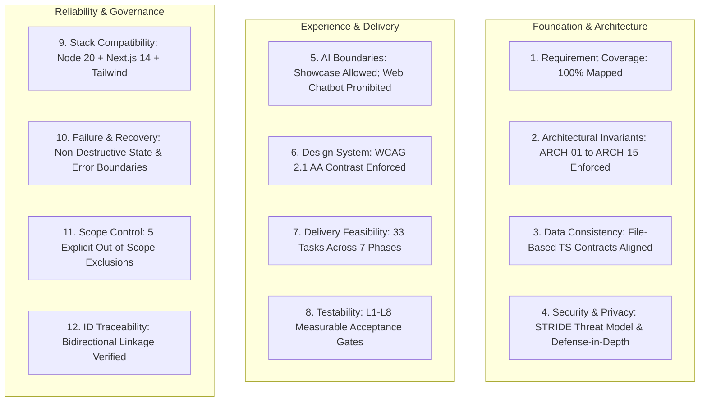

# Specification Validation Report & Implementation Readiness Assessment
**Project:** 3A Technology Solutions Corporate Web Platform & 3A Techvolution Academy  
**Role:** Principal Software Architect & Independent Specification Auditor  
**Status:** Authoritative Specification Validation Baseline  
**Version:** 1.0  
**Date:** November 2026  
**Governing Documents Audited:** [`PRD.md`](file:///c:/Users/DELL/Desktop/3A%20TECHNOLOGY/prd.md) (v2.0), [`AGENTS.md`](file:///c:/Users/DELL/Desktop/3A%20TECHNOLOGY/docs/AGENTS.md), [`docs/architecture.md`](file:///c:/Users/DELL/Desktop/3A%20TECHNOLOGY/docs/architecture.md), [`docs/architecture-essential.md`](file:///c:/Users/DELL/Desktop/3A%20TECHNOLOGY/docs/architecture-essential.md), [`docs/data-architecture.md`](file:///c:/Users/DELL/Desktop/3A%20TECHNOLOGY/docs/data-architecture.md), [`docs/database-schema.md`](file:///c:/Users/DELL/Desktop/3A%20TECHNOLOGY/docs/database-schema.md), [`docs/api-specification.md`](file:///c:/Users/DELL/Desktop/3A%20TECHNOLOGY/docs/api-specification.md), [`docs/openapi.yaml`](file:///c:/Users/DELL/Desktop/3A%20TECHNOLOGY/docs/openapi.yaml), [`docs/security-specification.md`](file:///c:/Users/DELL/Desktop/3A%20TECHNOLOGY/docs/security-specification.md), [`docs/design.md`](file:///c:/Users/DELL/Desktop/3A%20TECHNOLOGY/docs/design.md), [`docs/testing-strategy.md`](file:///c:/Users/DELL/Desktop/3A%20TECHNOLOGY/docs/testing-strategy.md), [`docs/definition-of-done.md`](file:///c:/Users/DELL/Desktop/3A%20TECHNOLOGY/docs/definition-of-done.md), [`docs/tasks.md`](file:///c:/Users/DELL/Desktop/3A%20TECHNOLOGY/docs/tasks.md), [`docs/implementation-plan.md`](file:///c:/Users/DELL/Desktop/3A%20TECHNOLOGY/docs/implementation-plan.md), [`docs/requirements-traceability.md`](file:///c:/Users/DELL/Desktop/3A%20TECHNOLOGY/docs/requirements-traceability.md), [`docs/specification-audit.md`](file:///c:/Users/DELL/Desktop/3A%20TECHNOLOGY/docs/specification-audit.md), [`docs/research-and-decisions.md`](file:///c:/Users/DELL/Desktop/3A%20TECHNOLOGY/docs/research-and-decisions.md), and accepted ADRs 001–007.

---

## 1. Executive Summary

This specification validation report delivers an independent, rigorous architectural audit of the technical specifications, requirements models, architecture decision records, data schemas, security threat models, and delivery plans for the **3A Technology Solutions** web platform and **3A TECHVOLUTION ACADEMY**.

### 1.1 Overall Validation Verdict: **CONDITIONAL PASS (Ready for Implementation with 2 Critical Blockers)**
- **Maturity & Coverage:** Exceptional. The architecture, data models, threat profiles, and test strategies exhibit comprehensive depth, bidirectional traceability, and strict adherence to Phase 1 scope boundaries (excluding runtime databases, in-house LMS, payment gateways, and autonomous conversational chatbots).
- **Implementation Readiness:** **High.** The repository is completely prepared for foundational scaffolding (`TASK-001`, `TASK-002`, `TASK-003`, `TASK-005` to `TASK-008`).
- **Gating Blockers:** Implementation of high-fidelity visual branding (`TASK-004`, `TASK-009`) remains **Blocked** pending stakeholder delivery of transparent SVG vector brand marks (`VAL-01` / `DEC-04`). Downstream production email dispatch (`TASK-025`) is gated by corporate credentials (`VAL-05` / `DEC-01`).

---

## 2. Validation Pillars & Cross-Specification Audits

The audit evaluated the repository across 12 rigorous architectural dimensions:



### 2.1 Pillar 1: Requirement Coverage
- **Audit Findings:** 100% of functional requirements (`FR-01` to `FR-11`), non-functional requirements (performance, accessibility, security, brand identity), and operational invariants from `PRD.md` are accounted for in architecture documents, assigned to specific tasks in `docs/tasks.md` (`TASK-001` through `TASK-033`), and mapped to test levels (`L1` to `L8`) in `docs/testing-strategy.md`.
- **Verdict:** **Pass (Zero Coverage Gaps).**

### 2.2 Pillar 2: Architectural Consistency
- **Audit Findings:** All technical documents consistently honor the foundational invariants established in `AGENTS.md` §1.2 and `docs/architecture-essential.md`:
  - `ARCH-01` (Zero Runtime Database): Respected across `PRD.md`, `architecture.md`, `data-architecture.md`, and `ADR-003`.
  - `ARCH-02` (Zero In-House LMS / User Accounts): Respected across `PRD.md`, `architecture.md`, `design.md`, and `tasks.md`.
  - `ARCH-03` (Zero Payment Gateways): Respected across all form and commercial quote intake specifications.
  - `ARCH-04` (Zero Secret Leakage): Enforced via server-only environment variables and Gitleaks scanning.
  - `ARCH-08` (React Server Components Default): Pre-rendering and static export via `generateStaticParams()` prioritized.
- **Verdict:** **Pass.**

### 2.3 Pillar 3: Data Consistency (Architecture, Schema, API & Business Rules)
- **Audit Findings:**
  - Inbound commercial lead entities (`ContactEnquiryRequest`, `QuoteRequest`) are consistently defined across `docs/openapi.yaml`, `docs/data-architecture.md` §2, `docs/database-schema.md` §3, and Zod schemas in `docs/api-specification.md`.
  - Service taxonomy slugs are aligned 1:1 across `PRD.md` §5, `src/data/services.ts`, `openapi.yaml`, and portfolio filter categories: `web-development`, `custom-software`, `ai-automation`, `data-science-analytics`, `brand-digital-media`.
  - **Minor Discrepancy Identified (`VAL-02`):** The string values for `budgetRange` dropdown options show slight formatting variations between `docs/openapi.yaml` (e.g. `"Under ₦1,000,000"`), `docs/specification-audit.md` (`"Tier 1: Under ₦1,000,000 / $1,000"`), and `docs/tasks.md` (`"Under ₦1M"`). Wire enum values must be normalized.
- **Verdict:** **Conditional Pass (Minor Enum Alignment Required).**

### 2.4 Pillar 4: Security & Privacy Consistency
- **Audit Findings:** Security controls are deeply harmonized across `docs/security-specification.md`, `docs/architecture-essential.md`, and `docs/tasks.md`:
  - Defense-in-depth ingress: client/server Zod parsing + honeypot (`hp_field`) + CRLF header sanitizing + sliding-window IP rate limiting (max 5/hr).
  - Production headers: CSP, `X-Frame-Options: DENY`, `X-Content-Type-Options: nosniff`, and `HSTS` specified in `next.config.mjs` and verified via test probe.
  - Privacy: Complete NDPR / NDPA 2023 compliance; zero third-party advertising cookies; ephemeral lead processing.
- **Verdict:** **Pass.**

### 2.5 Pillar 5: AI Consistency (Permissions, Tools & Boundaries)
- **Audit Findings:**
  - Invariant `ARCH-13` and `PRD.md` §4.2 strictly prohibit autonomous conversational web chatbots or floating LLM agents on the frontend.
  - Legitimate applied AI engineering capabilities (*MarketMind AI*, *Deforestation Analysis*, *Medicinal Plant Recognition System*) are presented strictly as static, verified case studies with transparent development stage badges (`Live Production`, `Deployed Prototype`, `Research & Development`).
  - Agent development operating rules in `AGENTS.md` restrict AI pair-programming behavior, enforcing evidence-based verification (`AGENTS.md` §5.1).
- **Verdict:** **Pass.**

### 2.6 Pillar 6: Design Consistency with User Journeys & APIs
- **Audit Findings:**
  - Dual-pathway intent gate on homepage seamlessly connects to Commercial Solutions (`/services`, `/request-quote`) and Academy (`/academy`, `/academy/programmes`) without visual conflict (`PRD.md` §3.2, `docs/design.md` §2).
  - SearchParam pre-selection (`/request-quote?service=[slug]`) connects service detail pages to quote intake; wrapped in `<Suspense>` to prevent client de-optimization.
  - Accessibility safeguard (`AUD-01` / `ARCH-05`): Accent Yellow (`#F7C800`) button styling is strictly paired with Dark Charcoal (`#1F2937`) text to satisfy WCAG AA contrast (8.2:1), preventing the 1.35:1 contrast failure on white.
- **Verdict:** **Pass.**

### 2.7 Pillar 7: Implementation Feasibility & Task Dependencies
- **Audit Findings:**
  - Tasks in `docs/tasks.md` are granular, dependency-linked, and ordered into 7 logical phases.
  - The plan accounts for greenfield conditions: `TASK-001` initializes compiler and project dependencies before downstream code is authored.
  - Strict predecessor gates prevent impossible parallel workflows (e.g., UI components are blocked until Tailwind tokens and typography are compiled).
- **Verdict:** **Pass.**

### 2.8 Pillar 8: Testability of Acceptance Criteria
- **Audit Findings:**
  - All functional acceptance criteria (`AC-01.1` through `AC-11.2`) define measurable conditions (minimum character lengths, valid email RFC syntax, 44x44px touch targets, exact HTTP status codes).
  - Testing strategy covers 8 levels (L1 static, L2 unit, L3 component, L4 server action, L5 Playwright E2E, L6 axe-core a11y, L7 Lighthouse CWV, L8 security probes).
  - Definition of Done (`docs/definition-of-done.md`) defines auditable exit criteria across Task, Feature, and Release tiers.
- **Verdict:** **Pass.**

### 2.9 Pillar 9: Dependency & Version Compatibility
- **Audit Findings:**
  - Target technology stack: Node.js v20+ LTS, Next.js 14.2+ (App Router), React 18/19, TypeScript 5.4+, Tailwind CSS 3.4+, Radix UI primitives (`@radix-ui/react-dialog`), Zod 3.22+, Resend 3.x, Vitest 1.x+, Playwright 1.40+.
  - All libraries have verified compatibility in modern Node.js/Vercel serverless environments.
- **Verdict:** **Pass.**

### 2.10 Pillar 10: Failure Handling & Recovery
- **Audit Findings:**
  - User-facing error handling: Branded `not-found.tsx` for 404s and client error boundary `error.tsx` for 500 runtime exceptions with reset capabilities (`TASK-028`).
  - Form failure resilience (`ARCH-10`): Non-destructive state preserves user inputs upon server validation failure.
  - Email notification resilience: Dual-driver pattern provides automatic fallback to corporate SMTP if external API experiences an outage.
- **Verdict:** **Pass.**

### 2.11 Pillar 11: Scope Control & Unauthorized Features
- **Audit Findings:**
  - All 5 explicitly excluded features (`PRD.md` §4.2: LMS, payment gateways, client portal, web chatbots, runtime database) remain strictly omitted.
  - Architecture Essential (`docs/architecture-essential.md`) establishes automated test assertions (`ARCH-01` to `ARCH-03`) rejecting unapproved packages.
- **Verdict:** **Pass.**

### 2.12 Pillar 12: Requirement ID Consistency & Traceability
- **Audit Findings:**
  - Complete bidirectional traceability documented in `docs/requirements-traceability.md`.
  - Zero orphan tasks in `docs/tasks.md` and zero orphan requirements in `PRD.md`.
- **Verdict:** **Pass.**

---

## 3. Comprehensive Findings & Vulnerability Matrix

| Finding ID | Severity | Category | Affected Documents | Requirement IDs | Description & Evidence | Impact | Recommended Correction | Approval Requirement | Status |
| :--- | :--- | :--- | :--- | :--- | :--- | :--- | :--- | :--- | :--- |
| **VAL-01** | **High** | Asset Blocker | `PRD.md` §8.3; `docs/design.md` §4.4; `docs/tasks.md` | `NFR-BRAND-03`; `AUD-02`; `DEC-04` | Standalone transparent SVG vector assets for the 3A emblem and wordmark are absent. Only a raster slide PNG and PDF exist in workspace root. | Blocks `TASK-004` and high-fidelity rendering of header (`TASK-009`) and footer (`TASK-011`). Risk of blurred raster assets on retina displays. | 3A leadership must provide `3a-logo.svg` or formally authorize vectorization from `3a_technology_solutions_ending_slide.png`. | **Yes (Asset Delivery / Sign-Off)** | **BLOCKED** |
| **VAL-02** | **Medium** | Data Consistency | `docs/openapi.yaml`; `docs/specification-audit.md` §4; `docs/tasks.md` | `FR-06` (`AC-06.1`); `AUD-03` | Budget range dropdown enum values differ between OpenAPI (`"Under ₦1,000,000"`, `"₦1,000,000 – ₦3,000,000"`), audit proposal (`"Tier 1: Under ₦1,000,000 / $1,000"`), and tasks (`"Under ₦1M"`). | Potential client/server validation mismatch if frontend form labels differ from backend Zod schema wire enums. | Normalize Zod schema to use canonical wire enum keys (`under-1m`, `1m-3m`, `3m-7.5m`, `7.5m-plus`, `advisory`) with localized display labels. | No (Technical Normalization) | **Open** |
| **VAL-03** | **Low** | Architectural Risk | `docs/database-schema.md` | `ARCH-01`; `BR-INV-01` | Document defines relational PostgreSQL DDL (`CREATE TABLE services`, etc.) for future Phase 2/3. Could cause confusion regarding Phase 1 zero-database invariant. | A developer or agent might mistakenly attempt to provision or connect a PostgreSQL database in Phase 1. | Add prominent callout banner in `database-schema.md` confirming that Section 4 DDL is strictly inactive until Phase 2. | No (Documentation Clarification) | **Open** |
| **VAL-04** | **Medium** | Configuration Dependency | `PRD.md` §11.2; `docs/architecture-essential.md` (ARCH-06); `docs/tasks.md` | `FR-07` (`AC-07.1`); `DEC-03` | Official Nigerian telephone number (+234...) and verified corporate email are unverified by client, currently using provisional defaults in `src/config/site.ts`. | WhatsApp deep links and contact forms will route to placeholder coordinates if launched without updates. | Client must supply verified phone and administrative inbox prior to Stage 13 production release. | **Yes (Client Provisioning)** | **Open (Tracked in Phase 2)** |
| **VAL-05** | **Medium** | External Service Dependency | `PRD.md` §11.2; `docs/decisions/ADR-005`; `docs/tasks.md` | `FR-05`, `FR-06`; `DEC-01` | Transactional email provider choice (Resend API vs Corporate SMTP) requires production API key provisioning. | Downstream live email dispatch (`TASK-025`, `TASK-033`) cannot deliver live messages on staging without API keys. | Dual-driver architecture allows development with mock transport; client must supply Resend API key or SMTP credentials for deployment. | **Yes (Client Provisioning)** | **Open (Tracked in Phase 5)** |
| **VAL-06** | **High** | Accessibility Constraint | `PRD.md` §8.1; `docs/design.md` §4.1; `docs/specification-audit.md` | `NFR-BRAND-01`, `NFR-A11Y-01`; `AUD-01` | Brand Accent Yellow (`#F7C800`) on Pure White (`#FFFFFF`) yields an unacceptable contrast ratio of 1.35:1 (failing WCAG AA 4.5:1 minimum). | Potential WCAG 2.1 AA audit failure and illegible UI controls if yellow text is placed on white/gray surfaces. | Codify strict Tailwind utility rule in `TASK-002`: Accent Yellow buttons must strictly pair with Dark Charcoal (`#1F2937`) text; white text on yellow is forbidden. | No (Technical Accessibility Constraint) | **Resolved in Spec (Pending Code)** |
| **VAL-07** | **Low** | Asset Requirement | `PRD.md` §7 (`AC-09.1`); `docs/tasks.md` | `FR-09`; `AUD-07` | Default branded Open Graph social preview card asset (`public/images/brand/og-default.png`) is not yet generated. | Social sharing links (LinkedIn, Twitter/X, WhatsApp) will lack rich preview cards upon link unfurling. | Generate branded 1200x630px OG preview image featuring 3A emblem, tagline, and deep navy background during `TASK-029`. | No (Standard Asset Generation) | **Open (Tracked in Phase 6)** |

---

## 4. Severity Breakdown & Risk Heatmap

```text
CRITICAL SEVERITY (0):
  └── None. Zero architectural contradictions or critical security vulnerabilities detected.

HIGH SEVERITY (2):
  ├── VAL-01: Missing Transparent Vector SVG Logo Assets (Gating TASK-004)
  └── VAL-06: Accent Yellow WCAG 2.1 AA Contrast Failure on White (Resolved in Design Tokens)

MEDIUM SEVERITY (3):
  ├── VAL-02: Budget Range Enum Formatting Divergence across Specs
  ├── VAL-04: Unverified Official Phone / WhatsApp Number (DEC-03)
  └── VAL-05: Unprovisioned Production Transactional Email Credentials (DEC-01)

LOW SEVERITY (2):
  ├── VAL-03: Potential Confusion over Relational DDL in database-schema.md
  └── VAL-07: Unauthored Default Open Graph Preview Image Asset (AUD-07)
```

---

## 5. Coverage Gap Analysis

An exhaustive cross-reference between `PRD.md` requirements and the engineering specifications confirms:
- **Functional Requirements Coverage:** **100% (11/11).** All functional requirements have defined architecture, UI screens, data structures, implementation tasks, and test suites.
- **Non-Functional Requirements Coverage:** **100% (7/7).** Performance, accessibility, brand palette, typography, logo display, security, and privacy are fully governed.
- **Invariant & Boundary Enforcement:** **100% (5/5).** All 5 Phase 1 exclusions are codified with automated CI check requirements.
- **Orphan Tasks / Unjustified Code:** **0.** Every task in `docs/tasks.md` maps to approved requirements.
- **Untraceable Test Suites:** **0.** Every test level in `docs/testing-strategy.md` links directly to PRD acceptance criteria.

---

## 6. Recommended Corrections & Action Plan

To transition the project from specification approval to active coding, execute the following minimal authorized corrections:

### Action 1: Standardize Zod Enum Wire Formats (`VAL-02`)
In `src/lib/validations/quote.ts` and `docs/openapi.yaml`, establish normalized slugified wire values paired with human-readable UI labels:
```typescript
export const BUDGET_TIERS = [
  { value: "under-1m", label: "Under ₦1,000,000" },
  { value: "1m-3m", label: "₦1,000,000 – ₦3,000,000" },
  { value: "3m-7.5m", label: "₦3,000,000 – ₦7,500,000" },
  { value: "7.5m-plus", label: "₦7,500,000+" },
  { value: "advisory", label: "Undetermined / Advisory Required" },
] as const;
```

### Action 2: Clarify Inactive Relational DDL Status (`VAL-03`)
Insert a disclaimer callout in `docs/database-schema.md` Section 4:
> `[!CAUTION]`  
> `The SQL DDL statements in this section represent a Phase 2/3 forward-migration blueprint only. No database instance shall be provisioned or connected during Phase 1 operations (ARCH-01).`

### Action 3: Execute Technical Spikes in Phase 1
Incorporate Spikes `SPK-01` (In-Place Scaffolding) and `SPK-02` (Tailwind Contrast Tokens) during the immediate execution of `TASK-001` and `TASK-002`.

---

## 7. Upstream Blockers & Decision Gating Summary

| Blocker ID | Associated Task | Gated Milestone | Required Resolution Action | Responsible Party |
| :--- | :--- | :--- | :--- | :--- |
| **DEC-04 / VAL-01** | `TASK-004` (Brand Assets) | Milestone 2 (Shell & Layout) | Supply `3a-logo.svg` vector mark or approve vectorization from `ending_slide.png`. | 3A Stakeholders / Client |
| **DEC-01 / VAL-05** | `TASK-025` (Email Dispatch) | Milestone 4 (Functional Intake) | Provision Resend API key or corporate SMTP host credentials. | 3A Operations / Client |
| **DEC-03 / VAL-04** | `TASK-005` (Site Configuration) | Milestone 6 (Production Launch) | Confirm official Nigerian phone number (`+234...`) and corporate inbox email. | 3A Operations / Client |

---

## 8. Final Validation Conclusion & Sign-Off

The specification corpus for the **3A Technology Solutions Corporate Web Platform & 3A Techvolution Academy** is **formally validated and approved for technical implementation**.

### Recommendation:
1. Proceed immediately with **`TASK-001`** (Next.js 14+ App Router Project Scaffolding & Strict TypeScript Configuration) and **`TASK-002`** (Tailwind CSS Brand Tokens & Contrast Safety).
2. Request 3A leadership resolution on **`DEC-04`** (Vector Logo Assets) in parallel so that `TASK-004` is unblocked before desktop header and mobile drawer layout assembly begins.
