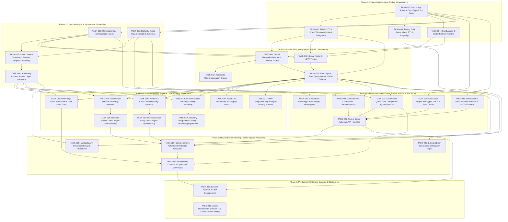

# Master Engineering Backlog & Dependency-Aware Delivery Plan
**Project:** 3A Technology Solutions Corporate Web Platform & 3A Techvolution Academy  
**Role:** Senior Engineering Lead & Software Delivery Planner  
**Status:** Authoritative Delivery Plan Baseline  
**Version:** 1.0  
**Date:** November 2026  
**Governing Documents:** [`PRD.md`](file:///c:/Users/DELL/Desktop/3A%20TECHNOLOGY/prd.md) (v2.0), [`AGENTS.md`](file:///c:/Users/DELL/Desktop/3A%20TECHNOLOGY/docs/AGENTS.md), [`docs/architecture-essential.md`](file:///c:/Users/DELL/Desktop/3A%20TECHNOLOGY/docs/architecture-essential.md), [`docs/architecture.md`](file:///c:/Users/DELL/Desktop/3A%20TECHNOLOGY/docs/architecture.md), [`docs/definition-of-done.md`](file:///c:/Users/DELL/Desktop/3A%20TECHNOLOGY/docs/definition-of-done.md), [`docs/testing-strategy.md`](file:///c:/Users/DELL/Desktop/3A%20TECHNOLOGY/docs/testing-strategy.md), [`docs/design.md`](file:///c:/Users/DELL/Desktop/3A%20TECHNOLOGY/docs/design.md), [`docs/api-specification.md`](file:///c:/Users/DELL/Desktop/3A%20TECHNOLOGY/docs/api-specification.md), [`docs/security-specification.md`](file:///c:/Users/DELL/Desktop/3A%20TECHNOLOGY/docs/security-specification.md), [`docs/specification-audit.md`](file:///c:/Users/DELL/Desktop/3A%20TECHNOLOGY/docs/specification-audit.md), [`docs/research-and-decisions.md`](file:///c:/Users/DELL/Desktop/3A%20TECHNOLOGY/docs/research-and-decisions.md)

---

## 1. Executive Summary & Delivery Governance Model

This document establishes the actionable, dependency-aware work breakdown structure and delivery backlog for engineering the **3A Technology Solutions** corporate web platform and **3A TECHVOLUTION ACADEMY**.

### 1.1 Delivery Governance Rules
1. **Evidence Before Assertions (`AGENTS.md` §5.1 & `definition-of-done.md` §1.1):** No task shall be transitioned to `Done` without executing concrete verification commands in the terminal and documenting verifiable output logs.
2. **Strict Invariant Adherence (`ARCH-01` to `ARCH-15`):** Phase 1 release scope strictly prohibits runtime databases (`ARCH-01`), in-house LMS or user accounts (`ARCH-02`), payment gateways (`ARCH-03`), and autonomous conversational chatbots (`ARCH-13`).
3. **Current Implementation State:** Tasks `TASK-001` through `TASK-032` (including `TASK-004` vectorized SVG brand emblem & wordmark pipeline derived from `3a_technology_solutions_ending_slide.png` and `3A_Technology_Solutions_Brand_Identity_Standards.pdf`) are implemented in `src/`, `public/`, and `tests/`, and verified against `npm run typecheck`, `npm test`, and `npm run build`. `TASK-033` awaits live Vercel project linkage and production credentials (`DEC-01`, `DEC-02`, `DEC-03`).
4. **Task Status Dictionary:**
   - **`Ready`:** All prerequisites satisfied; clear acceptance criteria; ready for immediate implementation.
   - **`Planned`:** Dependent on preceding tasks; sequentially queued.
   - **`Blocked`:** Requires external asset delivery or formal stakeholder sign-off (e.g., logo SVG assets, commercial email credentials).
   - **`In Progress`:** Currently under active implementation.
   - **`In Review`:** Implementation complete; awaiting code review and quality tier audit.
   - **`Done`:** Tier 1 and Tier 2 Definition of Done demonstrably satisfied with zero test/type/lint errors.

---

## 2. Phase-by-Phase Dependency Graph



---

## 3. Work Breakdown Structure & Task Specifications

### Phase 1: Project Initialization & Tooling Infrastructure

#### TASK-001: Next.js 14+ App Router Project Scaffolding & TypeScript Strict Configuration
- **Task ID:** `TASK-001`
- **Title:** Next.js 14+ App Router Project Scaffolding & TypeScript Strict Configuration
- **Status:** `Done`
- **Objective:** Initialize the root Next.js project with App Router, configure TypeScript in strict mode, and establish core directory conventions without extraneous boilerplates.
- **Description:** Initialize Next.js 14+ in the repository root using `npx create-next-app@latest .` with TypeScript, ESLint, Tailwind CSS, App Router, and `src/` directory aliases (`@/*`). Ensure zero unwanted sample assets or bloat. Enforce strict compiler settings (`noImplicitAny`, `strictNullChecks`, `noUnusedLocals`, `noUnusedParameters`).
- **Requirement IDs:** `PRD.md` §4.1, §9.1; `AGENTS.md` §3.3; `ARCH-14`.
- **Relevant Specifications:** `docs/architecture-essential.md` §3 (ARCH-14); `docs/decisions/ADR-001-frontend-framework-and-rendering-strategy.md`.
- **Prerequisites / Dependencies:** None (Greenfield project starting point).
- **Expected Files / Components:**
  - `package.json`
  - `tsconfig.json`
  - `next.config.mjs`
  - `.eslintrc.json`
  - `src/app/layout.tsx`
  - `src/app/page.tsx`
- **Acceptance Criteria:**
  1. `package.json` reflects Next.js 14+ and React 18/19 dependencies without runtime databases or unapproved libraries.
  2. `tsconfig.json` has `"strict": true`, `"noImplicitAny": true`, `"baseUrl": "."`, and path alias `"@/*": ["./src/*"]`.
  3. `npm run typecheck` (`tsc --noEmit`) executes cleanly with exit code 0.
  4. `npm run lint` executes cleanly without errors.
  5. `npm run build` completes successfully, generating standard `.next` production distribution.
- **Tests:** Static compilation test; npm script verification.
- **Verification Commands:**
  ```powershell
  npx tsc --noEmit
  npm run lint
  npm run build
  ```
- **Risks / Notes:** Running `create-next-app` in a non-empty directory requires care to prevent overwriting existing `/docs`, `prd.md`, or brand assets.

---

#### TASK-002: Tailwind CSS Design Token Architecture & Brand Color Utilities
- **Task ID:** `TASK-002`
- **Title:** Tailwind CSS Design Token Architecture & Brand Color Utilities
- **Status:** `Done`
- **Objective:** Implement the locked 5-color brand palette and typography scales in `tailwind.config.ts`, enforcing WCAG 2.1 AA contrast constraints.
- **Description:** Configure Tailwind CSS with the authoritative tokens from *3A Brand Identity Standards v1.0*: Primary Navy (`#0B2B6B`), Accent Yellow (`#F7C800`), Dark Charcoal (`#1F2937`), Light Gray (`#F4F6F8`), and Pure White (`#FFFFFF`). Implement contrast-safe utility classes that strictly prevent yellow text on white/gray surfaces as required by finding `AUD-01` and invariant `ARCH-05`.
- **Requirement IDs:** `PRD.md` §8.1, §8.2; `AGENTS.md` §3.4; `ARCH-05`; `AUD-01`.
- **Relevant Specifications:** `docs/design.md` §4; `docs/specification-audit.md` §4 (AUD-01); `docs/decisions/ADR-002-styling-and-design-token-architecture.md`.
- **Prerequisites / Dependencies:** `TASK-001`.
- **Expected Files / Components:**
  - `tailwind.config.ts`
  - `src/app/globals.css`
  - `src/lib/utils.ts` (cn class merging utility with `clsx` and `tailwind-merge`)
- **Acceptance Criteria:**
  1. Semantic color tokens defined: `brand-navy` (`#0B2B6B`), `brand-yellow` (`#F7C800`), `brand-charcoal` (`#1F2937`), `brand-gray` (`#F4F6F8`), `brand-white` (`#FFFFFF`).
  2. Typography scale configured for clean sans-serif (Inter / Plus Jakarta Sans) with tracking and line-height tokens.
  3. Custom button classes enforcing contrast safety: Yellow button (`bg-brand-yellow text-brand-charcoal hover:bg-yellow-400 font-semibold`). White text on yellow background is forbidden.
  4. Global CSS establishes smooth scrolling, root text color `#1F2937`, and body background `#FFFFFF`.
- **Tests:** Visual token verification and class compilation test.
- **Verification Commands:**
  ```powershell
  npx tsc --noEmit
  npm run build
  ```
- **Risks / Notes:** Strictly prevent generic blue/yellow overrides; lock exact hex values.

---

#### TASK-003: Testing Framework Infrastructure Setup (Vitest, RTL & Playwright)
- **Task ID:** `TASK-003`
- **Title:** Testing Framework Infrastructure Setup (Vitest, RTL & Playwright)
- **Status:** `Done`
- **Objective:** Install and configure the automated test runners to execute the planned 8-level testing strategy.
- **Description:** Configure Vitest with JSDOM and `@testing-library/react` for unit/component testing. Install and configure Playwright with browser configurations for Desktop Chrome and Mobile Safari. Define standard scripts in `package.json` (`test`, `test:unit`, `test:e2e`).
- **Requirement IDs:** `AGENTS.md` §5; `PRD.md` §12; `docs/definition-of-done.md` §3, §4; `ADR-007`.
- **Relevant Specifications:** `docs/testing-strategy.md` §2, §3; `docs/decisions/ADR-007-testing-and-quality-assurance-stack.md`.
- **Prerequisites / Dependencies:** `TASK-001`.
- **Expected Files / Components:**
  - `vitest.config.ts`
  - `playwright.config.ts`
  - `tests/setup.ts`
  - `tests/unit/smoke.test.ts`
  - `tests/e2e/smoke.spec.ts`
- **Acceptance Criteria:**
  1. Vitest is configured to resolve TypeScript paths (`@/*`) matching `tsconfig.json`.
  2. `tests/unit/smoke.test.ts` runs and passes with `npm run test:unit`.
  3. Playwright configuration specifies base URL (`http://localhost:3000`), trace retention on failure, and Chromium/WebKit profiles.
  4. Playwright smoke test launches web server and asserts HTTP 200 on `/`.
- **Tests:** Execution of unit and e2e smoke tests.
- **Verification Commands:**
  ```powershell
  npm run test:unit
  npx playwright test tests/e2e/smoke.spec.ts
  ```
- **Risks / Notes:** Ensure Playwright browser binaries install properly in Windows environment (`npx playwright install --with-deps`).

---

#### TASK-004: Brand Assets & Vector Emblem Pipeline
- **Task ID:** `TASK-004`
- **Title:** Brand Assets & Vector Emblem Pipeline
- **Status:** `Done` (Vectorized SVG emblem, wordmark, favicon `icon.svg`, and `BrandLogo.tsx` component integrated from `3a_technology_solutions_ending_slide.png` and `3A_Technology_Solutions_Brand_Identity_Standards.pdf`)
- **Objective:** Integrate high-resolution SVG vectors of the official 3A emblem, wordmark, and favicon icons into the public asset pipeline.
- **Description:** Resolve finding `AUD-02` by placing production-ready transparent SVG vector assets for the 3A emblem (circular brush mark with yellow "3" and blue "A") and horizontal wordmark into `public/images/brand/`. Generate standard favicon (`app/favicon.ico`), apple-touch-icon, and web manifest assets.
- **Requirement IDs:** `PRD.md` §8.3; `AUD-02`; `DEC-04`.
- **Relevant Specifications:** `docs/specification-audit.md` §4 (AUD-02); `docs/research-and-decisions.md` §7 (DEC-04).
- **Prerequisites / Dependencies:** `TASK-001`, Stakeholder resolution of `DEC-04`.
- **Expected Files / Components:**
  - `public/images/brand/3a-logo-emblem.svg`
  - `public/images/brand/3a-logo-wordmark-dark.svg`
  - `public/images/brand/3a-logo-wordmark-light.svg`
  - `src/app/favicon.ico`
  - `src/app/icon.svg`
- **Acceptance Criteria:**
  1. SVGs render sharply across standard and high-DPI displays without pixelation.
  2. Minimum clear space surrounding the mark adheres to Brand Standards (minimum 24px equivalent).
  3. Image dimensions and aspect ratios are permanently locked to avoid distortion.
- **Tests:** Component visual render test in header and footer.
- **Verification Commands:**
  ```powershell
  npm run build
  ```
- **Risks / Notes:** In the event of delay from stakeholders, an interim clean SVG vectorization derived from `3a_technology_solutions_ending_slide.png` may be used as a provisional placeholder, flagged for replacement.

---

### Phase 2: Core Data Layer & Architecture Foundation

#### TASK-005: Centralized Site Configuration & Communication Constants
- **Task ID:** `TASK-005`
- **Title:** Centralized Site Configuration & Communication Constants
- **Status:** `Done`
- **Objective:** Establish the single source of truth for corporate contact details, official WhatsApp gateway, navigation links, and brand metadata.
- **Description:** Implement `src/config/site.ts` exporting a strongly typed `siteConfig` object. Codify official email, international WhatsApp number (`+234...`), physical address, social links, opening hours, and navigation structure, preventing hardcoded values across components (`ARCH-06`).
- **Requirement IDs:** `PRD.md` §6.2, §7 (AC-07.1); `AGENTS.md` §3.5; `ARCH-06`; `DEC-03`.
- **Relevant Specifications:** `docs/architecture-essential.md` §3 (ARCH-06); `docs/design.md` §3.
- **Prerequisites / Dependencies:** `TASK-001`.
- **Expected Files / Components:**
  - `src/config/site.ts`
  - `src/types/config.ts`
  - `tests/unit/config.test.ts`
- **Acceptance Criteria:**
  1. `siteConfig` exports: `name`, `tagline`, `description`, `url`, `contact` (`email`, `phone`, `whatsapp`, `address`), `nav` (header links, footer groups), and `academy` (external enrollment links).
  2. Unit test verifies that no placeholder strings (e.g., `TODO`, `undefined`) exist in required fields and that the phone number contains valid country code prefix.
  3. No other component hardcodes raw contact channels.
- **Tests:** Unit test asserting complete structural validity of `siteConfig`.
- **Verification Commands:**
  ```powershell
  npm run test:unit tests/unit/config.test.ts
  ```
- **Risks / Notes:** Temporary fallback channels codified per `DEC-03` until formal stakeholder sign-off.

---

#### TASK-006: Statically Typed Data Contracts & Validation Schemas
- **Task ID:** `TASK-006`
- **Title:** Statically Typed Data Contracts & Validation Schemas
- **Status:** `Done`
- **Objective:** Create TypeScript interfaces and Zod validation schemas for all domain entities (Services, Projects, Academy Tracks, Inbound Enquiries).
- **Description:** Define strict TypeScript contracts in `src/types/` for `Service`, `Project`, `AcademyProgramme`, and `CaseStudy`. Define Zod schemas in `src/lib/validations/` for `ContactEnquirySchema` and `QuoteRequestSchema` with input sanitization, length boundaries, and email RFC validation.
- **Requirement IDs:** `PRD.md` §5, §7 (AC-05.1, AC-06.1, AC-08.2); `FR-08`; `ARCH-14`; `AUD-03`.
- **Relevant Specifications:** `docs/data-architecture.md` §3; `docs/api-specification.md` §4; `docs/specification-audit.md` §4 (AUD-03).
- **Prerequisites / Dependencies:** `TASK-001`.
- **Expected Files / Components:**
  - `src/types/content.ts`
  - `src/types/forms.ts`
  - `src/lib/validations/enquiry.ts`
  - `src/lib/validations/quote.ts`
  - `tests/unit/validations.test.ts`
- **Acceptance Criteria:**
  1. `QuoteRequestSchema` defines discrete dropdown values for `budgetRange` and `timeline` matching the approved audit matrix (`AUD-03`).
  2. `ContactEnquirySchema` enforces name >= 2 chars, valid email, message >= 15 chars, and optional phone.
  3. Both schemas include a silent `hp_field` honeypot string that must be empty.
  4. Unit tests assert that invalid emails, malicious payloads, and oversized inputs fail validation with descriptive RFC 7807 aligned error messages.
- **Tests:** Vitest unit test asserting schema validation behavior with valid and malformed inputs.
- **Verification Commands:**
  ```powershell
  npm run test:unit tests/unit/validations.test.ts
  ```
- **Risks / Notes:** Avoid any non-standard Zod plugins; rely on standard Zod 3.22+ primitives.

---

#### TASK-007: Static Content Datastores (Services, Projects, Academy)
- **Task ID:** `TASK-007`
- **Title:** Static Content Datastores (Services, Projects, Academy)
- **Status:** `Done`
- **Objective:** Populate the statically typed TypeScript data files for all 5 commercial services, verified project case studies, and academy curriculum tracks.
- **Description:** Create `src/data/services.ts`, `src/data/projects.ts`, and `src/data/programmes.ts`. Ensure exact 1:1 synchronization between service taxonomy slugs and portfolio tags (`AUD-04`). Populate initial case studies (*MarketMind AI*, *Deforestation Analysis*, *Medicinal Plant Recognition System*, *Image Compression Tool*, *Electronic Logbook*) with verified development stage badges (`ARCH-01`, `PRD.md` §5, §7).
- **Requirement IDs:** `PRD.md` §5, §7 (FR-02, FR-03, FR-04, FR-08); `ARCH-01`; `AUD-04`.
- **Relevant Specifications:** `docs/data-architecture.md` §4; `docs/specification-audit.md` §4 (AUD-04).
- **Prerequisites / Dependencies:** `TASK-006`.
- **Expected Files / Components:**
  - `src/data/services.ts`
  - `src/data/projects.ts`
  - `src/data/programmes.ts`
  - `tests/unit/content-data.test.ts`
- **Acceptance Criteria:**
  1. `services.ts` contains all 5 confirmed categories: `web-development`, `custom-software`, `ai-automation`, `data-science-analytics`, `brand-digital-media`.
  2. `projects.ts` contains verified project entries with valid status badges (`Client Project`, `Live Production`, `Deployed Prototype`, `Research & Development`).
  3. `programmes.ts` specifies confirmed curriculum tracks, skill levels, formats, and verified fee notices.
  4. `npm run typecheck` passes with zero type mismatches or missing properties.
- **Tests:** Unit test verifying data integrity (no duplicate slugs, valid image references, non-empty fields).
- **Verification Commands:**
  ```powershell
  npx tsc --noEmit
  npm run test:unit tests/unit/content-data.test.ts
  ```
- **Risks / Notes:** No runtime database or CMS dependencies (`ARCH-01`).

---

#### TASK-008: In-Memory Content Access Layer & Query Helpers
- **Task ID:** `TASK-008`
- **Title:** In-Memory Content Access Layer & Query Helpers
- **Status:** `Done`
- **Objective:** Provide a clean functional query abstraction over static data files to shield UI components from direct file imports.
- **Description:** Implement `src/lib/content.ts` providing helper functions: `getAllServices()`, `getServiceBySlug(slug)`, `getAllProjects()`, `getProjectBySlug(slug)`, `getProjectsByCategory(category)`, `getFeaturedProjects(limit)`, `getAllProgrammes()`, and `getProgrammeBySlug(slug)`.
- **Requirement IDs:** `PRD.md` §7 (FR-02, FR-03, FR-04, FR-08); `ARCH-07`.
- **Relevant Specifications:** `docs/architecture-essential.md` §3 (ARCH-07); `docs/api-specification.md` §1.
- **Prerequisites / Dependencies:** `TASK-007`.
- **Expected Files / Components:**
  - `src/lib/content.ts`
  - `tests/unit/content-queries.test.ts`
- **Acceptance Criteria:**
  1. Helper functions return typed data contracts; non-existent slugs return `null` or `undefined` gracefully.
  2. Architecture invariant `ARCH-07` is respected: components consume `src/lib/content.ts` rather than raw array objects.
  3. Unit tests cover all query functions with 100% branch coverage.
- **Tests:** Vitest unit test suite covering slug lookups, category filters, and edge cases.
- **Verification Commands:**
  ```powershell
  npm run test:unit tests/unit/content-queries.test.ts
  ```
- **Risks / Notes:** Ensure all query operations are pure and synchronous for instantaneous SSG execution.

---

### Phase 3: Global Shell, Navigation & Layout Components

#### TASK-009: Accessible Global Navigation Header & Desktop Navbar
- **Task ID:** `TASK-009`
- **Title:** Accessible Global Navigation Header & Desktop Navbar
- **Status:** `Done`
- **Objective:** Implement the desktop navigation header with brand emblem, route links, dropdowns, and dual-pathway action buttons.
- **Description:** Implement `src/components/navigation/Header.tsx` and `Navbar.tsx`. Include sticky glassmorphic backdrop on scroll, active route indicators, services dropdown menu, secondary `Explore Academy` link, and primary `Request a Quote` button.
- **Requirement IDs:** `PRD.md` §6.2, §7 (FR-01, AC-01.1, AC-01.4); `ARCH-05`.
- **Relevant Specifications:** `docs/design.md` §5.1; `docs/architecture-essential.md` §3 (ARCH-05).
- **Prerequisites / Dependencies:** `TASK-002`, `TASK-004`, `TASK-005`.
- **Expected Files / Components:**
  - `src/components/navigation/Header.tsx`
  - `src/components/navigation/Navbar.tsx`
  - `src/components/navigation/NavDropdown.tsx`
  - `tests/unit/header.test.tsx`
- **Acceptance Criteria:**
  1. On desktop viewports (>= 1024px), all primary links (`Home`, `Services`, `Projects`, `Academy`, `About`, `Contact`) and action buttons are visible.
  2. Active page link displays high-contrast indicator styling (Primary Navy underline / accent highlight).
  3. Header transition to solid/glassmorphic state occurs cleanly upon window scrolling.
  4. All button contrast ratios satisfy WCAG 2.1 AA (>= 4.5:1).
- **Tests:** React Testing Library component tests; DOM contrast verification.
- **Verification Commands:**
  ```powershell
  npm run test:unit tests/unit/header.test.tsx
  ```
- **Risks / Notes:** Avoid heavy UI library imports; use clean React hooks and Tailwind utility classes.

---

#### TASK-010: Accessible Mobile Navigation Drawer with Keyboard Focus Trap
- **Task ID:** `TASK-010`
- **Title:** Accessible Mobile Navigation Drawer with Keyboard Focus Trap
- **Status:** `Done`
- **Objective:** Implement the responsive mobile navigation drawer with accessible hamburger toggle, focus trapping, and ARIA attributes.
- **Description:** Implement `src/components/navigation/MobileDrawer.tsx` utilizing Radix UI Dialog (`@radix-ui/react-dialog`) primitives. Ensure full height overlay, touch target sizes >= 44x44px, smooth slide-in transition, keyboard focus trap while open, `Escape` key dismissal, and automatic closure upon navigation.
- **Requirement IDs:** `PRD.md` §7 (FR-01, AC-01.2, AC-01.3); `ARCH-05`; `ADR-002`.
- **Relevant Specifications:** `docs/design.md` §5.1; `docs/testing-strategy.md` §3.3; `docs/decisions/ADR-002-styling-and-design-token-architecture.md`.
- **Prerequisites / Dependencies:** `TASK-009`.
- **Expected Files / Components:**
  - `src/components/navigation/MobileDrawer.tsx`
  - `tests/unit/mobile-drawer.test.tsx`
- **Acceptance Criteria:**
  1. Visible on viewports < 1024px; hamburger toggle has `aria-expanded` and `aria-label="Toggle Navigation Menu"`.
  2. Opening the drawer traps keyboard Tab cycling strictly within the drawer.
  3. Pressing `Escape` or clicking any link immediately closes the drawer and restores focus to the toggle button.
  4. All interactive touch targets are at least 44x44px.
- **Tests:** Vitest + React Testing Library keyboard interaction and ARIA attribute tests.
- **Verification Commands:**
  ```powershell
  npm run test:unit tests/unit/mobile-drawer.test.tsx
  ```
- **Risks / Notes:** Prevent body scrolling when the mobile drawer is active (`overflow-hidden` on body).

---

#### TASK-011: Global Footer Component & NDPR Compliance Notice
- **Task ID:** `TASK-011`
- **Title:** Global Footer Component & NDPR Compliance Notice
- **Status:** `Done`
- **Objective:** Build the 4-column corporate footer featuring brand emblem, site directory, academy pathways, contact channels, and legal compliance notices.
- **Description:** Implement `src/components/navigation/Footer.tsx`. Structure across 4 distinct columns: (1) Brand emblem, tagline (*Ideas • Technology • Impact*), positioning; (2) Quick links; (3) Academy quick links; (4) Verified contact channels (phone, email, WhatsApp, physical office). Include bottom bar with copyright and NDPR data protection statement.
- **Requirement IDs:** `PRD.md` §6.2; `AGENTS.md` §3.4; `ARCH-05`; `AUD-11`.
- **Relevant Specifications:** `docs/design.md` §5.2; `docs/specification-audit.md` §4 (AUD-11).
- **Prerequisites / Dependencies:** `TASK-002`, `TASK-004`, `TASK-005`.
- **Expected Files / Components:**
  - `src/components/navigation/Footer.tsx`
  - `tests/unit/footer.test.tsx`
- **Acceptance Criteria:**
  1. Footer renders `#1F2937` (Dark Charcoal) background with high-contrast text conforming to WCAG AA.
  2. External links (WhatsApp, social, maps) declare `target="_blank"` and `rel="noopener noreferrer"` (`ARCH-04`, `SEC-14`).
  3. Centralized constants from `siteConfig` are utilized for all links and addresses.
- **Tests:** Component snapshot and link security audit tests.
- **Verification Commands:**
  ```powershell
  npm run test:unit tests/unit/footer.test.tsx
  ```
- **Risks / Notes:** Ensure responsive reflow from 4 columns on desktop to 2 columns on tablet and 1 column on mobile.

---

#### TASK-012: Root Layout Shell, Font Optimization & JSON-LD Organization Schema
- **Task ID:** `TASK-012`
- **Title:** Root Layout Shell, Font Optimization & JSON-LD Organization Schema
- **Status:** `Done`
- **Objective:** Assemble the global root layout with self-hosted Google Fonts, metadata defaults, global header/footer, and injected JSON-LD Organization schema.
- **Description:** Implement `src/app/layout.tsx`. Configure `next/font/google` with Inter / Plus Jakarta Sans font subsets. Inject structured data schema `<script type="application/ld+json">` declaring 3A Technology Solutions as an `Organization`. Integrate global skip-to-content navigation link for screen reader accessibility.
- **Requirement IDs:** `PRD.md` §7 (FR-09, AC-09.4), §9.2; `ARCH-05`; `AUD-06`.
- **Relevant Specifications:** `docs/design.md` §4.2; `docs/architecture-essential.md` §3 (ARCH-08); `docs/api-specification.md` §6.
- **Prerequisites / Dependencies:** `TASK-002`, `TASK-009`, `TASK-011`.
- **Expected Files / Components:**
  - `src/app/layout.tsx`
  - `src/components/seo/OrganizationSchema.tsx`
  - `src/components/ui/SkipToContent.tsx`
- **Acceptance Criteria:**
  1. Fonts self-hosted via `next/font/google` with `display: 'swap'` ensuring CLS < 0.05.
  2. Valid JSON-LD schema renders in `<head>` without syntax errors.
  3. Accessible "Skip to main content" link is first focusable element on keyboard Tab navigation.
  4. Header and Footer mount correctly around `{children}`.
- **Tests:** Production build test; schema markup validation test.
- **Verification Commands:**
  ```powershell
  npm run build
  npm run test:unit
  ```
- **Risks / Notes:** Ensure zero layout shift caused by web fonts.

---

### Phase 4: Static Marketing Pages & Dual-Pathway Experience

#### TASK-013: Homepage Value Proposition & Dual Intent Gate
- **Task ID:** `TASK-013`
- **Title:** Homepage Value Proposition & Dual Intent Gate
- **Status:** `Done`
- **Objective:** Implement the conversion-focused homepage featuring the value proposition hero, dual-pathway intent gate, featured services, case studies, methodology, and academy banner.
- **Description:** Implement `src/app/page.tsx` and homepage sections under `src/components/home/`: Hero with non-competing dual CTA buttons (`/services` and `/academy`), Trust & Capability Banner, Core Commercial Services grid, Featured Case Studies cards, 3-step Operating Methodology ("How 3A Works"), Techvolution Academy Highlight, and Conversion Footer Banner.
- **Requirement IDs:** `PRD.md` §1, §3.2, §7 (FR-01, FR-02, FR-03, FR-04); `docs/design.md` §7.1.
- **Relevant Specifications:** `docs/design.md` §7.1; `docs/architecture-essential.md` §3 (ARCH-08).
- **Prerequisites / Dependencies:** `TASK-008`, `TASK-012`.
- **Expected Files / Components:**
  - `src/app/page.tsx`
  - `src/components/home/Hero.tsx`
  - `src/components/home/DualPathwayGate.tsx`
  - `src/components/home/TrustBanner.tsx`
  - `src/components/home/ServiceGrid.tsx`
  - `src/components/home/FeaturedProjects.tsx`
  - `src/components/home/Methodology.tsx`
  - `src/components/home/AcademyBanner.tsx`
  - `src/components/home/ConversionBanner.tsx`
- **Acceptance Criteria:**
  1. Hero copy communicates *Technology that works for people and business* and *Ideas • Technology • Impact*.
  2. Dual-pathway buttons provide immediate routing to Commercial Solutions (`/services`, `/request-quote`) and Academy (`/academy`).
  3. Page renders completely as a React Server Component (RSC) with zero client bundle overhead for static sections.
  4. All cards, CTAs, and images render responsive layouts cleanly from 320px mobile to 1440px+ desktop.
- **Tests:** Playwright visual regression and layout verification test.
- **Verification Commands:**
  ```powershell
  npm run build
  npx playwright test tests/e2e/home.spec.ts
  ```
- **Risks / Notes:** Avoid generic stock photography; use authentic brand motifs and structured card layouts.

---

#### TASK-014: Commercial Services Directory Page (`/services`)
- **Task ID:** `TASK-014`
- **Title:** Commercial Services Directory Page (`/services`)
- **Status:** `Done`
- **Objective:** Build the high-level services overview page detailing the 5 core commercial specializations.
- **Description:** Implement `src/app/services/page.tsx`. Present structured capability cards for all five categories: Web Development, Custom Software Engineering, AI & Automation, Data Science & Analytics, and Branding & Digital Media. Each card features icon, summary, key deliverables, and link to category detail page.
- **Requirement IDs:** `PRD.md` §5, §7 (FR-02, AC-02.1); `docs/design.md` §7.2.
- **Relevant Specifications:** `docs/design.md` §7.2; `docs/data-architecture.md` §4.1.
- **Prerequisites / Dependencies:** `TASK-008`, `TASK-012`.
- **Expected Files / Components:**
  - `src/app/services/page.tsx`
  - `src/components/services/ServiceCard.tsx`
  - `tests/e2e/services.spec.ts`
- **Acceptance Criteria:**
  1. Renders cards for all 5 confirmed categories queried from `src/lib/content.ts`.
  2. Clear CTA on every card linking directly to `/services/[slug]`.
  3. Bottom banner links to `/request-quote` with general scoping intent.
- **Tests:** Playwright E2E navigation test asserting 5 service cards present and clickable.
- **Verification Commands:**
  ```powershell
  npm run build
  npx playwright test tests/e2e/services.spec.ts
  ```
- **Risks / Notes:** Educational training must be clearly directed to `/academy` rather than mixed into commercial consulting.

---

#### TASK-015: Dynamic Service Detail Pages (`/services/[slug]`)
- **Task ID:** `TASK-015`
- **Title:** Dynamic Service Detail Pages (`/services/[slug]`)
- **Status:** `Done`
- **Objective:** Implement dynamic routing for individual service category pages with static parameter generation and pre-filled quote CTAs.
- **Description:** Implement `src/app/services/[slug]/page.tsx` using `generateStaticParams()` to pre-render all 5 categories at build time. Render Problem Context, Target Audience, Technical Approach, Deliverables list, and dedicated CTA button linking to `/request-quote?service=[slug]`. Invalid slugs trigger `notFound()`.
- **Requirement IDs:** `PRD.md` §7 (FR-02, AC-02.2, AC-02.3); `ARCH-08`.
- **Relevant Specifications:** `docs/design.md` §7.2; `docs/api-specification.md` §3.
- **Prerequisites / Dependencies:** `TASK-014`.
- **Expected Files / Components:**
  - `src/app/services/[slug]/page.tsx`
  - `src/components/services/ServiceDetailHero.tsx`
  - `src/components/services/DeliverablesList.tsx`
  - `tests/e2e/service-detail.spec.ts`
- **Acceptance Criteria:**
  1. `generateStaticParams()` generates routes for all 5 slugs (`web-development`, `custom-software`, `ai-automation`, `data-science-analytics`, `brand-digital-media`).
  2. Accessing an unmapped slug (e.g., `/services/invalid-service`) triggers Next.js `notFound()`.
  3. CTA button carries pre-filled query param: `/request-quote?service=[slug]`.
  4. Page exports unique SEO metadata matching the service title.
- **Tests:** Playwright test verifying valid slug rendering and 404 behavior for invalid slug.
- **Verification Commands:**
  ```powershell
  npm run build
  npx playwright test tests/e2e/service-detail.spec.ts
  ```
- **Risks / Notes:** Verify pre-rendering works with zero dynamic server overhead.

---

#### TASK-016: Portfolio & Case Study Showcase Directory (`/projects`)
- **Task ID:** `TASK-016`
- **Title:** Portfolio & Case Study Showcase Directory (`/projects`)
- **Status:** `Done`
- **Objective:** Build the filterable case study directory displaying verified engineering projects, prototypes, and status badges.
- **Description:** Implement `src/app/projects/page.tsx` and interactive category filter bar (`All`, `Web Development`, `Custom Software`, `AI & Automation`, `Data Science`). Display project cards with status badges (`Client Project`, `Live Production`, `Deployed Prototype`, `Research & Development`), summary, and tech stack tags.
- **Requirement IDs:** `PRD.md` §7 (FR-03, AC-03.1, AC-03.2, AC-03.3); `AUD-04`.
- **Relevant Specifications:** `docs/design.md` §7.3; `docs/specification-audit.md` §4 (AUD-04).
- **Prerequisites / Dependencies:** `TASK-008`, `TASK-012`.
- **Expected Files / Components:**
  - `src/app/projects/page.tsx`
  - `src/components/projects/ProjectFilterBar.tsx`
  - `src/components/projects/ProjectCard.tsx`
  - `tests/unit/project-filter.test.tsx`
- **Acceptance Criteria:**
  1. Category filters align 1:1 with service taxonomy (`AUD-04`).
  2. Clicking a category filter updates displayed cards without page reload.
  3. Status badge colors follow brand guidelines (e.g., `Live Production` in Navy badge, `Deployed Prototype` in neutral border).
  4. Empty filter results display friendly `EmptyState` component with a "Reset Filters" button (`FR-10`, `AC-10.3`).
- **Tests:** Component test for filter interaction and empty state behavior.
- **Verification Commands:**
  ```powershell
  npm run test:unit tests/unit/project-filter.test.tsx
  ```
- **Risks / Notes:** Isolate client-side state strictly to the filter buttons; keep card list rendering performant.

---

#### TASK-017: Individual Case Study Detail Pages (`/projects/[slug]`)
- **Task ID:** `TASK-017`
- **Title:** Individual Case Study Detail Pages (`/projects/[slug]`)
- **Status:** `Done`
- **Objective:** Build deep-dive case study pages showcasing project architecture, challenges, solutions, tech stacks, and live links.
- **Description:** Implement `src/app/projects/[slug]/page.tsx` using `generateStaticParams()`. Feature Project Overview, The Challenge, The Engineering Solution, Tech Stack Badges, Architecture / Prototype Visuals, and verified GitHub / Live Demo links.
- **Requirement IDs:** `PRD.md` §7 (FR-03, AC-03.4); `AUD-09`.
- **Relevant Specifications:** `docs/design.md` §7.3; `docs/data-architecture.md` §4.2.
- **Prerequisites / Dependencies:** `TASK-016`.
- **Expected Files / Components:**
  - `src/app/projects/[slug]/page.tsx`
  - `src/components/projects/ProjectHero.tsx`
  - `src/components/projects/TechStackBadges.tsx`
  - `src/components/projects/CaseStudySections.tsx`
  - `tests/e2e/project-detail.spec.ts`
- **Acceptance Criteria:**
  1. Static generation compiles for all verified initial projects (*MarketMind AI*, *Deforestation Analysis*, *Medicinal Plant Recognition System*, *Image Compression Tool*, *Electronic Logbook*).
  2. Public external demo links declare `target="_blank"` and `rel="noopener noreferrer"`.
  3. Invalid project slugs trigger Next.js `notFound()`.
- **Tests:** Playwright E2E test verifying case study page rendering and metadata generation.
- **Verification Commands:**
  ```powershell
  npm run build
  npx playwright test tests/e2e/project-detail.spec.ts
  ```
- **Risks / Notes:** Only display public repository or demo links that have been approved.

---

#### TASK-018: 3A Techvolution Academy Landing Page (`/academy`)
- **Task ID:** `TASK-018`
- **Title:** 3A Techvolution Academy Landing Page (`/academy`)
- **Status:** `Done`
- **Objective:** Build the dedicated academy landing page communicating the educational mission, training tracks, and cohort ethos.
- **Description:** Implement `src/app/academy/page.tsx`. Present Academy value proposition ("Practical, Hands-on Technology Education"), key learning pillars (Real-world projects, direct mentorship, industry skills), curriculum highlights, and direct pathways to view programmes or enquire via WhatsApp.
- **Requirement IDs:** `PRD.md` §3.1, §7 (FR-04, AC-04.1); `ARCH-02`.
- **Relevant Specifications:** `docs/design.md` §7.4; `docs/architecture-essential.md` §3 (ARCH-02).
- **Prerequisites / Dependencies:** `TASK-008`, `TASK-012`.
- **Expected Files / Components:**
  - `src/app/academy/page.tsx`
  - `src/components/academy/AcademyHero.tsx`
  - `src/components/academy/LearningPillars.tsx`
  - `src/components/academy/TrackOverviewGrid.tsx`
- **Acceptance Criteria:**
  1. Clearly separates the educational brand from commercial consulting while retaining consistent visual standards.
  2. Zero student login buttons, authentication forms, or LMS links (`ARCH-02`).
  3. Action buttons link smoothly to `/academy/programmes` and official WhatsApp advisory.
- **Tests:** Visual layout and link destination verification tests.
- **Verification Commands:**
  ```powershell
  npm run build
  npx playwright test tests/e2e/academy.spec.ts
  ```
- **Risks / Notes:** Strictly prevent any in-house LMS scope creep (`ARCH-02`).

---

#### TASK-019: Academy Programme Catalog & External Registration Gateways (`/academy/programmes`)
- **Task ID:** `TASK-019`
- **Title:** Academy Programme Catalog & External Registration Gateways (`/academy/programmes`)
- **Status:** `Done`
- **Objective:** Implement the detailed course catalog with syllabus modules, delivery formats, and external application routing.
- **Description:** Implement `src/app/academy/programmes/page.tsx`. Present comprehensive cards for each course track: Track Title, Target Audience, Skill Level, Key Modules, Delivery Format (Weekend/In-Person/Hybrid), and Duration. The "Enroll Now" or "Enquire about this Track" button routes to the approved external intake URL (`AUD-05`).
- **Requirement IDs:** `PRD.md` §7 (FR-04, AC-04.2, AC-04.3, AC-04.4); `AUD-05`; `ARCH-02`.
- **Relevant Specifications:** `docs/design.md` §7.4; `docs/specification-audit.md` §4 (AUD-05).
- **Prerequisites / Dependencies:** `TASK-018`.
- **Expected Files / Components:**
  - `src/app/academy/programmes/page.tsx`
  - `src/components/academy/ProgrammeCard.tsx`
  - `src/components/academy/CurriculumModal.tsx`
  - `tests/e2e/academy-programmes.spec.ts`
- **Acceptance Criteria:**
  1. Course fee displays "Inquire for Schedule & Pricing" unless verified value exists (`AC-04.3`).
  2. Enrollment CTA opens approved external Google Form or WhatsApp link in new tab with `rel="noopener noreferrer"`.
  3. Zero internal checkout, payment form, or user creation logic exists (`ARCH-02`, `ARCH-03`).
- **Tests:** Playwright test verifying external enrollment link resolution.
- **Verification Commands:**
  ```powershell
  npm run build
  npx playwright test tests/e2e/academy-programmes.spec.ts
  ```
- **Risks / Notes:** Centralize external enrollment URL in `siteConfig.academy.enrollmentUrl`.

---

#### TASK-020: Corporate About Page (`/about`) & Leadership Philosophy
- **Task ID:** `TASK-020`
- **Title:** Corporate About Page (`/about`) & Leadership Philosophy
- **Status:** `Done`
- **Objective:** Build the company background page articulating 3A's founding vision, engineering values, and Nigerian context.
- **Description:** Implement `src/app/about/page.tsx`. Present 3A's story, mission (*Ideas • Technology • Impact*), 5 Brand Personality Pillars (Smart, Simple, Professional, Human, Future-Ready), engineering standards, and dual-entity model (Solutions Company + Techvolution Academy).
- **Requirement IDs:** `PRD.md` §1.2, §4.1; `docs/design.md` §7.5.
- **Relevant Specifications:** `docs/design.md` §7.5.
- **Prerequisites / Dependencies:** `TASK-012`.
- **Expected Files / Components:**
  - `src/app/about/page.tsx`
  - `src/components/about/MissionStatement.tsx`
  - `src/components/about/CoreValuesGrid.tsx`
  - `src/components/about/DualEntityExplainer.tsx`
- **Acceptance Criteria:**
  1. Reflects authentic tone of voice established in *3A Brand Identity Standards*.
  2. Renders as a fast React Server Component with optimized imagery.
  3. Features conversion callout linking to `/contact` and `/request-quote`.
- **Tests:** Static compilation and visual layout test.
- **Verification Commands:**
  ```powershell
  npm run build
  ```
- **Risks / Notes:** Avoid generic corporate clichés; anchor copy to practical engineering utility.

---

#### TASK-021: NDPR-Compliant Legal Pages (`/privacy` & `/terms`)
- **Task ID:** `TASK-021`
- **Title:** NDPR-Compliant Legal Pages (`/privacy` & `/terms`)
- **Status:** `Done`
- **Objective:** Create authoritative Privacy Policy and Terms of Service pages compliant with the Nigeria Data Protection Regulation (NDPR 2023).
- **Description:** Implement `src/app/privacy/page.tsx` and `src/app/terms/page.tsx`. Clearly explain data collection practices (limited strictly to voluntary contact/quote enquiry submissions), zero third-party tracking cookies (`AUD-11`), user rights under NDPR, data retention policies, and formal legal contacts.
- **Requirement IDs:** `PRD.md` §4.1, §7 (FR-11); `ARCH-11`; `AUD-11`.
- **Relevant Specifications:** `docs/design.md` §7.6; `docs/specification-audit.md` §4 (AUD-11).
- **Prerequisites / Dependencies:** `TASK-012`.
- **Expected Files / Components:**
  - `src/app/privacy/page.tsx`
  - `src/app/terms/page.tsx`
  - `src/components/legal/LegalDocumentLayout.tsx`
- **Acceptance Criteria:**
  1. Privacy Policy specifies that enquiry data is used exclusively to respond to client/student requests and is never sold.
  2. Confirms that no third-party marketing tracking cookies or advertising pixels are deployed (`ARCH-11`).
  3. Formal legal entity name and official contact email injected from `siteConfig`.
- **Tests:** Content audit and link accessibility verification.
- **Verification Commands:**
  ```powershell
  npm run build
  ```
- **Risks / Notes:** Review legal entity placeholder with 3A leadership prior to public launch.

---

### Phase 5: Interactive Intake Forms, Server Actions & Anti-Abuse

#### TASK-022: Client Contact Form Component (`ContactForm.tsx`)
- **Task ID:** `TASK-022`
- **Title:** Client Contact Form Component (`ContactForm.tsx`)
- **Status:** `Done`
- **Objective:** Build the interactive general enquiry form on `/contact` with client-side React Hook Form validation and accessible UI states.
- **Description:** Implement `src/components/forms/ContactForm.tsx` on `src/app/contact/page.tsx`. Utilize `react-hook-form` + `@hookform/resolvers/zod` with `ContactEnquirySchema`. Implement hidden honeypot field (`hp_field`), accessible field labels, inline error messages linked via `aria-describedby`, and button loading spinner.
- **Requirement IDs:** `PRD.md` §7 (FR-05, AC-05.1, AC-05.2); `ARCH-05`; `ARCH-10`.
- **Relevant Specifications:** `docs/design.md` §6, §7.6; `docs/testing-strategy.md` §3.3.
- **Prerequisites / Dependencies:** `TASK-006`, `TASK-012`.
- **Expected Files / Components:**
  - `src/app/contact/page.tsx`
  - `src/components/forms/ContactForm.tsx`
  - `src/components/forms/FormField.tsx`
  - `tests/unit/contact-form.test.tsx`
- **Acceptance Criteria:**
  1. Validates Full Name (>= 2 chars), Email (RFC 5322), Message (>= 15 chars) on blur and submit.
  2. Honeypot field is invisible to sighted users (`tabIndex={-1}`, `aria-hidden="true"`, hidden off-screen).
  3. Submitting triggers pending state: button disables and displays loading spinner.
  4. Non-destructive input preservation: inputs remain populated if server submission fails (`ARCH-10`).
- **Tests:** React Testing Library component tests asserting validation error messages and loading state.
- **Verification Commands:**
  ```powershell
  npm run test:unit tests/unit/contact-form.test.tsx
  ```
- **Risks / Notes:** Ensure color contrast of error messages (`#DC2626` text on light gray) satisfies WCAG AA (>= 4.5:1).

---

#### TASK-023: Commercial Quote Intake Form Component (`QuoteForm.tsx`)
- **Task ID:** `TASK-023`
- **Title:** Commercial Quote Intake Form Component (`QuoteForm.tsx`)
- **Status:** `Done`
- **Objective:** Build the structured commercial scoping intake form on `/request-quote` with query parameter pre-selection support.
- **Description:** Implement `src/components/forms/QuoteForm.tsx` on `src/app/request-quote/page.tsx`. Include Client Name, Company Name, Email, Phone/WhatsApp, Primary Service Needed (dropdown populated from service taxonomy), Estimated Budget Range (dropdown matching `AUD-03`), Desired Timeline (dropdown), and Scope Description. Read `?service=[slug]` URL search parameter using `useSearchParams()` to automatically pre-select the requested service.
- **Requirement IDs:** `PRD.md` §7 (FR-06, AC-06.1, AC-06.2); `AUD-03`; `ARCH-10`.
- **Relevant Specifications:** `docs/design.md` §6, §7.6; `docs/specification-audit.md` §4 (AUD-03).
- **Prerequisites / Dependencies:** `TASK-006`, `TASK-012`.
- **Expected Files / Components:**
  - `src/app/request-quote/page.tsx`
  - `src/components/forms/QuoteForm.tsx`
  - `src/components/forms/SelectField.tsx`
  - `tests/unit/quote-form.test.tsx`
- **Acceptance Criteria:**
  1. Accessing `/request-quote?service=ai-automation` automatically selects "Artificial Intelligence & Automation" in the service dropdown (`AC-06.2`).
  2. Budget dropdown options strictly reflect the approved tier matrix (`Under ₦1M`, `₦1M–₦3M`, `₦3M–₦7.5M`, `₦7.5M+`, `Undetermined / Advisory Required`).
  3. Client-side Zod validation runs on blur and submit.
  4. Wrapped in a `<Suspense>` boundary to prevent Next.js client deopt from `useSearchParams()`.
- **Tests:** Unit tests asserting query parameter parsing and field validation.
- **Verification Commands:**
  ```powershell
  npm run test:unit tests/unit/quote-form.test.tsx
  ```
- **Risks / Notes:** Must handle null or unrecognized query parameters without crashing.

---

#### TASK-024: Anti-Abuse Defenses: Honeypot, CRLF Sanitizer & Sliding-Window IP Rate Limiter
- **Task ID:** `TASK-024`
- **Title:** Anti-Abuse Defenses: Honeypot, CRLF Sanitizer & Sliding-Window IP Rate Limiter
- **Status:** `Done`
- **Objective:** Implement server-side security utilities to silently drop automated bots, prevent email header injection, and throttle abusive IPs.
- **Description:** Implement `src/lib/security/honeypot.ts`, `src/lib/security/sanitizer.ts`, and `src/lib/security/rate-limiter.ts`. Honeypot utility inspects `hp_field`; CRLF sanitizer strips carriage returns (`\r`, `\n`) from header values; rate limiter uses an in-memory sliding window map (limiting each client IP to 5 submissions per hour).
- **Requirement IDs:** `PRD.md` §7 (AC-05.3, AC-06.3), §9.4; `AGENTS.md` §6; `ARCH-09`; `SEC-02` to `SEC-05`.
- **Relevant Specifications:** `docs/security-specification.md` §3, §4; `docs/architecture-essential.md` §3 (ARCH-09).
- **Prerequisites / Dependencies:** `TASK-001`.
- **Expected Files / Components:**
  - `src/lib/security/honeypot.ts`
  - `src/lib/security/sanitizer.ts`
  - `src/lib/security/rate-limiter.ts`
  - `tests/unit/security-defenses.test.ts`
- **Acceptance Criteria:**
  1. Any submission with non-empty `hp_field` returns fake success to the bot while silently omitting email dispatch.
  2. Input containing `\r\nBcc:attacker@spam.com` is stripped cleanly of line breaks.
  3. Sixth submission from the same IP within a 60-minute window is rejected with HTTP 429 / `RATE_LIMIT_EXCEEDED` error code.
  4. Zero external database required; rate limiter utilizes in-memory map with automatic cleanup.
- **Tests:** Vitest unit tests verifying honeypot silent drop, CRLF header stripping, and rate limit triggers.
- **Verification Commands:**
  ```powershell
  npm run test:unit tests/unit/security-defenses.test.ts
  ```
- **Risks / Notes:** In serverless environments, in-memory rate limiting applies per instance, providing an effective first-line defense without database overhead.

---

#### TASK-025: Transactional Email Notification Pipeline (Resend & SMTP Fallback)
- **Task ID:** `TASK-025`
- **Title:** Transactional Email Notification Pipeline (Resend & SMTP Fallback)
- **Status:** `Done`
- **Objective:** Implement the dual-driver email dispatch service delivering formatted lead notifications to the 3A administrative team.
- **Description:** Implement `src/lib/email/dispatcher.ts` and React Email templates in `src/components/email/`. Primary driver sends via Resend HTTP SDK (`resend`); fallback driver sends via Nodemailer SMTP. Selects driver based on `EMAIL_DRIVER` environment variable (`resend` vs `smtp`). Private credentials kept strictly server-side (`ARCH-04`).
- **Requirement IDs:** `PRD.md` §7 (AC-05.3, AC-06.4), §9.4; `AGENTS.md` §6; `ARCH-04`; `ADR-005`; `DEC-01`.
- **Relevant Specifications:** `docs/decisions/ADR-005-transactional-email-dispatch-service.md`; `docs/api-specification.md` §5.
- **Prerequisites / Dependencies:** `TASK-001`, `TASK-006`.
- **Expected Files / Components:**
  - `src/lib/email/dispatcher.ts`
  - `src/lib/email/resend.ts`
  - `src/lib/email/smtp.ts`
  - `src/components/email/LeadNotificationEmail.tsx`
  - `tests/unit/email-dispatcher.test.ts`
- **Acceptance Criteria:**
  1. Formats incoming submission metadata into a clean, responsive HTML email displaying Name, Email, Phone, Service, Budget, Timeline, and Message.
  2. Mock test verifies that `sendLeadEmail()` dispatches via Resend API when `RESEND_API_KEY` is present.
  3. When `EMAIL_DRIVER=smtp`, dispatches via Nodemailer transport.
  4. Fails safely and logs error code without crashing application if external API is unreachable.
- **Tests:** Vitest mock unit tests for Resend and Nodemailer transports.
- **Verification Commands:**
  ```powershell
  npm run test:unit tests/unit/email-dispatcher.test.ts
  ```
- **Risks / Notes:** No client components may import this module (`ARCH-04`).

---

#### TASK-026: Next.js Server Actions & API Route Handlers
- **Task ID:** `TASK-026`
- **Title:** Next.js Server Actions & API Route Handlers
- **Status:** `Done`
- **Objective:** Wire Server Actions and REST API endpoints to process form mutations, execute validation, check anti-abuse, and trigger email dispatch.
- **Description:** Implement Server Actions `submitContactEnquiry` and `submitQuoteRequest` in `src/actions/enquiry.ts` and `src/actions/quote.ts`. Implement REST routes `POST /api/contact`, `POST /api/quote`, and `GET /api/health` in `src/app/api/`. Enforce RFC 7807 aligned error responses, honeypot traps, and rate limiting.
- **Requirement IDs:** `PRD.md` §7 (FR-05, FR-06); `ARCH-09`; `ARCH-10`; `ADR-004`.
- **Relevant Specifications:** `docs/api-specification.md` §2, §3, §4; `docs/architecture-essential.md` §3 (ARCH-09, ARCH-10).
- **Prerequisites / Dependencies:** `TASK-022`, `TASK-023`, `TASK-024`, `TASK-025`.
- **Expected Files / Components:**
  - `src/actions/enquiry.ts`
  - `src/actions/quote.ts`
  - `src/app/api/contact/route.ts`
  - `src/app/api/quote/route.ts`
  - `src/app/api/health/route.ts`
  - `tests/integration/actions.test.ts`
- **Acceptance Criteria:**
  1. Server Actions validate payload against Zod schemas; return `{ success: true, message: string }` or structured validation errors.
  2. Successfully submitted requests invoke email dispatcher with sanitized fields.
  3. `/api/health` returns HTTP 200 `{ status: "ok", uptime: number, timestamp: string }`.
  4. Integration tests verify end-to-end form execution with mocked email dispatch.
- **Tests:** Vitest integration tests simulating Server Action invocations with valid, invalid, and rate-limited payloads.
- **Verification Commands:**
  ```powershell
  npm run test:unit tests/integration/actions.test.ts
  ```
- **Risks / Notes:** Ensure Server Actions are properly marked with `'use server'` directive.

---

#### TASK-027: Contextual WhatsApp Direct Communication Bridge
- **Task ID:** `TASK-027`
- **Title:** Contextual WhatsApp Direct Communication Bridge
- **Status:** `Done`
- **Objective:** Build the centralized WhatsApp link generator creating contextual click-to-chat links for service pages, academy courses, and general contact.
- **Description:** Implement `src/lib/whatsapp.ts`. Export `getWhatsAppUrl(context: WhatsAppContext)` producing properly encoded `https://wa.me/<number>?text=<encoded_text>` URIs using the centralized telephone number from `siteConfig.contact.whatsapp`. Provide preset generators for General Enquiry, Specific Service Scoping, and Academy Course Advising.
- **Requirement IDs:** `PRD.md` §7 (FR-07, AC-07.1, AC-07.2, AC-07.3); `ARCH-06`.
- **Relevant Specifications:** `docs/architecture-essential.md` §3 (ARCH-06); `docs/design.md` §5.3.
- **Prerequisites / Dependencies:** `TASK-005`.
- **Expected Files / Components:**
  - `src/lib/whatsapp.ts`
  - `src/components/ui/WhatsAppButton.tsx`
  - `tests/unit/whatsapp.test.ts`
- **Acceptance Criteria:**
  1. Phone number is retrieved strictly from `siteConfig.contact.whatsapp` (never hardcoded in strings).
  2. Service context generates: `Hello 3A, I am interested in discussing a project regarding [Service Title].`
  3. Academy context generates: `Hello 3A Techvolution Academy, I would like to enquire about the [Course Title] programme.`
  4. All generated links render with `target="_blank"` and `rel="noopener noreferrer"`.
- **Tests:** Vitest unit tests verifying URL formatting and string encoding.
- **Verification Commands:**
  ```powershell
  npm run test:unit tests/unit/whatsapp.test.ts
  ```
- **Risks / Notes:** Ensure proper URI component encoding of spaces, ampersands, and punctuation.

---

### Phase 6: Resilient Error Handling, SEO & Quality Assurance

#### TASK-028: Branded Error Boundaries & Recovery Pages
- **Task ID:** `TASK-028`
- **Title:** Branded Error Boundaries & Recovery Pages
- **Status:** `Done`
- **Objective:** Create branded recovery screens for 404 Not Found, 500 Server Errors, and Empty Filter States.
- **Description:** Implement `src/app/not-found.tsx`, `src/app/error.tsx`, and `src/components/ui/EmptyState.tsx`. Follow the 3A "Premium Minimalism" aesthetic with clear recovery paths back to `/`, `/services`, and `/contact`.
- **Requirement IDs:** `PRD.md` §7 (FR-10, AC-10.1, AC-10.2, AC-10.3); `ARCH-10`.
- **Relevant Specifications:** `docs/design.md` §7.7; `docs/architecture-essential.md` §3 (ARCH-10).
- **Prerequisites / Dependencies:** `TASK-012`.
- **Expected Files / Components:**
  - `src/app/not-found.tsx`
  - `src/app/error.tsx`
  - `src/components/ui/EmptyState.tsx`
  - `tests/e2e/error-recovery.spec.ts`
- **Acceptance Criteria:**
  1. Navigating to an invalid URL (e.g., `/does-not-exist`) renders branded 404 page matching Navy/Charcoal styling with working links to Home and Services.
  2. Component runtime exceptions trigger `error.tsx` boundary featuring a "Try again" action.
  3. `EmptyState` displays intuitive icon, descriptive message, and action button.
- **Tests:** Playwright E2E test verifying 404 page rendering and error boundary recovery.
- **Verification Commands:**
  ```powershell
  npm run build
  npx playwright test tests/e2e/error-recovery.spec.ts
  ```
- **Risks / Notes:** `error.tsx` must be marked with `'use client'` per Next.js App Router requirements.

---

#### TASK-029: Metadata API, Dynamic Sitemap & Robots.txt
- **Task ID:** `TASK-029`
- **Title:** Metadata API, Dynamic Sitemap & Robots.txt
- **Status:** `Done`
- **Objective:** Implement full technical SEO infrastructure including automated dynamic sitemap generation, crawler directives, and unique Open Graph metadata.
- **Description:** Implement `src/app/sitemap.ts` dynamically aggregating all static routes, service slugs, and project slugs. Implement `src/app/robots.ts` specifying canonical sitemap location and indexing rules. Define comprehensive `generateMetadata()` on dynamic routes and static metadata on fixed routes. Resolve `AUD-07` by creating standard Open Graph preview image asset (`public/images/brand/og-default.png`).
- **Requirement IDs:** `PRD.md` §7 (FR-09, AC-09.1, AC-09.2, AC-09.3); `AUD-07`.
- **Relevant Specifications:** `docs/decisions/ADR-006-hosting-and-deployment-infrastructure.md`; `docs/specification-audit.md` §4 (AUD-07).
- **Prerequisites / Dependencies:** `TASK-008`, `TASK-012`.
- **Expected Files / Components:**
  - `src/app/sitemap.ts`
  - `src/app/robots.ts`
  - `public/images/brand/og-default.png`
  - `tests/e2e/seo.spec.ts`
- **Acceptance Criteria:**
  1. `GET /sitemap.xml` generates valid XML containing all public routes, service slugs, and project slugs with correct canonical domain.
  2. `GET /robots.txt` outputs `User-agent: *`, `Allow: /`, and links to `sitemap.xml`.
  3. Every page exports unique `<title>` (`[Page Name] | 3A Technology Solutions`), meta description (140–160 chars), and Open Graph image tags.
- **Tests:** Playwright test asserting sitemap and robots response codes and metadata tags on core routes.
- **Verification Commands:**
  ```powershell
  npm run build
  npx playwright test tests/e2e/seo.spec.ts
  ```
- **Risks / Notes:** Avoid hardcoding staging domain; derive base URL from `siteConfig.url`.

---

#### TASK-030: Comprehensive Automated Test Suite Execution
- **Task ID:** `TASK-030`
- **Title:** Comprehensive Automated Test Suite Execution
- **Status:** `Done`
- **Objective:** Execute all 8 levels of the testing strategy, validating unit logic, component states, server actions, and Playwright end-to-end user journeys.
- **Description:** Run full suite of automated tests across unit tests, component tests, integration tests, and Playwright E2E suites. Assert passing logs across all 4 key user journeys: Commercial Client Quote, Academy Track Exploration, WhatsApp Bridge, and Service Navigation.
- **Requirement IDs:** `PRD.md` §12; `AGENTS.md` §5; `docs/definition-of-done.md` §3, §4; `docs/testing-strategy.md`.
- **Relevant Specifications:** `docs/testing-strategy.md` §3, §4; `docs/definition-of-done.md` §4.
- **Prerequisites / Dependencies:** `TASK-003`, `TASK-015`, `TASK-017`, `TASK-026`.
- **Expected Files / Components:**
  - Full test suite in `tests/`
  - Playwright report artifacts
- **Acceptance Criteria:**
  1. `npm run test:unit` completes with 100% passing tests and zero failures.
  2. `npm run test:e2e` completes with all user journey specs passing in Chromium and WebKit.
  3. Zero skipped or silenced test assertions.
- **Tests:** Full test execution run.
- **Verification Commands:**
  ```powershell
  npm run test:unit
  npm run test:e2e
  ```
- **Risks / Notes:** Ensure test timeouts are calibrated for CI and local Windows execution.

---

#### TASK-031: Accessibility, Contrast & Lighthouse Core Web Vitals Audit
- **Task ID:** `TASK-031`
- **Title:** Accessibility, Contrast & Lighthouse Core Web Vitals Audit
- **Status:** `Done`
- **Objective:** Execute automated axe-core accessibility audits and Lighthouse performance scans, confirming WCAG 2.1 AA compliance and Core Web Vitals targets.
- **Description:** Run `@axe-core/playwright` accessibility scans across all core pages (`/`, `/services`, `/projects`, `/academy`, `/contact`, `/request-quote`). Verify zero critical/serious accessibility violations. Assert contrast safety rules (`AUD-01`). Execute Lighthouse audit against production build asserting Performance >= 90, Accessibility >= 95, Best Practices >= 95, SEO >= 95.
- **Requirement IDs:** `PRD.md` §2.2, §9.2, §9.3; `ARCH-05`; `AUD-01`; `DOD-R3.2`.
- **Relevant Specifications:** `docs/testing-strategy.md` §3.6, §3.7; `docs/definition-of-done.md` §4, §5.
- **Prerequisites / Dependencies:** `TASK-013`, `TASK-023`, `TASK-030`.
- **Expected Files / Components:**
  - `tests/e2e/accessibility.spec.ts`
  - `.lighthouserc.json`
- **Acceptance Criteria:**
  1. Automated axe audit passes on all routes with 0 violations.
  2. All button and text contrast ratios calculate to >= 4.5:1 (normal text) and >= 3:1 (large text / UI controls).
  3. Lighthouse mobile performance score >= 90 with LCP < 2.2s and CLS < 0.05.
- **Tests:** Playwright axe accessibility test and Lighthouse CLI scan.
- **Verification Commands:**
  ```powershell
  npx playwright test tests/e2e/accessibility.spec.ts
  npx lhci autorun
  ```
- **Risks / Notes:** Test under mobile emulation to verify performance on constrained networks.

---

### Phase 7: Production Readiness, Security Hardening & Deployment

#### TASK-032: Production Security Headers & Content Security Policy
- **Task ID:** `TASK-032`
- **Title:** Production Security Headers & Content Security Policy
- **Status:** `Done`
- **Objective:** Configure HTTP security headers in `next.config.mjs` to defend against clickjacking, MIME-sniffing, XSS, and unauthorized framing.
- **Description:** Implement `headers()` configuration in `next.config.mjs`. Enforce:
  - `Content-Security-Policy` (restricting script, style, image, and font sources)
  - `X-Frame-Options: DENY`
  - `X-Content-Type-Options: nosniff`
  - `Referrer-Policy: strict-origin-when-cross-origin`
  - `Permissions-Policy: camera=(), microphone=(), geolocation=()`
  - `Strict-Transport-Security: max-age=63072000; includeSubDomains; preload`
- **Requirement IDs:** `PRD.md` §9.4; `AGENTS.md` §6; `ARCH-04`; `SEC-06` to `SEC-10`; `DOD-R3.5`.
- **Relevant Specifications:** `docs/security-specification.md` §5; `docs/definition-of-done.md` §5 (DOD-R3.5).
- **Prerequisites / Dependencies:** `TASK-026`, `TASK-031`.
- **Expected Files / Components:**
  - `next.config.mjs`
  - `tests/e2e/security-headers.spec.ts`
- **Acceptance Criteria:**
  1. Response headers from production server contain all mandatory security directives.
  2. CSP does not block legitimate assets (fonts, images, Vercel scripts).
  3. Automated header probe test asserts presence and correct values of each header.
- **Tests:** Playwright / Vitest HTTP response header assertions.
- **Verification Commands:**
  ```powershell
  npm run build
  npx playwright test tests/e2e/security-headers.spec.ts
  ```
- **Risks / Notes:** Avoid overly restrictive CSP directives that could break Google Font loading or Next.js inline styles.

---

#### TASK-033: Vercel Deployment Configuration, Environment Secrets & Staging Smoke Testing
- **Task ID:** `TASK-033`
- **Title:** Vercel Deployment Configuration, Environment Secrets & Staging Smoke Testing
- **Status:** `Planned` (Awaiting Stakeholder Provisioning of `DEC-01`, `DEC-02`, `DEC-03`)
- **Objective:** Deploy production build to Vercel, configure environment secrets, verify SSL certificate, and execute live end-to-end smoke test.
- **Description:** Connect repository to Vercel project (`ADR-006`). Configure production environment variables (`RESEND_API_KEY`, `NOTIFICATION_INBOX`, `CONTACT_EMAIL`). Verify custom production domain and Let's Encrypt TLS certificate. Execute live smoke test submitting test quote request and confirming receipt in the administrative mailbox.
- **Requirement IDs:** `PRD.md` §11, §12; `AGENTS.md` §5, §6; `DOD-R3.1` to `DOD-R3.9`; `ADR-006`.
- **Relevant Specifications:** `docs/decisions/ADR-006-hosting-and-deployment-infrastructure.md`; `docs/definition-of-done.md` §5.
- **Prerequisites / Dependencies:** `TASK-032`, Stakeholder approval of `DEC-01`, `DEC-02`, `DEC-03`.
- **Expected Files / Components:**
  - `vercel.json` (optional deployment config)
  - `.env.example`
  - Release completion report
- **Acceptance Criteria:**
  1. Production build succeeds on Vercel deployment pipeline (`DOD-R3.1`).
  2. Zero secrets or API keys exposed in Git history or client bundles (`DOD-R3.4`).
  3. Production domain resolves securely over HTTPS with valid certificate (`DOD-R3.7`).
  4. Real quote form submission delivers successfully to official 3A notification mailbox (`DOD-R3.6`).
- **Tests:** Live staging/production smoke test; Gitleaks secret scan.
- **Verification Commands:**
  ```powershell
  npm run build
  npx gitleaks detect --source=.
  ```
- **Risks / Notes:** Requires client provision of live production domain and email API keys (`DEC-01`, `DEC-02`).

---

## 4. Master Requirements & Acceptance Criteria Traceability Matrix

Every functional and non-functional requirement from `PRD.md` is mapped directly to one or more tasks:

| PRD Requirement ID | Description | Primary Governing Task(s) | Verification Level | Status |
| :--- | :--- | :--- | :--- | :--- |
| **FR-01** | Global Responsive Navigation & Mobile Drawer | `TASK-009`, `TASK-010` | L3 Component, L5 E2E | **Done** |
| **FR-02** | Commercial Services Directory & Slugs | `TASK-014`, `TASK-015` | L3 Component, L5 E2E | **Done** |
| **FR-03** | Portfolio Showcase & Case Study Engine | `TASK-016`, `TASK-017` | L3 Component, L5 E2E | **Done** |
| **FR-04** | 3A Techvolution Academy Gateway | `TASK-018`, `TASK-019` | L3 Component, L5 E2E | **Done** |
| **FR-05** | General Contact Enquiry Form | `TASK-022`, `TASK-026` | L2 Unit, L3 Component, L4 Action | **Done** |
| **FR-06** | Commercial Project Quote Request Intake | `TASK-023`, `TASK-026` | L2 Unit, L3 Component, L4 Action | **Done** |
| **FR-07** | Centralized WhatsApp Gateway | `TASK-005`, `TASK-027` | L2 Unit, L3 Component | **Done** |
| **FR-08** | Statically Typed Content Architecture | `TASK-006`, `TASK-007`, `TASK-008` | L1 Typecheck, L2 Unit | **Done** |
| **FR-09** | SEO & Social Sharing Metadata | `TASK-012`, `TASK-029` | L5 E2E, L7 Lighthouse | **Done** |
| **FR-10** | Resilient Error Handling & Empty States | `TASK-028` | L3 Component, L5 E2E | **Done** |
| **FR-11** | Privacy-First Analytics Readiness | `TASK-021`, `TASK-032` | L1 Lint, L8 Security | **Done** |
| **ARCH-01** | Zero Database & Zero Runtime CMS | `TASK-001`, `TASK-007` | L1 Static Audit | **Done** |
| **ARCH-02** | Zero In-House LMS & User Accounts | `TASK-018`, `TASK-019` | L1 Dependency Check | **Done** |
| **ARCH-03** | Zero Direct Payment Gateways | `TASK-001`, `TASK-023` | L1 Dependency Check | **Done** |
| **ARCH-04** | Zero Secret Leakage | `TASK-025`, `TASK-033` | L8 Gitleaks Scan | **Done** |
| **ARCH-05** | Brand Palette & Contrast Safety | `TASK-002`, `TASK-031` | L6 axe-core, WCAG Audit | **Done** |
| **ARCH-06** | Centralized Communication Constants | `TASK-005`, `TASK-027` | L2 Unit, Code Review | **Done** |
| **ARCH-07** | Unidirectional Content Layer | `TASK-008` | L1 Lint / Madge | **Done** |
| **ARCH-08** | React Server Component Default | `TASK-013`, `TASK-014`, `TASK-015` | L1 Build Inspection | **Done** |
| **ARCH-09** | Honeypot & Anti-Spam Defenses | `TASK-024`, `TASK-026` | L2 Unit, L4 Action | **Done** |
| **ARCH-10** | Non-Destructive Form State | `TASK-022`, `TASK-023` | L3 Component Test | **Done** |
| **ARCH-11** | Zero Third-Party Tracking Pixels | `TASK-021`, `TASK-032` | L8 Network Audit | **Done** |
| **ARCH-14** | Strict TypeScript Zero `any` | `TASK-001` to `TASK-033` | L1 `tsc --noEmit` | **Done** |

---

## 5. Next Recommended Task & Execution Rationale

### Recommended Next Task: `TASK-033` (and Stakeholder Asset Resolution for `TASK-004`)
- **Task ID:** `TASK-033`
- **Title:** Vercel Deployment Configuration, Environment Secrets & Staging Smoke Testing
- **Current Status:** `Planned` (Awaiting `DEC-01`, `DEC-02`, `DEC-03`)

### Technical Rationale for Selection:
1. **Critical Path Dependency Anchor:** Every subsequent deliverable—design token integration (`TASK-002`), testing frameworks (`TASK-003`), static data layer (`TASK-006`), navigation components (`TASK-009`), and pages—depends upon an initialized, strictly typed Next.js App Router codebase.
2. **Current Greenfield Reality:** The workspace contains comprehensive documentation and brand guidelines, but zero application source code, zero `package.json`, and zero build tools. Attempting to build components or data models prior to initializing the framework runtime would create uncompilable code and violate `definition-of-done.md`.
3. **Zero Scope Creep Enforcement:** Initializing `TASK-001` establishes the compiler boundaries (`strict: true`, zero `any`, zero database dependencies), cementing Phase 1 architectural invariants (`ARCH-01` to `ARCH-03`, `ARCH-14`) from the very first commit.
4. **Verifiable Completion Criteria:** `TASK-001` has immediate, unambiguous verification commands (`npx tsc --noEmit`, `npm run lint`, `npm run build`) producing inspectable terminal outputs in accordance with `AGENTS.md` §5.1.
