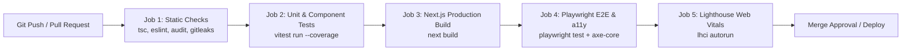

# Master Software Testing and Quality Assurance Strategy
**Project:** 3A Technology Solutions Corporate Web Platform & 3A Techvolution Academy  
**Role:** Senior Software Quality Engineer  
**Status:** Authoritative Quality Assurance Strategy Baseline (Proposed Automation Framework)  
**Version:** 1.0  
**Date:** November 2026  
**Governing Documents:** [`PRD.md`](file:///c:/Users/DELL/Desktop/3A%20TECHNOLOGY/prd.md) (v2.0), [`AGENTS.md`](file:///c:/Users/DELL/Desktop/3A%20TECHNOLOGY/AGENTS.md), [`docs/architecture.md`](file:///c:/Users/DELL/Desktop/3A%20TECHNOLOGY/docs/architecture.md), [`docs/architecture-essential.md`](file:///c:/Users/DELL/Desktop/3A%20TECHNOLOGY/docs/architecture-essential.md), [`docs/security-specification.md`](file:///c:/Users/DELL/Desktop/3A%20TECHNOLOGY/docs/security-specification.md), [`docs/api-specification.md`](file:///c:/Users/DELL/Desktop/3A%20TECHNOLOGY/docs/api-specification.md), [`docs/design.md`](file:///c:/Users/DELL/Desktop/3A%20TECHNOLOGY/docs/design.md)  

---

## 1. Executive Summary & Verification Standard

This document establishes the authoritative software quality assurance, automated test suite architecture, accessibility audit protocols, and security verification standards for the **3A Technology Solutions** web platform and **3A TECHVOLUTION ACADEMY**.

### 1.1 The Evidence-Based Verification Standard (`AGENTS.md` Section 5.1)
- **Golden Rule:** Never declare a feature "complete," "working," or "verified" without executing concrete verification commands and inspecting output.
- **Zero Fabrication Policy:** Hypotheses, assumptions, or silent omissions are unacceptable.
- **Test State Classification:**
  1. **Executed & Passed:** Verification command run in environment; terminal logs inspectable.
  2. **Executed & Failed:** Verification command run; defects recorded.
  3. **Planned (Proposed):** Fully specified in this document, ready for execution upon framework initialization.
  4. **Unexecuted:** Explicitly declared with technical justification.

> [!NOTE]
> **Current Project State:** At the present stage, no application source code has been implemented. Therefore, all test suites, automation scripts, and CI workflows defined in this document represent the **Approved Testing Specification & Planned Automation Matrix**. No synthetic test passes or fabricated test run outputs are recorded.

---

## 2. Testing Levels & Verification Taxonomy

The testing architecture is structured into 8 distinct levels calibrated to 3A's architectural invariants (Next.js 14+ App Router, zero runtime database, static TypeScript content models, and Server Actions):

```mermaid
graph TD
    subgraph L1 [Level 1: Static Code Analysis & Type Safety]
        TypeScript[TypeScript strict Compiler: tsc --noEmit]
        ESLint[ESLint: Security, a11y, import boundaries]
        DependencyCheck[npm audit & license scan]
    end

    subgraph L2 [Level 2: Unit Testing]
        ZodSchemas[Zod Schema Validators: enquiry.ts, quote.ts]
        Honeypot[Honeypot Logic & CRLF Sanitizers]
        ConfigHelpers[URL Encoding & Config Helpers: site.ts]
    end

    subgraph L3 [Level 3: Component & UI Integration]
        RadixDrawer[Mobile Drawer Focus Trap & ARIA Tests]
        FormStates[QuoteForm & ContactForm State Transitions]
        FilterBar[Portfolio Category Filter Buttons]
    end

    subgraph L4 [Level 4: Server Action & Integration]
        RateLimiting[Sliding-Window IP Rate Limiter Mock]
        EmailDriver[Resend / SMTP Gateway Driver Mocks]
        StaticQueries[src/lib/content.ts Query Integrity]
    end

    subgraph L5 [Level 5: End-to-End E2E Browser Testing]
        PlaywrightUser[Full User Journeys across Viewports]
        QuoteFlow[Form Scoping Intake -> Confirmation Card]
        DeepLinks[WhatsApp & External Enrollment Handoffs]
    end

    subgraph L6 [Level 6: Accessibility a11y & Contrast Audit]
        AxeCore[Playwright axe-core Automated Scan]
        ContrastRules[Yellow/White Contrast Prevention Rule AUD-01]
        KeyboardNav[Tab Navigation & Focus Ring Checks]
    end

    subgraph L7 [Level 7: Performance & Core Web Vitals]
        Lighthouse[Lighthouse CLI: Performance >= 90]
        WebPCheck[Next.js Image Optimization & CLS < 0.05]
    end

    subgraph L8 [Level 8: Security Verification]
        SecurityHeaders[HTTP Security Headers Probe]
        SecretScan[Gitleaks Token Detection]
        XSSInjection[Negative Payload Fuzzing]
    end

    L1 --> L2 --> L3 --> L4 --> L5 --> L6 --> L7 --> L8
```



---

## 3. Detailed Testing Level Specifications

### 3.1 Level 1: Static Code Analysis & Type Verification
- **Purpose:** Prevent syntax errors, type divergence, dead code, security anti-patterns, and circular imports before compilation.
- **Scope:** 100% of `.ts`, `.tsx`, `.mjs`, and configuration files.
- **Frameworks & Tools:**
  - `tsc --noEmit` (TypeScript Compiler v5.4+ with `strict: true`).
  - `eslint` (with `@typescript-eslint`, `eslint-plugin-react-hooks`, `eslint-plugin-jsx-a11y`, `eslint-plugin-next`).
  - `madge --circular src/` (Circular dependency detector).
  - `npm audit --audit-level=high` (Dependency vulnerability checker).
- **Dependencies & Data:** Pure static code; zero runtime dependencies.
- **Planned Execution Command:**
  ```powershell
  npm run typecheck && npm run lint && npm audit --audit-level=high
  ```
- **Failure Handling:** Blocks the CI pipeline immediately; pull requests cannot be merged with any linting or type warning.

---

### 3.2 Level 2: Unit Testing (Pure Logic & Validation Schemas)
- **Purpose:** Verify deterministic business logic, validation schemas, string sanitizers, and URL builders in complete isolation.
- **Scope:**
  - `src/lib/validations/enquiry.ts` (`ContactEnquirySchema`, `QuoteRequestSchema`).
  - `src/lib/email/sanitizer.ts` (CRLF injection prevention).
  - `src/lib/whatsapp.ts` (Contextual click-to-chat URL encoding).
  - `src/lib/content.ts` (Static query filter functions).
- **Frameworks & Tools:** `vitest` (Vite-native unit test runner for ultra-fast ESM execution).
- **Test Data Practice:** Synthetic, randomized edge cases (empty strings, maximum length strings, malformed email addresses, control characters). **Zero real customer data.**
- **Planned Execution Command:**
  ```powershell
  npm run test:unit
  ```
- **Representative Unit Test Scenarios:**
  1. *Zod Quote Schema:* Validates that `budgetRange` rejects unlisted string values and accepts only approved enum options.
  2. *Honeypot Trap:* Verifies that any non-empty string in `hp_field` fails schema validation or triggers the silent-drop flag.
  3. *CRLF Stripping:* Verifies that `sanitizer.cleanHeader("Ibrahim\r\nBcc:spam@attacker.com")` returns `"Ibrahim"`.
  4. *WhatsApp URL:* Verifies that `generateWhatsAppUrl("+2348012345678", "Hello World & Tech")` outputs `https://wa.me/2348012345678?text=Hello%20World%20%26%20Tech`.

---

### 3.3 Level 3: Component & UI Integration Testing
- **Purpose:** Verify component rendering, conditional UI states (loading, error, empty, success), accessibility attributes, and keyboard traps.
- **Scope:** Isolated UI components under `src/components/`.
- **Frameworks & Tools:** `vitest` + `@testing-library/react` + `@testing-library/user-event` + `jsdom`.
- **Key Scenarios:**
  1. *Mobile Navigation Drawer (`MobileDrawer.tsx`):*
     - Renders closed by default.
     - Clicking the hamburger button opens the drawer and sets `aria-expanded="true"`.
     - Pressing `Escape` key closes the drawer and restores focus to the toggle button.
     - Tabbing cycles strictly within the drawer (focus trap test).
  2. *Quote Intake Form (`QuoteForm.tsx`):*
     - Submitting an empty form triggers inline accessible error messages linked via `aria-describedby`.
     - Submitting valid data transitions button into disabled loading state with animated SVG spinner.
  3. *Empty State Component (`EmptyState.tsx`):*
     - When category filters match 0 case studies, renders the branded empty state card with a working "Reset Filters" action.

---

### 3.4 Level 4: Server Action & Service Integration Testing
- **Purpose:** Validate Next.js Server Actions, anti-spam mechanisms, rate-limiting guards, and email notification formatting without dispatching real emails.
- **Scope:** `src/actions/enquiry.ts` and `src/lib/email/`.
- **Frameworks & Tools:** `vitest` with network mocking via `msw` (Mock Service Worker) or Vitest spy mocks (`vi.spyOn`).
- **Dependencies & Mocks:**
  - Mock Resend API HTTP endpoint (`https://api.resend.com/emails`) returning `200 OK` or `500 Error`.
  - In-memory rate-limiter store resetting between test runs.
- **Negative & Security Scenarios:**
  1. *Spam Submission:* Action receives payload with `hp_field: "buy-viagra-now"`. Action logs zero errors, invokes zero email dispatch calls, and returns `{ success: true }`.
  2. *Rate Limiting Exhaustion:* IP `192.168.1.100` submits 5 successful requests. 6th request within the rolling hour is rejected with HTTP `429` / `{ success: false, error: "RATE_LIMIT_EXCEEDED" }`.
  3. *Gateway Outage Simulation:* Resend API mock returns HTTP `503 Service Unavailable`. Action catches error gracefully, returns `{ success: false, error: "..." }`, and confirms form state is non-destructively preserved (`ARCH-10`).

---

### 3.5 Level 5: End-to-End (E2E) Multi-Browser Testing
- **Purpose:** Verify complete user journeys in real headless browser environments across mobile and desktop form factors.
- **Scope:** Complete Next.js production build (`next start`) executing on `http://localhost:3000`.
- **Frameworks & Tools:** `playwright` (Chromium, Firefox, WebKit, Mobile Safari, Mobile Chrome).
- **Execution Viewports:**
  - Desktop: `1280 x 800` (Chromium / WebKit)
  - Mobile: `390 x 844` (iPhone 14 / Mobile Safari emulation)
- **Planned Execution Command:**
  ```powershell
  npm run test:e2e
  ```
- **Core E2E User Journeys:**
  - **Journey 1 (Commercial Discovery & Scoping Intake):**
    Visitor lands on `/` $\rightarrow$ clicks "Explore Services" $\rightarrow$ navigates to `/services/ai-automation` $\rightarrow$ clicks "Request a Quote for AI Automation" $\rightarrow$ verifies `/request-quote?service=ai-automation` has AI category pre-selected $\rightarrow$ fills form $\rightarrow$ submits $\rightarrow$ verifies Success State Card renders.
  - **Journey 2 (Academy Pathway & External Gateway):**
    Visitor lands on `/` $\rightarrow$ clicks "Explore Academy Courses" $\rightarrow$ lands on `/academy` $\rightarrow$ navigates to `/academy/programmes` $\rightarrow$ clicks "Enroll in Cohort" $\rightarrow$ verifies target opens external Google Form in a new tab with `rel="noopener noreferrer"`.
  - **Journey 3 (Responsive Navigation Drawer):**
    Mobile viewport loaded $\rightarrow$ header shows logo and hamburger button $\rightarrow$ clicks hamburger $\rightarrow$ drawer expands $\rightarrow$ clicks "Contact Us" $\rightarrow$ drawer closes $\rightarrow$ page scrolls to contact form.

---

### 3.6 Level 6: Accessibility (a11y) & Contrast Verification
- **Purpose:** Guarantee compliance with **WCAG 2.1 Level AA** and prevent contrast defects (`AUD-01`).
- **Frameworks & Tools:** `@axe-core/playwright` integrated into E2E test runs.
- **Mandatory Accessibility Assertions:**
  1. **Zero Axe Violations:** No critical or serious accessibility violations across `/`, `/services`, `/projects`, `/academy`, `/contact`, `/request-quote`, `/privacy`, `/terms`, and `/404`.
  2. **Mandatory Contrast Rule Enforcement (AUD-01):**
     - Assert that all buttons with background `brand-yellow` (`#F7C800`) compute to text color `brand-charcoal` (`#1F2937`) or `brand-navy` (`#0B2B6B`).
     - Automated assertion checking that no DOM element contains yellow text on white or light gray backgrounds.
  3. **Skip Link Operability:** Verify that the first Tab keypress focuses the `<a href="#main-content">` skip link.
  4. **Form Error Accessibility:** Verify that submitting invalid forms sets `aria-invalid="true"` and associates error messages via `aria-describedby`.

---

### 3.7 Level 7: Performance & Core Web Vitals Audits
- **Purpose:** Ensure sub-second mobile page loads across Nigerian network conditions.
- **Frameworks & Tools:** Google Lighthouse CI (`@lhci/cli`) running against local production build.
- **Threshold Assertions (Failing if below):**
  - **Performance:** $\ge 90$
  - **Accessibility:** $\ge 95$
  - **Best Practices:** $\ge 95$
  - **SEO:** $\ge 95$
- **Core Web Vitals Thresholds:**
  - Largest Contentful Paint (LCP): $< 2.2\text{ seconds}$ on simulated 4G mobile.
  - Cumulative Layout Shift (CLS): $< 0.05$ (guaranteed by Next.js `<Image />` dimensions).
  - First Input Delay (FID) / Interaction to Next Paint (INP): $< 100\text{ ms}$.

---

### 3.8 Level 8: Security Verification & Vulnerability Scanning
- **Purpose:** Validate defense-in-depth security controls (`SEC-01` to `SEC-16`).
- **Frameworks & Tools:** `curl`, `gitleaks`, Playwright security injection fixtures.
- **Automated Security Test Scenarios:**
  1. *Secret Detection:* Execute `gitleaks detect --source=.` ensuring zero API tokens or private keys exist in working directories or Git history.
  2. *Security Headers Audit:* Probe local server response headers verifying:
     - `Strict-Transport-Security` present.
     - `X-Frame-Options: DENY`.
     - `X-Content-Type-Options: nosniff`.
     - `Content-Security-Policy` active.
  3. *XSS Fuzzing:* Submit form payloads containing `<script>alert('XSS')</script>` and ``. Verify that outputs are escaped and rendered as harmless text strings.
  4. *Tab-Nabbing Audit:* Query all `<a>` tags with `target="_blank"` across the rendered DOM; assert that 100% of them possess `rel="noopener noreferrer"`.

---

## 4. Requirements to Verification Mapping Matrix

| PRD Requirement ID | Feature / System Area | Primary Verification Level | Automated Test Mechanism | Acceptance Evidence Standard |
| :--- | :--- | :--- | :--- | :--- |
| **FR-01** | Global Navigation & Drawer | Level 3 & Level 5 | Playwright E2E + Radix Dialog test | Drawer expands, traps focus, responds to `Escape`, closes on link click. |
| **FR-02** | Services Catalog & Dynamic Slugs | Level 2 & Level 5 | Vitest content test + Playwright route scan | All 5 service slugs resolve with 200 OK; invalid slug triggers Next.js 404. |
| **FR-03** | Portfolio Directory & Case Studies | Level 3 & Level 5 | Component filter test + Playwright test | Status badges visible; category pills filter list; empty state renders if 0 matches. |
| **FR-04** | Academy Gateway & External Links | Level 5 & Level 8 | Playwright anchor inspection | Course cards display modules; enrollment CTA has `rel="noopener noreferrer"`. |
| **FR-05** | General Contact Form Intake | Level 2, Level 4, Level 5 | Vitest schema test + Playwright submit test | Valid submit returns Success Card; empty submit shows accessible inline errors. |
| **FR-06** | Commercial Project Quote Intake | Level 2, Level 4, Level 5 | Vitest schema test + Playwright prefill test | `/request-quote?service=ai-automation` pre-selects category; Zod validates budget/timeline. |
| **FR-07** | WhatsApp Direct Integration | Level 2 & Level 5 | Vitest URL test + Playwright link click test | Pre-filled URL encoding verified; number imported from `siteConfig`. |
| **FR-08** | Statically Typed Content Model | Level 1 | `npx tsc --noEmit` build check | Zero compiler errors; strict interface conformance across all data files. |
| **FR-09** | Technical SEO, Metadata & Sitemap | Level 5 & Level 7 | Playwright HTTP probe + Lighthouse SEO | `sitemap.xml` and `robots.txt` return valid 200 OK; Open Graph tags present. |
| **FR-10** | Error Handling & Recovery | Level 5 | Playwright 404/500 simulation test | Visiting `/non-existent` renders branded 404 with working Home button. |
| **FR-11** | Privacy & Zero Tracking Pixels | Level 8 | Browser network trace audit | Zero network requests to Meta, Google Analytics, or third-party ad networks. |

---

## 5. Test Data Management & Privacy Standards

In strict accordance with the **Nigeria Data Protection Act (NDPA 2023 / NDPR)** and `AGENTS.md` Section 6:
1. **Zero Real Customer Data:** Real prospective client emails, personal telephone numbers, or confidential commercial scoping briefs must **never be used in test fixtures or mock datasets**.
2. **Deterministic Synthetic Test Data:** All test suites must use synthetic, standardized mock datasets:
   ```typescript
   export const mockQuotePayload = {
     fullName: "Test User Ibrahim",
     company: "Acme Logistics Test Ltd",
     email: "test.prospect@example.com",
     phone: "+2348012345678",
     service: "ai-automation" as const,
     budgetRange: "₦3,000,000 – ₦7,500,000" as const,
     timeline: "1 – 3 months" as const,
     projectDescription: "This is an automated synthetic scoping test payload exceeding 20 characters.",
     hp_field: "",
   };
   ```
3. **Dedicated Domain Reservation:** Synthetic test emails must strictly utilize RFC 2606 reserved domains (`@example.com`, `@example.org`, `@test.ng`) to guarantee test dispatches cannot accidentally reach real individuals.

---

## 6. External Service Mocking and Integration Test Philosophy

Because Phase 1 operates without a persistent database and integrates with external communication services (Resend API, WhatsApp, Google Forms), integration tests must enforce clear boundaries:

| External System | Integration Style | Testing & Mocking Strategy |
| :--- | :--- | :--- |
| **Resend Email API** | HTTPS REST API | **Mocked in Unit/CI:** Mocked via MSW or Vitest spy; intercepts outbound POSTs and verifies payload HTML formatting.<br>**Live Smoke Test in Staging:** A single real test email dispatched during Phase 6 deployment verification using a designated QA inbox. |
| **WhatsApp Business** | Browser `wa.me` URI Protocol | **Never Mock Network Protocol:** Verified by testing the generated anchor string in the DOM; automated test asserts that `href` matches expected encoded query string. |
| **Google Forms (Academy)**| External Hosted Form | **Anchor Verification Only:** Automated test verifies the link destination, HTTP 200 reachability, and `rel="noopener noreferrer"` attributes. |

---

## 7. Flaky Test Prevention and Investigation Protocol

Flaky tests degrade engineering velocity and erode trust in verification suites. The following architectural standards are mandated to guarantee determinism:

### 7.1 Flakiness Prevention Rules
1. **Zero Arbitrary Time Delays (`sleep` / `setTimeout`):** Hardcoded time waits are strictly prohibited. Tests must await explicit deterministic signals:
   - *Prohibited:* `await page.waitForTimeout(3000);`
   - *Mandatory:* `await expect(page.getByRole('alert')).toBeVisible();`
2. **Explicit Form State Awaiting:** When testing form submissions, tests must wait for the disabled button state to resolve or the Success Card to attach to the DOM.
3. **Isolated Edge In-Memory Caches:** Rate-limiting memory caches must be reset before each integration test scenario to prevent cross-test interference.

### 7.2 Flaky Test Remediation Workflow
If a test fails intermittently in CI:
1. **Quarantine & Tag:** Mark the test with `.fixme()` or isolate it; do not disable assertions silently.
2. **Reproduce Locally:** Execute the test 50 times in a loop:
   ```powershell
   npx vitest run --repeat 50
   # or for Playwright:
   npx playwright test --repeat-each=20
   ```
3. **Trace Inspection:** Inspect Playwright visual trace recordings (`trace.zip`), network logs, and DOM snapshots to identify timing race conditions.
4. **Fix & Verify:** Adjust selectors to use user-visible accessibility roles (`getByRole`, `getByLabel`) rather than brittle CSS class selectors.

---

## 8. Continuous Integration (CI) Automation Architecture

The proposed CI workflow defines the automated gatekeeper pipeline that runs on every pull request and commit to `main`:



### Proposed GitHub Actions Workflow (`.github/workflows/ci.yml`):
```yaml
name: Continuous Quality Assurance & Security Gate

on:
  push:
    branches: [main]
  pull_request:
    branches: [main]

jobs:
  static-and-unit:
    name: Typecheck, Lint & Unit Tests
    runs-on: ubuntu-latest
    steps:
      - uses: actions/checkout@v4
      - uses: actions/setup-node@v4
        with:
          node-version: 20
          cache: 'npm'
      - run: npm ci
      - run: npm run typecheck
      - run: npm run lint
      - run: npm audit --audit-level=high
      - run: npm run test:unit

  build-and-e2e:
    name: Production Build & Playwright E2E
    needs: static-and-unit
    runs-on: ubuntu-latest
    steps:
      - uses: actions/checkout@v4
      - uses: actions/setup-node@v4
        with:
          node-version: 20
          cache: 'npm'
      - run: npm ci
      - run: npx playwright install --with-deps
      - run: npm run build
      - run: npm run test:e2e
      - uses: actions/upload-artifact@v4
        if: failure()
        with:
          name: playwright-traces
          path: test-results/
```

---

## 9. Definition of Tested (Evidence Required to Claim Completion)

In accordance with `AGENTS.md` Section 5 and Section 9, an AI agent or software engineer may **never claim a change has been tested** unless all of the following evidentiary criteria are met and documented in the completion report:

1. **Clean Typecheck Output:** Command `npm run typecheck` (`tsc --noEmit`) completed with exit code `0` and zero warnings.
2. **Clean Linting Output:** Command `npm run lint` completed with exit code `0`.
3. **Unit / Component Test Execution:** Relevant unit tests executed via `npm run test:unit`, displaying passing test suites and assertion counts.
4. **Successful Production Build:** Command `npm run build` completed successfully, demonstrating that all static pages pre-rendered without runtime exceptions.
5. **Exact Command Log Inclusion:** The completion report must include the exact command lines executed, terminal exit codes, and output summaries.

---

## 10. Implementation Status & Next Steps

| Workstream / Capability | Strategy Specification Status | Active Implementation Status |
| :--- | :--- | :--- |
| **Static Analysis (`tsc`, ESLint)** | **Approved & Specified** | Awaiting package initialization (Phase 2). |
| **Unit Testing (Vitest)** | **Approved & Specified** | Awaiting package initialization (Phase 2). |
| **Component Testing (RTL)** | **Approved & Specified** | Awaiting package initialization (Phase 2). |
| **E2E Testing (Playwright)** | **Approved & Specified** | Awaiting package initialization (Phase 2). |
| **Accessibility Testing (axe-core)**| **Approved & Specified** | Awaiting package initialization (Phase 2). |
| **Security Scanning (Gitleaks)** | **Approved & Specified** | Awaiting pre-commit setup (Phase 2). |
| **Continuous Integration (GitHub)** | **Approved & Specified** | Awaiting `.github/workflows/ci.yml` commit. |

### Immediate Next Step:
With the entire architectural and quality assurance baseline established across `PRD.md`, `AGENTS.md`, `architecture.md`, `architecture-essential.md`, `data-architecture.md`, `database-schema.md`, `api-specification.md`, `design.md`, and `testing-strategy.md`, the platform is ready for **Phase 2 Implementation Scaffolding** upon stakeholder approval of the pending decisions in `docs/research-and-decisions.md`.
