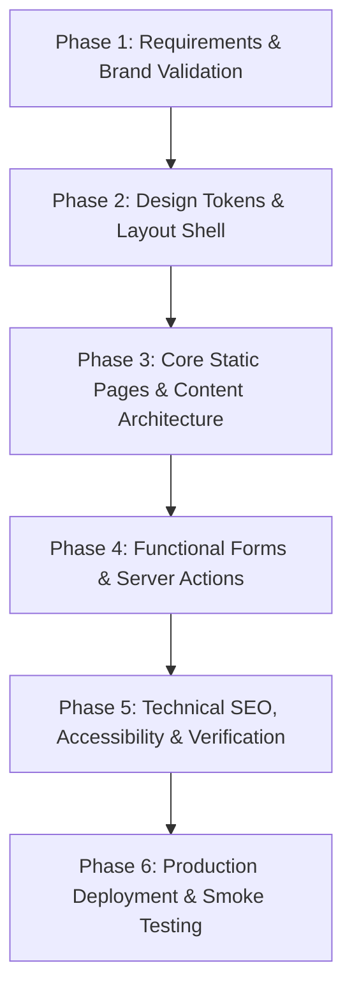

# Product Requirements Document (PRD)
## 3A Technology Solutions Corporate Website & 3A Techvolution Academy

**Document Status:** Approved for Technical Architecture & Design  
**Version:** 2.0 (Refined & Validated)  
**Product:** 3A Technology Solutions Corporate Web Platform  
**Sub-Brand / Educational Arm:** 3A TECHVOLUTION ACADEMY  
**Implementation Architecture:** Next.js (App Router) + TypeScript + Tailwind CSS  
**Target Market:** Nigeria (Primary) & International Clients (Secondary)  
**Authoritative Brand Standards:** *3A Technology Solutions Brand Identity Standards v1.0 (October 2026)*

---

## 1. Executive Summary & Brand Foundation

### 1.1 Product Purpose
The purpose of this project is to engineer a high-performance, accessible, and conversion-focused corporate website for **3A Technology Solutions**. The platform serves as the definitive digital flagship for the company, establishing commercial credibility, showcasing applied technical expertise across AI and software engineering, generating qualified commercial client leads, and introducing prospective learners to its training arm, **3A TECHVOLUTION ACADEMY**.

### 1.2 Brand Essence & Core Principles
- **Brand Essence:** *Technology that works for people and business.*
- **Brand Motto / Tagline:** *Ideas • Technology • Impact*
- **Brand Personality Pillars:**
  1. **SMART:** Communicates with substance and clarity without unnecessary complexity.
  2. **SIMPLE:** Demystifies advanced technology so businesses and learners can understand and apply it.
  3. **PROFESSIONAL:** Delivers an intentional, polished, robust, and dependable experience across all touchpoints.
  4. **HUMAN:** Approachable, respectful, and grounded in real-world human needs; speaks to people, not machines.
  5. **FUTURE-READY:** Leverages contemporary, scalable technologies while remaining anchored in practical utility.
- **Core Operating Principle:** 3A does not sell technology for technology's sake. The platform must highlight how technology solves real problems—improving productivity, communication, visibility, decision-making, and commercial growth.

---

## 2. Business Objectives & Success Metrics

### 2.1 Primary Business Objectives
1. **Commercial Credibility:** Establish an authoritative online presence positioning 3A as a dependable technology partner for Nigerian enterprises, SMEs, startups, and institutions.
2. **Qualified Lead Generation:** Capture structured, actionable enquiries for custom software engineering, website development, AI integrations, data science, and workflow automation.
3. **Proven Capability Showcase:** Present documented, verified case studies and technical prototypes demonstrating tangible problem-solving capabilities.
4. **Academy Funnel:** Provide a dedicated, frictionless gateway for prospective students to discover practical courses and initiate enrollment enquiries through approved external channels.
5. **Organic Search Visibility:** Implement semantic technical SEO, fast page loads, and structured data to capture search demand across Nigerian and regional technology queries.
6. **Maintainable Codebase Foundation:** Deliver a modular, statically generated codebase using TypeScript and static data files that can later transition to a headless CMS without requiring a rewrite.

### 2.2 Key Performance Indicators (KPIs)
Performance will be evaluated post-launch against the following quantitative events:
- Total volume and conversion rate of valid project enquiries submitted via `/contact` and `/request-quote`.
- Volume of click-through events initiating conversations via the official WhatsApp bridge.
- Volume of click-through events to 3A TECHVOLUTION ACADEMY registration pathways.
- Average page engagement and scroll depth on Service detail pages and Project case studies.
- Lighthouse / Core Web Vitals score thresholds: Performance ≥ 90, Accessibility ≥ 95, Best Practices ≥ 95, SEO ≥ 95.
- Form delivery reliability: 100% successful dispatch rate of validated submissions to the administrative notification inbox.

*(Note: Baseline quantitative volume targets will be calibrated following the first 60 days of production telemetry.)*

---

## 3. Target Audiences & Dual-Pathway Experience

### 3.1 Primary Audience Personas
1. **Business & Enterprise Clients:**
   - *Profiles:* Small and medium-sized enterprises (SMEs), corporate institutions, founders, educational administrators, and operational leads.
   - *Needs:* Online business visibility, bespoke web/mobile software, internal workflow automation, data analysis, and pragmatic AI integration.
   - *Primary Intent:* "I need a technology solution to solve a business bottleneck or scale my company."
2. **Learners & Tech Enthusiasts:**
   - *Profiles:* University undergraduates, recent graduates, NYSC corps members, career transitioners, and upskilling professionals.
   - *Needs:* Practical, industry-relevant curriculum in programming, AI engineering, and data analysis with clear guidance and mentorship.
   - *Primary Intent:* "I want to acquire practical technology skills through 3A TECHVOLUTION ACADEMY."

### 3.2 Dual-Pathway User Journey
The homepage hero and global navigation must immediately resolve visitor intent through a non-competing, two-pillar visual pathway:
- **Pathway A (Commercial Solutions):** Primary CTA directed to `/services` and `/request-quote`.
- **Pathway B (Technology Education):** Secondary distinct CTA directed to `/academy`.
Neither pathway shall diminish the other; the design must convey that 3A is both a capable technology engineering company and an academy builder.

---

## 4. Release Scope & Boundary Management

### 4.1 In Scope (Initial Production Release)
- Fully responsive corporate web application built with Next.js (App Router), TypeScript, and Tailwind CSS.
- Global branded navigation bar with desktop dropdowns and accessible mobile drawer menu.
- Homepage featuring value proposition hero, dual-pathway routing, core service cards, featured project highlights, operating methodology, academy intro, trust indicators, and conversion footer.
- Services architecture: Services index page (`/services`) and dedicated detail pages for each confirmed service category (`/services/[slug]`).
- Portfolio architecture: Projects index page (`/projects`) with category filtering and individual case-study pages (`/projects/[slug]`).
- Academy architecture: Dedicated academy landing page (`/academy`) and programme details index (`/academy/programmes`).
- Company background page (`/about`) articulating 3A's mission, values, leadership philosophy, and dual-entity model.
- Direct contact page (`/contact`) with full interactive enquiry form, direct phone/email links, and office address.
- Request-a-Quote page (`/request-quote`) with multi-step structured intake for scope, timeline, and budget.
- Legal compliance pages: Privacy Policy (`/privacy`) and Terms of Service (`/terms`) tailored for Nigerian data protection standards (NDPR).
- WhatsApp direct integration utility with pre-filled enquiry parameters.
- Server-side form validation (Zod) and automated email dispatch integration.
- Anti-spam defenses (honeypot fields and IP-based rate limiting).
- Complete technical SEO package: dynamic XML sitemap, `robots.txt`, Open Graph / Twitter metadata, canonical URLs, and JSON-LD schema markup.
- Custom branded 404 (`not-found.tsx`) and 500 (`error.tsx`) recovery pages.

### 4.2 Out of Scope (Explicitly Deferred)
To ensure delivery speed, security, and architectural simplicity, the following capabilities are strictly excluded from the initial release:
- **No In-House Learning Management System (LMS):** No student logins, video streaming, quiz engines, or dashboard accounts.
- **No Direct Payment Gateway Processing:** No Paystack, Flutterwave, Stripe, or checkout cart logic. (All billing is handled via direct enterprise invoicing or manual registration channels).
- **No Client Management Portal:** No client authentication, ticket submission system, or proprietary client project dashboards.
- **No Autonomous Web Chatbots / AI Agents:** No conversational floating chat widgets embedded on the site.
- **No Headless or Database-Backed CMS:** Content is maintained statically in version-controlled TypeScript data files.
- **No Relational Database Runtime:** No PostgreSQL, MySQL, or MongoDB dependencies required for baseline runtime.

---

## 5. Service Taxonomy & Consistency Mapping

To prevent contradictions across navigation, sitemaps, and content models, the service taxonomy is standardized into the following five core commercial categories (with educational services housed under the Academy):

| Category Key / Slug | Official Service Title | Core Offerings & Deliverables | Primary Target Audience |
| :--- | :--- | :--- | :--- |
| `web-development` | **Web & Digital Product Development** | Corporate websites, custom web applications, e-commerce storefronts, landing pages, responsive UI/UX design, web performance optimization. | SMEs, startups, schools, corporate bodies. |
| `custom-software` | **Custom Software Engineering** | Bespoke business applications, internal tools, record management systems, database architectures, RESTful API development. | Mid-market businesses, enterprise operations. |
| `ai-automation` | **Artificial Intelligence & Automation** | Generative AI integration, workflow automation pipelines, bespoke AI assistants, document parsing, process optimization. | Companies seeking operational efficiency. |
| `data-science-analytics` | **Data Science & Analytics** | Data cleaning/transformation, predictive machine learning models, business intelligence dashboards, computer vision implementations. | Organizations with unutilized business data. |
| `brand-digital-media` | **Branding & Digital Media** | Corporate visual identity design, logo vectorization, digital marketing collateral, technical presentation graphics, social media assets. | Growing businesses establishing market identity. |

*(Note: Technical training and student mentorship are unified under **3A TECHVOLUTION ACADEMY** at `/academy` to avoid confusing commercial consulting with educational courses).*

---

## 6. Information Architecture & Sitemap Specification

### 6.1 Route Tree
```text
/
├── services/
│   ├── index (Services Overview)
│   └── [slug]/ (Service Category Details: web-development, custom-software, ai-automation, data-science-analytics, brand-digital-media)
├── projects/
│   ├── index (Case Studies & Portfolio Directory)
│   └── [slug]/ (Individual Project Case Study)
├── academy/
│   ├── index (3A Techvolution Academy Landing)
│   └── programmes/ (Confirmed Course Catalog & Curriculum Details)
├── about/ (Company Mission, Principles & Vision)
├── contact/ (Direct Contact Information & General Enquiry Form)
├── request-quote/ (Detailed Commercial Project Intake Form)
├── privacy/ (NDPR-Compliant Privacy Policy)
├── terms/ (Terms of Service)
├── sitemap.xml (Automated Dynamic XML Sitemap)
└── robots.txt (Automated Search Engine Crawler Directives)
```

### 6.2 Global Navigation Rules
- **Header Navigation Items:**
  - `Home` (`/`)
  - `Services` (`/services` with dropdown to category slugs)
  - `Projects` (`/projects`)
  - `Academy` (`/academy`)
  - `About` (`/about`)
  - `Contact` (`/contact`)
- **Header CTAs:**
  - Secondary Link: `Explore Academy` (`/academy`)
  - Primary Button: `Request a Quote` (`/request-quote`)
- **Footer Structure:**
  - Column 1: Official 3A Emblem & Wordmark, Tagline (*Ideas • Technology • Impact*), brief company positioning statement.
  - Column 2: Quick Links (Services directory, Portfolio, About 3A, Privacy, Terms).
  - Column 3: 3A Techvolution Academy (Academy overview, Programmes, Student enquiry, Community).
  - Column 4: Verified Contact Channels (Official email, Phone, Verified WhatsApp click-to-chat, Physical office location in Nigeria).
  - Bottom Bar: Copyright notice and NDPR compliance acknowledgment.

---

## 7. Functional Requirements & Acceptance Criteria

### FR-01: Global Responsive Navigation & Mobile Drawer
- **Description:** Provide seamless, accessible page routing across all screen form factors.
- **Acceptance Criteria:**
  - `AC-01.1`: On desktop viewport (≥ 1024px), all primary navigation links and action buttons must be visible with active page indicator styling.
  - `AC-01.2`: On mobile viewport (< 1024px), a hamburger toggle must expand a full-height navigation drawer with clear touch targets (minimum 44x44px).
  - `AC-01.3`: The mobile drawer must be accessible via keyboard (Tab, Shift+Tab), trap focus while open, and close upon pressing the `Escape` key or clicking any link.
  - `AC-01.4`: The navigation bar must support a sticky glassmorphic or solid state on scroll with a smooth transition and appropriate z-index layering.

### FR-02: Commercial Service Directory & Dynamic Detail Routing
- **Description:** Enable prospective clients to explore 3A's capabilities and drill down into specific service pages.
- **Acceptance Criteria:**
  - `AC-02.1`: The `/services` page must render cards for all five defined categories with title, icon, summary, and bulleted deliverables.
  - `AC-02.2`: Dynamic route `/services/[slug]` must validate the `slug` parameter against static TypeScript data; invalid slugs must trigger Next.js `notFound()`.
  - `AC-02.3`: Each service detail page must feature: Problem Context, Target Audience, Technical Approach, Typical Deliverables, and a dedicated CTA linking to `/request-quote?service=[slug]` with the service pre-selected.

### FR-03: Portfolio Showcase & Case Study Engine
- **Description:** Display verified technical projects, prototypes, and client engagements with complete transparency regarding their development stage.
- **Acceptance Criteria:**
  - `AC-03.1`: The `/projects` directory must display project cards filterable by category tags (e.g., `Web`, `AI & ML`, `Automation`, `Software`).
  - `AC-03.2`: Each project must carry an explicit status badge: `Client Project`, `Live Production`, `Deployed Prototype`, or `Research & Development`.
  - `AC-03.3`: Initial featured projects must include: *MarketMind AI*, *Deforestation Analysis*, *Medicinal Plant Recognition System*, *Image Compression Tool*, and *Electronic Logbook*.
  - `AC-03.4`: Individual case study pages (`/projects/[slug]`) must render: Project Overview, The Challenge, The Technical Solution, Technologies Used (with badge UI), Architecture / Screenshots, and verified Live Demo / GitHub links (if publicly approved).

### FR-04: 3A Techvolution Academy Presentation & External Enrollment Gateway
- **Description:** Present the academy brand, educational ethos, and available training tracks without embedding a complex LMS.
- **Acceptance Criteria:**
  - `AC-04.1`: `/academy` must clearly distinguish the academy's mission: hands-on, practical technology education for students, graduates, and professionals.
  - `AC-04.2`: Course cards on `/academy/programmes` must specify Track Name, Target Audience, Skill Level, Key Curriculum Modules, Delivery Format (e.g., Weekend Cohort / In-Person / Hybrid), and Duration.
  - `AC-04.3`: Course fees and schedules must display verified values only; if unconfirmed, the card must display "Inquire for Schedule & Pricing".
  - `AC-04.4`: The "Enroll Now" or "Enquire about this Track" button must open an approved external enrollment form (e.g., designated Google Form) or pre-configured WhatsApp chat in a new tab with `rel="noopener noreferrer"`.

### FR-05: General Contact Enquiry Form
- **Description:** Provide a secure, validated contact form on `/contact` for general enquiries.
- **Acceptance Criteria:**
  - `AC-05.1`: Form fields must include: Full Name (required, min 2 chars), Email Address (required, valid email RFC 5322), Phone Number (optional), Subject / Service (optional), and Message (required, min 15 chars).
  - `AC-05.2`: Client-side validation must execute on blur/submit using React Hook Form + Zod schema validation, highlighting inline error states in accessible contrast.
  - `AC-05.3`: Form submission must route to a Next.js Server Action or `/api/contact` endpoint that validates inputs server-side, verifies the honeypot field is empty, and applies rate limiting.
  - `AC-05.4`: Upon successful dispatch, a prominent success feedback message must be displayed and form fields cleared. Upon network or server failure, an error alert must display with preserved user inputs.

### FR-06: Commercial Project Quote Request Intake
- **Description:** Provide a dedicated commercial intake form on `/request-quote` for structured project scoping.
- **Acceptance Criteria:**
  - `AC-06.1`: Fields must include: Client Name, Company/Organization Name, Email Address, Phone/WhatsApp Number, Primary Service Needed (dropdown populated from service taxonomy), Estimated Budget Range (dropdown), Desired Timeline (dropdown), and Project Scope Description (textarea).
  - `AC-06.2`: Query parameter support: accessing `/request-quote?service=ai-automation` must pre-select "Artificial Intelligence & Automation" in the service dropdown.
  - `AC-06.3`: The form must enforce server-side validation and anti-spam protection identical to FR-05.
  - `AC-06.4`: Successfully submitted quote requests must trigger an administrative email notification containing all submitted metadata.

### FR-07: Centralized WhatsApp & Direct Contact Gateway
- **Description:** Enable instant communication through WhatsApp while maintaining centralized configuration.
- **Acceptance Criteria:**
  - `AC-07.1`: The official WhatsApp business number must be stored in a single environment or configuration constant (`siteConfig.contact.whatsapp`), never hardcoded in multiple components.
  - `AC-07.2`: WhatsApp click targets must generate an encoded `https://wa.me/<number>?text=<encoded_message>` URI tailored to the page context (e.g., "Hello 3A, I am interested in a web development project" vs "Hello 3A, I would like to inquire about Academy programmes").
  - `AC-07.3`: All external contact links must open in a new tab with secure `rel="noopener noreferrer"` attributes.

### FR-08: Statically Typed Content Architecture
- **Description:** Manage website content in strongly typed TypeScript files for maintainability without a CMS.
- **Acceptance Criteria:**
  - `AC-08.1`: Content must reside in dedicated files (e.g., `src/data/services.ts`, `src/data/projects.ts`, `src/data/programmes.ts`).
  - `AC-08.2`: Every content model must adhere to exported TypeScript interfaces (`Service`, `Project`, `AcademyProgramme`, `SiteConfig`).
  - `AC-08.3`: Build-time type verification (`tsc --noEmit`) must fail if any required content property is missing or malformed.

### FR-09: Search Engine Optimization & Social Sharing Metadata
- **Description:** Provide automated search-engine discovery and rich social preview cards.
- **Acceptance Criteria:**
  - `AC-09.1`: Every route must export unique, contextual Next.js `Metadata` objects containing title (formatted: `Page Title | 3A Technology Solutions`), description (140–160 characters), canonical URL, and Open Graph tags.
  - `AC-09.2`: `sitemap.xml` must dynamically generate from the route list and content slugs at build time.
  - `AC-09.3`: `robots.txt` must properly allow indexing of public pages and specify the canonical sitemap URL.
  - `AC-09.4`: Root layout must inject a valid JSON-LD schema representing the `Organization` with official name, brand colors, URL, and contact details.

### FR-10: Resilient Error Handling & Empty States
- **Description:** Deliver polished recovery interfaces for non-existent pages or runtime exceptions.
- **Acceptance Criteria:**
  - `AC-10.1`: Visiting an unmapped route must render a branded `not-found.tsx` page matching the corporate aesthetic, with direct navigation back to `/` and `/services`.
  - `AC-10.2`: Uncaught component exceptions must trigger a branded `error.tsx` client boundary with a "Try again" action and error reporting instructions.
  - `AC-10.3`: Filterable lists with zero results must display a friendly, helpful empty state with a "Reset Filters" action.

### FR-11: Privacy-First Analytics Readiness
- **Description:** Prepare the site for future telemetry without deploying non-compliant cookies or unauthorized tracking scripts.
- **Acceptance Criteria:**
  - `AC-11.1`: Conversion buttons must include declarative data attributes (e.g., `data-analytics-event="click_request_quote"`).
  - `AC-11.2`: No third-party tracking scripts (Google Analytics, Meta Pixel) shall be activated until client approval and cookie consent requirements are finalized.

---

## 8. Brand Identity & Visual Design Specification

The website design must strictly adhere to the official **3A Technology Solutions Brand Identity Standards (v1.0)**.

### 8.1 Color System & Rules
The approved color system is strictly locked to the following tokens:

| Token Name | Hex Code | HSL / RGB | Intended Application & Hierarchy |
| :--- | :--- | :--- | :--- |
| **Primary Navy** | `#0B2B6B` | `rgb(11, 43, 107)` | **Anchor Color:** Dominates major surfaces, header accents, primary buttons, hero text, and high-level headings. |
| **Accent Yellow** | `#F7C800` | `rgb(247, 200, 0)` | **Accent Only:** Use selectively for high-visibility CTAs, key number highlights, badges, dividers, and focal points. |
| **Dark Charcoal** | `#1F2937` | `rgb(31, 41, 55)` | **Text & Contrast:** Primary body text, dark cards, footer background, and strong borders. |
| **Light Gray** | `#F4F6F8` | `rgb(244, 246, 248)` | **Backgrounds:** Section backgrounds, card fills, input field backdrops, and subtle dividers. |
| **Pure White** | `#FFFFFF` | `rgb(255, 255, 255)` | **Breathing Room:** Primary canvas, card surfaces, and contrast spacing. |

**Prohibited Color Practices:**
- Never substitute the Navy with generic royal blue, cyan, or purple.
- Never use neon yellow or gold gradients in place of `#F7C800`.
- Avoid rainbow accent palettes; keep the palette disciplined and corporate.

### 8.2 Typography Scale
- **Headlines:** Clean, modern geometric sans-serif (e.g., Inter, Plus Jakarta Sans, or Outfit) with bold weights (600, 700) and tight, confident tracking.
- **Body Text:** Highly legible neutral sans-serif (e.g., Inter) with comfortable line height (1.6 to 1.7) and high-contrast charcoal coloring.
- **Hierarchy:** Contrast is created through font size, font weight, and spatial hierarchy, never through decorative fonts or novelty scripts.

### 8.3 Logo Integrity & Display Rules
The supplied 3A Technology Solutions logo mark (circular brush emblem with yellow "3", blue "A", and logotype "3A Technology Solutions") is authoritative.
- **Integrity Rules:**
  - Proportions must remain locked (no horizontal or vertical distortion).
  - Ample clear space must surround the logo (minimum 24px padding on all sides).
  - The logo must sit over solid white, light gray, or clean deep navy backgrounds; never over busy photographic backgrounds.
  - No drop shadows, glows, bevels, or casual redrawing may be applied.
- **Placement:** Positioned intentionally in the global header (left-aligned) and footer, supporting the layout without dominating the screen.

### 8.4 Visual Aesthetics & Imagery Guidelines
- **Style:** "Premium Minimalism"—clean grid structures, generous whitespace, sharp card boundaries, subtle border outlines (`1px solid #E5E7EB`), and understated modern technology motifs.
- **Prohibited Aesthetics:** No sci-fi holograms, no neon cyberpunk aesthetics, no floating futuristic circuit grids, no generic non-contextual stock photos of Western corporate boardrooms.
- **Authentic Imagery:** When photographs are utilized, favor authentic Nigerian and African business workspaces, real engineering environments, genuine students, and verified screenshots of built software.

---

## 9. Technical Architecture & Non-Functional Requirements

### 9.1 Technology Stack
- **Framework:** Next.js 14+ (App Router with React Server Components).
- **Language:** TypeScript (strict mode enabled, zero `any` policy).
- **Styling:** Tailwind CSS with centralized design tokens configured in `tailwind.config.ts`.
- **Icons:** Lucide React (clean, lightweight stroke icons).
- **Form Management:** React Hook Form + Zod validation.
- **Email Dispatch:** Next.js Server Actions with Resend or Nodemailer SMTP driver.

### 9.2 Performance & Web Vitals
- All images must use the Next.js `<Image />` component with WebP conversion, explicit width/height dimensions, and responsive `sizes` attributes.
- Critical Above-The-Fold hero assets must be prioritized with `priority={true}`.
- Font files must be self-hosted via `next/font/google` to eliminate third-party DNS latency and layout shifts (CLS < 0.05).
- First Contentful Paint (FCP) target: < 1.2s; Largest Contentful Paint (LCP): < 2.2s on standard mobile connections.

### 9.3 Accessibility (a11y)
- Full conformance with **WCAG 2.1 Level AA** standards.
- Minimum contrast ratio of 4.5:1 for standard text and 3:1 for large headings against background colors.
- All non-text content (images, icons) must provide meaningful `alt` text or `aria-hidden="true"` attributes.
- Full keyboard operability for navigation, modals, buttons, and form inputs. Visible focus rings (`focus-visible:ring-2`) on all interactive controls.

### 9.4 Security & Data Protection
- **Input Sanitization:** All text inputs stripped of dangerous characters to prevent cross-site scripting (XSS).
- **Email Injection Defense:** Header validation on contact endpoints to prevent mail relay abuse.
- **Rate Limiting:** IP-based request throttling on form submission endpoints (e.g., maximum 5 submissions per IP per hour).
- **Honeypot Field:** Hidden form fields to silently trap automated spam bots.
- **Environment Variables:** All API keys and email secrets strictly contained in `.env.local` and never exposed via `NEXT_PUBLIC_` prefixes.
- **Security Headers:** Deployment must enforce `Content-Security-Policy`, `X-Frame-Options: DENY`, `X-Content-Type-Options: nosniff`, and `Referrer-Policy: strict-origin-when-cross-origin`.

---

## 10. Implementation Phasing & Milestones

To ensure systematic engineering, development must follow structured sequential phases:



- **Phase 1: Requirements & Brand Validation (Current Milestone):** Validate PRD against official brand standards; resolve ambiguities; confirm content structure.
- **Phase 2: Design Tokens & Layout Shell:** Configure Tailwind theme tokens (`#0B2B6B`, `#F7C800`, etc.), Google Fonts, global header with mobile drawer, and footer.
- **Phase 3: Core Static Pages & Content Architecture:** Populate TypeScript data models for Services, Projects, and Academy; build Homepage, Services pages, Case Studies, Academy pages, About, Privacy, and Terms.
- **Phase 4: Functional Forms & Server Actions:** Implement React Hook Form + Zod on Contact and Quote pages; configure Server Actions with anti-spam and email dispatch.
- **Phase 5: Technical SEO, Accessibility & Verification:** Validate metadata, Open Graph cards, sitemap, keyboard navigation, Lighthouse audits, and responsive behavior.
- **Phase 6: Production Deployment & Smoke Testing:** Deploy to Vercel/Node environment, verify custom domain SSL, and execute end-to-end form submission smoke test.

---

## 11. Assumptions & Unresolved Business Decisions

### 11.1 Documented Assumptions
1. **Hosting Environment:** Deployment will target Vercel or a comparable modern Node.js cloud platform supporting Next.js Server Components.
2. **Email Notification Service:** Transactional emails from contact/quote forms will use a dedicated API service (such as Resend or Postmark) or client-supplied SMTP credentials.
3. **Primary WhatsApp Gateway:** WhatsApp will be heavily utilized by Nigerian prospective clients and students as a primary, immediate communication bridge.
4. **Content Ownership:** Initial case studies and course outlines will be provided by 3A leadership and verified prior to public launch.

### 11.2 Unresolved Business Decisions (Client Sign-Off Required)
The following decisions require explicit business confirmation prior to Phase 4 (Functional Integration) and Phase 6 (Deployment):
1. **Official Communication Channels:**
   - Exact official corporate email address (e.g., `info@...` or `contact@...`).
   - Official WhatsApp business telephone number with international dialing prefix (`+234...`).
   - Physical corporate office address in Nigeria (or designation as a distributed/remote hub).
2. **Production Domain Name:**
   - The registered production domain (e.g., `3atechnology.com.ng`, `3atechnologysolutions.com`, or alternative).
3. **Email Dispatch Gateway Credentials:**
   - Confirmation of the transactional email provider and destination inbox address for incoming client enquiries.
4. **Verified Initial Case Study Assets:**
   - Formal sign-off on public technical details, descriptions, and screenshots for *MarketMind AI*, *Deforestation Analysis*, and other featured projects.
5. **Academy Enrollment Workflow:**
   - Whether the initial student enrollment CTA links to a dedicated Google Form or initiates an enrollment enquiry conversation directly via WhatsApp.
6. **Legal Entity Specification:**
   - Formal registered entity name in Nigeria (for insertion into the Privacy Policy and Terms of Service).

---

## 12. Definition of Done (Initial Release)

The initial release of the 3A Technology Solutions website is deemed **Complete** when:
1. Every route specified in the sitemap renders cleanly with zero console warnings or TypeScript errors.
2. The visual theme strictly adheres to the official Navy (`#0B2B6B`) and Accent Yellow (`#F7C800`) brand palette with high contrast and premium minimalism.
3. The official 3A logo emblem and wordmark are implemented with perfect proportions and clear space.
4. The dual-pathway routing on the homepage effortlessly directs corporate clients to Services and learners to Academy tracks.
5. Contact and Quote forms validate on both client and server, trap spam bots, and successfully deliver structured emails to the administrative inbox.
6. Mobile drawer menu operates smoothly and meets WCAG 2.1 AA keyboard accessibility criteria.
7. Automated production build (`npm run build`) completes with zero errors.
8. Live smoke test confirms end-to-end form delivery and WhatsApp link resolution on the production domain.
9. No unapproved features (LMS, payment gateways, user accounts, chatbots, or CMS) are present in the codebase.
